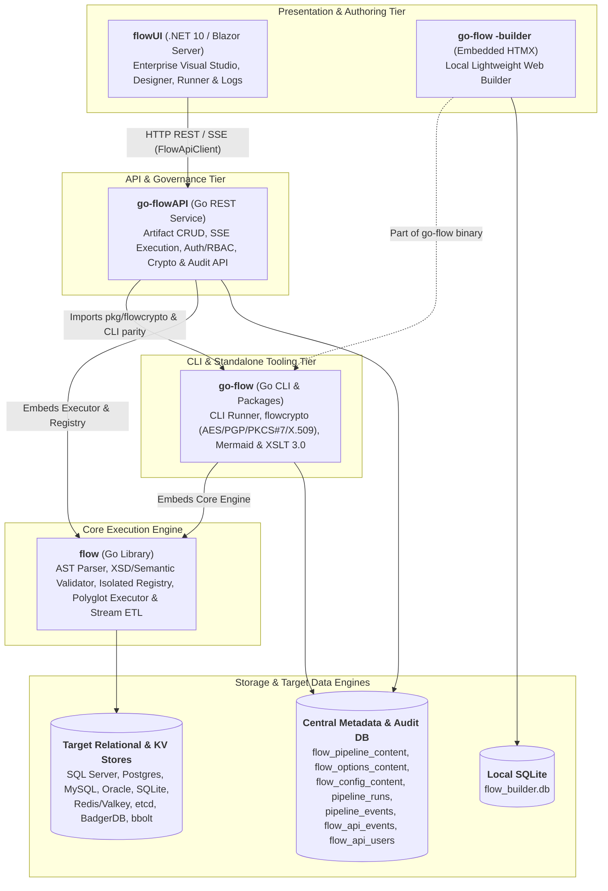
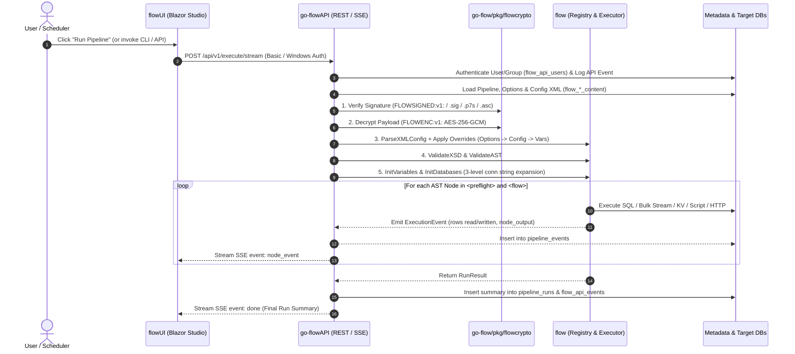

# The Flow Ecosystem (`flow`, `go-flow`, `go-flowAPI`, `flowUI`)

The **Flow Ecosystem** is a complete, lightweight, and high-performance data integration, ETL (Extract, Transform, Load), and workflow orchestration platform. Designed as a modern, zero-bloat alternative to legacy tools like SSIS and heavy code-based orchestrators like Apache Airflow, the ecosystem spans four modular projects across Go and .NET 10.

---

## 1. High-Level Architecture & Component Relationships

The four projects form a layered architecture—from the embeddable core execution library up to the standalone CLI/runner, the central REST API & governance tier, and the enterprise Blazor Studio UI:

### Summary of Projects

| Project | Path | Language / Stack | Primary Role |
| :--- | :--- | :--- | :--- |
| **`flow`** | [`flow/`](https://github.com/etl-madness/flow) | Go (`1.26.5`) Library | Core embeddable pipeline AST parser, XSD/semantic validator, thread-isolated state [`Registry`](https://github.com/etl-madness/flow/registry.go), polyglot script & control-flow [`Executor`](https://github.com/etl-madness/flow/executor.go), and cross-database streaming ETL engine. |
| **`go-flow`** | [`go-flow/`](https://github.com/etl-madness/go-flow) | Go (`1.26.5`) CLI & Packages | Standalone single-binary CLI engine (`flow.exe` / `go-flow.exe`), cryptographic security package ([`pkg/flowcrypto`](https://github.com/etl-madness/go-flow/blob/main/pkg/flowcrypto)), embedded local HTMX builder ([`builder/`](https://github.com/etl-madness/go-flow/blob/main/builder)), Mermaid diagram generator, XSLT 3.0 processor, and helper tools (`crypto_tool`, `db_importer`). |
| **`go-flowAPI`** | [`go-flowAPI/`](https://github.com/etl-madness/go-flowAPI) | Go (`1.26.5`) HTTP Server | Unified REST & Server-Sent Events (SSE) API wrapping `flow` and `go-flow`. Provides multi-dialect database artifact CRUD (`pipelines`, `options`, `configs`), synchronous and live-streamed execution, cryptographic endpoints, RBAC authentication (BasicAuth & Windows/AD), OpenAPI/Swagger UI, and full API/pipeline audit telemetry. |
| **`flowUI`** | [`flowUI/`](https://github.com/etl-madness/flowUI) | .NET 10 / Blazor Server (C#) | Rich web-based visual IDE ("Flow Builder Studio") built with Radzen Blazor. Communicates **strictly via `go-flowAPI`** (zero direct DB dependencies) to design pipelines, manage configs/options, sign/encrypt payloads, run & stream jobs, and inspect telemetry logs. |

---

## 2. Deep Dive by Component

### 2.1 `flow` — Core Orchestration & Stream ETL Library
**Location:** [`flow/`](https://github.com/etl-madness/flow) | **Module:** `github.com/etl-madness/flow`

`flow` is the foundational Go package that defines the declarative XML pipeline language and executes the Abstract Syntax Tree (AST).

* **Zero Global State ([`registry.go`](https://github.com/etl-madness/flow/blob/main/pkg/registry.go)):** All variable values (`string`, `int`, `bool`, `float`, `datetime`, `date`) and database connection pools are encapsulated inside a thread-safe [`Registry`](https://github.com/etl-madness/flow/blob/main/pkg/registry.go) instance. Multiple pipelines can run concurrently in the same OS process without interference.
* **Parsing & Multi-Stage Validation ([`config.go`](https://github.com/etl-madness/flow/blob/main/config.go), [`validator.go`](https://github.com/etl-madness/flow/blob/main/validator.go), [`schema.go`](https://github.com/etl-madness/flow/blob/main/schema.go)):**
  * [`ParseXMLConfig`](https://github.com/etl-madness/flow/blob/main/config.go) decodes UTF-8 and UTF-16 XML configurations into `<variables>`, `<databases>`, `<preflight>`, and `<flow>` AST nodes.
  * [`ValidateXSD`](https://github.com/etl-madness/flow/blob/main/validator.go) validates XML structure against the embedded [`xsd/pipeline.xsd`](https://github.com/etl-madness/flow/blob/main/xsd/pipeline.xsd) schema.
  * [`ValidateAST`](https://github.com/etl-madness/flow/blob/main/validator.go) performs semantic validation (ID uniqueness, database handle reference integrity, loop bounds).
* **Multi-Dialect Relational & Key-Value Support ([`etl.go`](https://github.com/etl-madness/flow/blob/main/etl.go), [`executor.go`](https://github.com/etl-madness/flow/blob/main/executor.go)):**
  * **Relational Engines:** Microsoft SQL Server (`sqlserver`/`mssql`), PostgreSQL (`postgres`), MySQL/MariaDB (`mysql`), Oracle (`oracle`), and SQLite (`sqlite`). Automatically translates parameter placeholders (`$1`, `@p1`, `:1`, `?`) across dialects.
  * **High-Speed MSSQL Bulk Copy:** `<sql_bulk>` uses native TDS `mssql.CopyIn` streaming when targeting SQL Server (supporting `tablock`, `check_constraints`, `fire_triggers`, `keep_nulls`), and automatically throttles multi-row batched inserts for other engines to respect the 2,100-parameter limit.
  * **Key-Value Engines (`<kv>`, `<kv_bulk>`):** Native support for `bbolt`, `badger`, `redis`/`valkey`, and `etcd` for rapid state lookups, caching, and SQL-to-KV bulk streaming.
* **Control Flow & Task Primitives ([`executor.go`](https://github.com/etl-madness/flow/blob/main/executor.go)):**
  * **Control Flow:** `<preflight>`, `<flow>`, `<parallel>` (semaphore-throttled via `max_threads`, cloned worker registries, dirty-variable tracking, and `WORKER_<id>_<var>` collision namespacing), `<if>`/`<then>`/`<else>`, `<foreach>` (SQL-driven row iteration), `<while>` (bounded condition loops), `<group>` (optional database transaction wrapping with automatic commit/rollback), and `<assert>` (with `<on_failure>` fallback nodes).
  * **Polyglot `<script>` Execution:**
    * **Embedded Go (`language="go"`):** Powered by [Yaegi](https://github.com/traefik/yaegi) with injected `host/vars` and `host/db` bridges.
    * **Embedded Lua (`language="lua"`):** Powered by [Gopher-Lua](https://github.com/yuin/gopher-lua) with a global `vars` table (`vars.Get`, `vars.Set`, etc.) and stdout capture.
    * **C# Scripts (`language="csx"` / `dotnet-script`):** Inline or file-sourced C# execution with NuGet package support.
    * **OS Shells:** `shell`, `cmd`, `powershell`/`pwsh`, `bash`, `git-bash`, `zsh`, `ksh`, `csh`, `tcsh`, `dash`, `fish`, `sh`.
  * **Data & File Nodes:** `<http_client>` (full TLS, proxy, redirect, cookie jar, and header/status capture), `<file_read>`, `<file_save>`, `<excel_read>`, `<excel_write>` (via `excelize`), `<template>` (`text/template`), `<template_html>` (`html/template`), `<json_path>` (`ajson`), `<yaml_path>` (`yaml.v3`), and `<xml_xpath>` (`xmlquery`).
* **Observability & Event Sinks ([`observability.go`](https://github.com/etl-madness/flow/blob/main/observability.go)):** Emits structured [`ExecutionEvent`](https://github.com/etl-madness/flow/blob/main/observability.go) and [`RunResult`](https://github.com/etl-madness/flow/blob/main/observability.go) telemetry (tracking sequence numbers, durations, `rows_read`, `rows_written`, `rows_affected`, and `node_output`) to pluggable `EventSink` implementations.

---

### 2.2 `go-flow` — Standalone CLI Runner, Security Engine & Local Builder
**Location:** [`go-flow/`](https://github.com/etl-madness/go-flow) | **Module:** `github.com/etl-madness/go-flow`

`go-flow` wraps the `flow` library into a production-ready single-binary CLI executable (`flow.exe` / `go-flow.exe`) and provides reusable sub-packages consumed by `go-flowAPI`.

* **Hierarchical Configuration & Resource Loading ([`main.go`](https://github.com/etl-madness/go-flow/blob/main/main.go), [`cli_loader.go`](https://github.com/etl-madness/go-flow/blob/main/cli_loader.go), [`resource_loader.go`](https://github.com/etl-madness/go-flow/blob/main/resource_loader.go)):**
  * Loads pipelines (`-file`), environment overrides (`-config`), and pre-baked CLI option profiles (`-options`, validated via [`xsd/options.xsd`](https://github.com/etl-madness/go-flow/xsd/options.xsd)) from either local disk or database URIs (`sql://...` / `db:...`).
  * Applies a strict override hierarchy: **Base Pipeline XML -> `-options` XML -> `-config` XML -> CLI `-vars`**.
  * Expands nested variables in database connection strings up to 3 levels deep.
* **Cryptographic Security & Digital Signatures ([`pkg/flowcrypto/`](https://github.com/etl-madness/go-flow/blob/main/pkg/flowcrypto)):**
  * **Encryption (`FLOWENC:v1:`):** Pure-Go AES-256-GCM authenticated encryption with PBKDF2-HMAC-SHA256 key derivation. Supports key resolution via `-key-file`, `-secure-key`, or `FLOW_SECURE_KEY`.
  * **Multi-Standard Digital Signatures (`FLOWSIGNED:v1:` & `FLOWSIG:v1:`):** Pure-Go signature creation and verification across:
    1. **OpenSSL / PEM:** RSA (PKCS#1v1.5 & PSS), ECDSA (P-256, P-384), and Ed25519 keys and X.509 certificates.
    2. **PKCS#7 / CMS (`.p7s`):** Detached signatures with X.509 certificate and Root CA chain validation.
    3. **OpenPGP / GPG (`.asc`, `.sig`):** Armored detached signatures and keyrings via `gopenpgp/v2`.
  * Enforces a strict **Verify -> Decrypt -> Parse -> Execute** lifecycle.
* **Self-Documenting Pipelines ([`mermaid.go`](https://github.com/etl-madness/go-flow/blob/main/mermaid.go), [`xslt_processing.go`](https://github.com/etl-madness/go-flow/blob/main/xslt_processing.go), [`autodoc/`](https://github.com/etl-madness/go-flow/blob/main/autodoc)):**
  * Automatically converts pipeline ASTs into Mermaid.js `flowchart TD` diagrams.
  * Integrates an XSLT 3.0 processor (`lestrrat-go/helium/xslt3`) and built-in stylesheets ([`autodoc_html.xslt`](https://github.com/etl-madness/go-flow/autodoc/autodoc_html.xslt), [`autodoc_md.xslt`](https://github.com/etl-madness/go-flow/autodoc/autodoc_md.xslt), [`pipeline-to-csv.xslt`](https://github.com/etl-madness/go-flow/autodoc/pipeline-to-csv.xslt)) for automated HTML/Markdown/CSV documentation generation.
* **Multi-Format Output ([`formating.go`](https://github.com/etl-madness/go-flow/blob/main/formating.go)):** Supports `csv`, `json`, `jsonpretty`, `markdown`, `text`, and live `stream` output formats.
* **Embedded HTMX Web Builder ([`builder/`](https://github.com/etl-madness/go-flow/blob/main/builder)):** Invoking `flow -builder` starts a self-contained local web UI backed by SQLite (`flow_builder.db`) for standalone visual pipeline editing without external servers.
* **Companion Utilities:**
  * [`crypto_tool/`](https://github.com/etl-madness/go-flow/blob/main/crypto_tool): Standalone CLI for key generation, file encryption/decryption, and digital signing/verification.
  * [`db_importer/`](https://github.com/etl-madness/go-flow/blob/main/db_importer): Utility for importing/exporting pipelines, options, and configs into database tables.

---

### 2.3 `go-flowAPI` — Unified REST, Execution, Security & Audit API
**Location:** [`go-flowAPI/`](https://github.com/etl-madness/go-flowAPI) | **Module:** `github.com/etl-madness/go-flowAPI`

`go-flowAPI` exposes the full capabilities of `flow` and `go-flow` as a centralized, multi-tenant HTTP service and acts as the sole backend for `flowUI`.

* **5 Supported Metadata & Audit Database Dialects ([`db.go`](https://github.com/etl-madness/go-flowAPI/blob/main/db.go), [`store.go`](https://github.com/etl-madness/go-flowAPI/blob/main/store.go), [`tables.go`](https://github.com/etl-madness/go-flowAPI/blob/main/tables.go)):**
  * Connects at startup (`-dsn` / `FLOW_API_DSN`) to **SQL Server**, **PostgreSQL**, **MySQL/MariaDB**, **SQLite**, or **Oracle**.
  * Automatically adapts SQL dialect syntax and schema prefixes (`DefaultSchema = "dbo."` on SQL Server/Postgres, stripped automatically on SQLite/MySQL/Oracle).
* **Artifact Management & Upload ([`handlers.go`](https://github.com/etl-madness/go-flowAPI/blob/main/handlers.go), [`store.go`](https://github.com/etl-madness/go-flowAPI/blob/main/store.go)):**
  * Full CRUD, file upload (`POST /api/v1/upload/{type}`), and raw XML export across three artifact repositories:
    1. `pipelines` -> `flow_pipeline_content`
    2. `options` -> `flow_options_content`
    3. `configs` -> `flow_config_content`
  * Supports addressing artifacts by either unique `Name` or database `ID`, with on-the-fly decryption (`?decrypt=true`).
* **Synchronous & Live SSE Pipeline Execution ([`executor.go`](https://github.com/etl-madness/go-flowAPI/blob/main/executor.go)):**
  * Full parity with `go-flow` CLI flags: supports inline XML or `db:<name>` / artifact ID references, `-config` and `-options` merging, runtime `vars`, XSD/AST validation (`/api/v1/validate`), preflight-only execution, XSLT transformations, signature verification, and decryption.
  * **Synchronous Execution:** `POST /api/v1/execute` and `POST /api/v1/execute/{type}/{id}`.
  * **Real-Time Server-Sent Events (SSE):** `POST /api/v1/execute/stream` and `POST|GET /api/v1/execute/stream/{type}/{id}` stream live `node_event` updates as each AST node starts and completes, followed by a final `done` event.
* **Cryptographic REST Endpoints ([`handlers_crypto.go`](https://github.com/etl-madness/go-flowAPI/blob/main/handlers_crypto.go)):**
  * `/api/v1/crypto/keygen`: Generates AES-256 keys, RSA-2048/4096, ECDSA-P256/P384, Ed25519 keypairs (with optional self-signed X.509 certificates), and OpenPGP keypairs.
  * `/api/v1/crypto/encrypt` & `/api/v1/crypto/decrypt`: Wraps/unwraps `FLOWENC:v1:` payloads.
  * `/api/v1/crypto/sign` & `/api/v1/crypto/verify`: Supports `OPENSSL`, `PKCS7`, and `PGP` schemes with `none`, `sign-then-encrypt`, and `encrypt-then-sign` envelope modes.
* **Authentication & Role-Based Access Control ([`auth.go`](https://github.com/etl-madness/go-flowAPI/blob/main/auth.go), [`win_groups_windows.go`](https://github.com/etl-madness/go-flowAPI/blob/main/win_groups_windows.go)):**
  * **Database-Backed BasicAuth:** Validates users against `flow_api_users` (supporting bcrypt hashes, `sha256:` digests, or constant-time plaintext matching).
  * **Windows / Active Directory Integrated Auth:** Supports `DOMAIN\user` and `DOMAIN\group` resolution via `X-Flow-Windows-User` / `X-Flow-Windows-Groups` headers and native Windows group lookup so AD groups can be granted permissions directly in `flow_api_users`.
  * **Granular Roles:** `read-only`, `execution-only`, `write` / `upload`, and `all` (combinable via comma-separated lists).
* **Comprehensive Telemetry & OpenAPI ([`telemetry.go`](https://github.com/etl-madness/go-flowAPI/blob/main/telemetry.go), [`swagger.go`](https://github.com/etl-madness/go-flowAPI/blob/main/swagger.go)):**
  * Every API request is audited to `flow_api_events` (`/api/v1/audit`).
  * Every pipeline run logs summaries to `pipeline_runs` (`/api/v1/runs`) and step-level metrics + 64 KB UTF-8 truncated & secret-redacted `node_output` to `pipeline_events` (`/api/v1/events`).
  * Built-in interactive Swagger UI at `/swagger/` (and `/docs`) backed by an OpenAPI 3.0.3 spec (`/api/v1/openapi.json`).

---

### 2.4 `flowUI` — Enterprise Blazor Visual Studio
**Location:** [`flowUI/`](https://github.com/etl-madness/flowUI) | **Solution:** [`FlowUI.sln`](https://github.com/etl-madness/flowUI/blob/main/FlowUI.sln) (.NET 10 / Blazor Interactive Server)

`flowUI` is a modern, stateless web IDE ("Flow Builder Studio") built with ASP.NET Core 10 Razor Components and Radzen Blazor.

> [!IMPORTANT]
> **Strict API-Driven Architecture:** `flowUI` has **no direct database connection** and **no internal database**. All artifact persistence, validation, execution, cryptography, authentication, and log queries flow exclusively through [`FlowApiClient`](https://github.com/etl-madness/flowUI/FlowUI/Services/FlowApiClient.cs) to `go-flowAPI`.

* **Workspace Tabs ([`Components/Tabs/`](https://github.com/etl-madness/flowUI/blob/main/FlowUI/Components/Tabs)):**
  1. **Pipeline Designer ([`PipelineDesignerTab.razor`](https://github.com/etl-madness/flowUI/blob/main/FlowUI/Components/Tabs/PipelineDesignerTab.razor)):** Visual drag-and-drop/card-based AST builder for Variables, Databases, Preflight steps, and Flow nodes (including nested `<parallel>`, `<if>`, `<foreach>`, `<while>`, `<group>`, and `<assert>` blocks), paired with bidirectional XML generation ([`XmlGeneratorService.cs`](https://github.com/etl-madness/flowUI/blob/main/FlowUI/Services/XmlGeneratorService.cs)), XML import ([`XmlImporterService.cs`](https://github.com/etl-madness/flowUI/blob/main/FlowUI/Services/XmlImporterService.cs)), and live Mermaid.js diagram rendering.
  2. **Config ([`ConfigTab.razor`](https://github.com/etl-madness/flowUI/blob/main/FlowUI/Components/Tabs/ConfigTab.razor)):** Visual and XML editor for environment override `<Configuration>` artifacts (`flow_config_content`).
  3. **Options ([`OptionsTab.razor`](https://github.com/etl-madness/flowUI/blob/main/FlowUI/Components/Tabs/OptionsTab.razor)):** Editor for reusable `<cli_options>` execution profiles (`flow_options_content`).
  4. **Runner ([`RunnerTab.razor`](https://github.com/etl-madness/flowUI/blob/main/FlowUI/Components/Tabs/RunnerTab.razor)):** Interactive execution console supporting artifact selection, runtime variable overrides, validation/preflight toggles, cryptographic key/certificate inputs, and live SSE event streaming from `go-flowAPI`.
  5. **Logs ([`LogsTab.razor`](https://github.com/etl-madness/flowUI/blob/main/FlowUI/Components/Tabs/LogsTab.razor)):** Unified telemetry explorer for `pipeline_runs`, step-level `pipeline_events` (with detailed `node_output` inspection via [`EventDetailModal.razor`](https://github.com/etl-madness/flowUI/blob/main/FlowUI/Components/Shared/EventDetailModal.razor)), and `flow_api_events` API audit trails.
  6. **Settings ([`SettingsTab.razor`](https://github.com/etl-madness/flowUI/blob/main/FlowUI/Components/Tabs/SettingsTab.razor)):** API connectivity diagnostics, database connection testing (`/api/v1/db/test`), and `flow_api_users` RBAC user management.
  7. **Handbook ([`Handbook.razor`](https://github.com/etl-madness/flowUI/blob/main/FlowUI/Components/Pages/Handbook.razor) & [`DocsService.cs`](https://github.com/etl-madness/flowUI/blob/main/FlowUI/Services/DocsService.cs)):** Embedded searchable component reference guide rendered from [`FlowUI/Docs/*.md`](https://github.com/etl-madness/flowUI/blob/main/FlowUI/Docs) via Markdig.
* **Integrated Cryptographic Studio ([`CryptoSignVerifyModal.razor`](https://github.com/etl-madness/flowUI/blob/main/FlowUI/Components/Shared/CryptoSignVerifyModal.razor) & [`FlowCryptoService.cs`](https://github.com/etl-madness/flowUI/blob/main/FlowUI/Services/FlowCryptoService.cs)):** Interactive UI for generating keys/certificates, encrypting/decrypting artifacts (`FLOWENC:v1:`), and signing/verifying payloads (`FLOWSIGNED:v1:`).
* **Pluggable UI Authentication ([`Services/Auth/`](https://github.com/etl-madness/flowUI/blob/main/FlowUI/Services/Auth)):**
  * [`FlowApiPassthroughAuthProvider`](https://github.com/etl-madness/flowUI/blob/main/FlowUI/Services/Auth/FlowApiPassthroughAuthProvider.cs) (`ApiBasic`): Authenticates directly against `go-flowAPI` using HTTP Basic Auth credentials entered at login.
  * [`WindowsIntegratedUiAuthProvider`](https://github.com/etl-madness/flowUI/blob/main/FlowUI/Services/Auth/WindowsIntegratedUiAuthProvider.cs) (`Windows`) & [`WindowsCredentialsUiAuthProvider`](https://github.com/etl-madness/flowUI/blob/main/FlowUI/Services/Auth/WindowsIntegratedUiAuthProvider.cs) (`WindowsCredentials`): Resolves OS/Active Directory identity (`DOMAIN\user`) and group memberships (`DOMAIN\group`) via Windows `advapi32.dll` `LogonUser` / `WindowsIdentity` and maps permissions against `flow_api_users` in `go-flowAPI`.

---

## 3. Shared Database Schema & Storage Model

Across `go-flow`, `go-flowAPI`, and `flowUI`, a unified 7-table schema (defaulting to schema `dbo.` on SQL Server and PostgreSQL) powers artifact storage, security, and observability:

| Table Name | Used By | Purpose |
| :--- | :--- | :--- |
| `flow_pipeline_content` | `go-flow`, `go-flowAPI`, `flowUI` | Stores named `<pipeline>` XML definitions (plaintext, `FLOWENC:v1:` encrypted, or `FLOWSIGNED:v1:` signed). |
| `flow_options_content` | `go-flow`, `go-flowAPI`, `flowUI` | Stores reusable `<cli_options>` execution profiles. |
| `flow_config_content` | `go-flow`, `go-flowAPI`, `flowUI` | Stores environment-specific `<Configuration>` override profiles (variables & database connections). |
| `pipeline_runs` | `flow`, `go-flow`, `go-flowAPI`, `flowUI` | Run-level execution summary (`run_id`, `status`, `started_at`, `finished_at`, `duration_ms`, `task_count`, `user_name`, `hostname`, `error_class`, `error_message`). |
| `pipeline_events` | `flow`, `go-flow`, `go-flowAPI`, `flowUI` | Granular step-level audit trail (`sequence_num`, `node_kind`, `node_id`, `status`, `rows_read`, `rows_written`, `rows_affected`, `node_output`). |
| `flow_api_events` | `go-flowAPI`, `flowUI` | HTTP API audit trail recording every REST operation, authenticated user, status code, duration, and JSON details. |
| `flow_api_users` | `go-flowAPI`, `flowUI` | Users, Active Directory groups, password hashes (bcrypt/SHA-256), and role permissions (`read-only`, `execution-only`, `write`, `upload`, `all`). |

---

## 4. End-to-End Execution & Security Lifecycle

Whether a pipeline is triggered from the **CLI** (`go-flow`), via **REST/SSE** (`go-flowAPI`), or interactively from **Flow Builder Studio** (`flowUI`), the ecosystem executes a deterministic 6-stage pipeline lifecycle:

---

## 5. Deployment Topologies

The ecosystem supports flexible deployment models ranging from zero-dependency single-binary CLI execution to full containerized microservices (detailed in [`go-flowAPI/DOCKER.md`](https://github.com/etl-madness/go-flowAPI/blob/main/DOCKER.md) and [`flowUI/DOCKER.md`](https://github.com/etl-madness/flowUI/blob/main/DOCKER.md)):

1. **Standalone CLI / Batch Agent (`go-flow` only):**
   * Deploy the single `flow.exe` / `go-flow` binary on any Windows, Linux, macOS, or FreeBSD host (e.g., via Cron, Autosys JIL, or Windows Task Scheduler) using local XML files or `sql://` database URIs.
2. **Local Developer Mode (`go-flow -builder`):**
   * Run `flow -builder -builder-port 8080` to use the embedded HTMX visual builder backed by a local `flow_builder.db` SQLite file.
3. **Headless API Server (`go-flowAPI` + Database):**
   * Run `go-flowAPI` via binary or Docker Compose ([`docker-compose.sqlserver.yml`](https://github.com/etl-madness/go-flowAPI/blob/main/docker-compose.sqlserver.yml), [`docker-compose.postgres.yml`](https://github.com/etl-madness/go-flowAPI/blob/main/docker-compose.postgres.yml), [`docker-compose.sqlite.yml`](https://github.com/etl-madness/go-flowAPI/blob/main/docker-compose.sqlite.yml)) for CI/CD artifact publishing, remote job triggering, and centralized auditing.
4. **Full Enterprise Studio Stack (`flowUI` + `go-flowAPI` + Database):**
   * Orchestrated via [`flowUI/docker-compose.full.yml`](https://github.com/etl-madness/flowUI/blob/main/docker-compose.full.yml) (self-contained with SQL Server 2022 and automatic schema initialization), [`flowUI/docker-compose.api.yml`](https://github.com/etl-madness/flowUI/blob/main/docker-compose.api.yml) (UI + API containers against an external DB), or Windows Containers (`Dockerfile.windows`) for native Active Directory / Windows Integrated Authentication.
