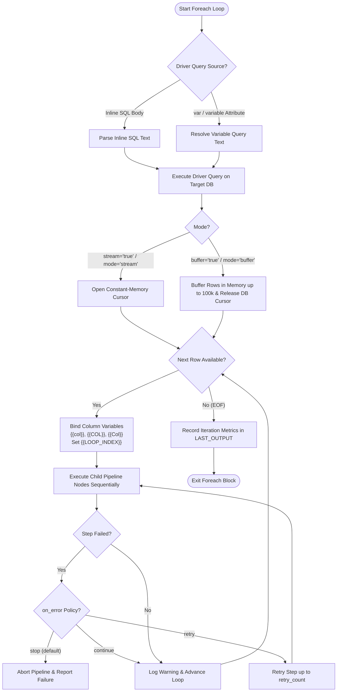
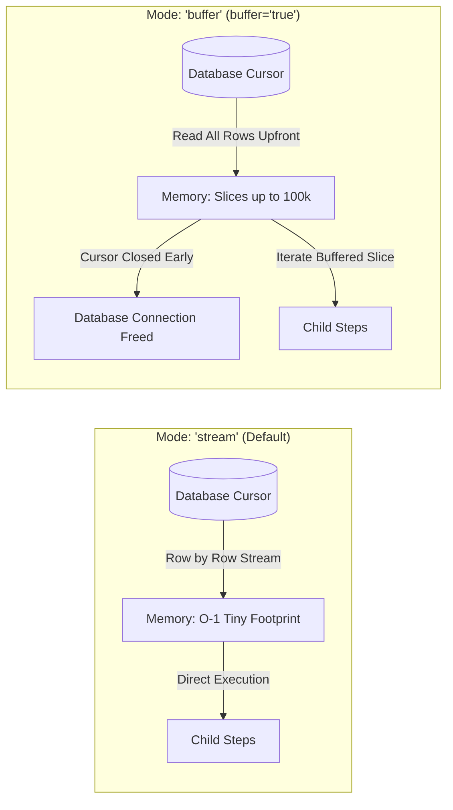
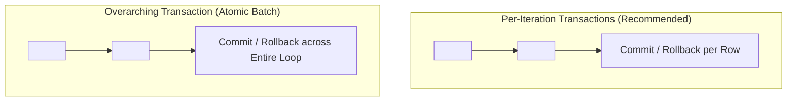

# `<foreach>` & `<loop>`

The `<foreach>` element (alias `<loop>`) executes nested pipeline steps iteratively for each record returned by a database driver query. It bridges relational query results with dynamic child task execution, automatically binding projected column values into the pipeline registry for use across subsequent SQL steps, scripts, templates, HTTP probes, file operations, and nested control groups.

Flow's `<foreach>` engine is engineered for high-throughput enterprise pipelines, supporting both **constant-memory streaming** for processing tens of millions of records without memory spikes, and **in-memory buffering** to release database locks upfront.

---

## Architecture & Lifecycle



---

## XML Syntax & Attribute Reference

```xml
<foreach id="ProcessBatch"
         db="source_db"
         language="sql"
         stream="true"
         buffer="false"
         mode="stream"
         on_error="stop"
         description="Iterate over pending customer orders">
    SELECT order_id, customer_email, total_amount FROM orders WHERE status = 'pending';

    <group id="ProcessSingleOrder" transaction="true" db="source_db">
        <!-- Child nodes executed once per returned row -->
    </group>
</foreach>
```

| Attribute | Mandatory | Default | Description |
| :--- | :---: | :---: | :--- |
| `id` | Optional | `foreach_N` | Unique step identifier used in logs, execution metrics, and diagnostics. |
| `db` / `database` | **Yes** | — | Name of the configured database connection used to execute the driver query. |
| `language` / `lang` | Optional | `sql` | Driver query engine runtime. Defaults to `sql`. |
| `var` / `variable` | Optional | — | Name of a pipeline variable containing the driver SQL query. If non-empty, takes precedence over inline XML body text. |
| `stream` | Optional | `true` | Boolean enabling constant-memory streaming cursor mode. Consumes $O(1)$ RAM regardless of result set size. |
| `buffer` | Optional | `false` | Boolean enabling in-memory row buffering (capped at 100,000 rows). Reads all records upfront to close the database cursor early. |
| `mode` | Optional | `stream` | Explicit execution mode: `'stream'` ($O(1)$ streaming cursor) or `'buffer'` (in-memory buffer). |
| `condition` / `cond` | Optional | — | Inline boolean expression evaluated before executing the loop. If false, the loop is skipped. |
| `on_error` | Optional | `stop` | Failure policy when a child step fails: `stop` (halts pipeline), `continue` (logs warning and advances to next row), or `retry`. |
| `retry_count` | Optional | `0` | Number of times to retry failed child steps before triggering `on_error`. |
| `retry_interval` | Optional | — | Duration delay between retries (e.g., `2s`, `500ms`). |
| `timeout` | Optional | — | Execution deadline duration for the loop (e.g., `30s`, `5m`). |
| `description` | Optional | — | Human-readable explanation of the loop logic. |
| *Inline Content* | Conditional | — | The driver SQL query placed between `<foreach>` and child tags. Required when `var` is not specified. |

---

## Streaming vs. Buffering Modes

Flow provides two execution architectures for iterating over driver queries:



### 1. Constant-Memory Streaming (`mode="stream"`, `stream="true"`)
* **Default behavior**: Ideal for massive tables (millions of rows).
* **Memory footprint**: $O(1)$ constant overhead. Rows are fetched and processed on-the-fly via native database cursors.
* **Connection hold**: Keeps the driver database connection open for the entire duration of the loop.

### 2. In-Memory Buffering (`mode="buffer"`, `buffer="true"`)
* **Use case**: Essential when child steps need to query or update the **same** database connection as the driver query without encountering connection pool starvation, cursor locks, or driver deadlocks.
* **Safety limit**: Upfront row ingestion is capped at 100,000 rows to prevent process out-of-memory errors.
* **Early release**: The database connection and cursor are released back to the pool before child steps start running.

---

## Variable Binding & Scoping

For every row processed, `<foreach>` automatically binds all projected columns into the pipeline registry:

### 1. Case-Insensitive Column Variables
Columns are registered in three naming conventions so child steps can reference them naturally:
* **Original column name**: e.g., `{{order_id}}`
* **Uppercase name**: e.g., `{{ORDER_ID}}`
* **Lowercase name**: e.g., `{{order_id}}`

### 2. Built-in Loop Index (`LOOP_INDEX`)
* Flow sets the variable `LOOP_INDEX` to the zero-based iteration index (`0, 1, 2, ...`).
* Access in SQL steps: `SELECT {{LOOP_INDEX}} AS current_iteration;`
* Access in Go scripts: `idx := vars.GetInt("LOOP_INDEX")`
* Access in templates: `Iteration: {{ .LOOP_INDEX }}`

### 3. Loop Result Diagnostics
Upon completion, `<foreach>` writes summary statistics to the step output and `LAST_OUTPUT`, reporting:
* `rows`: Total rows returned by driver query.
* `iterations`: Total child iterations completed.
* `duration`: Wall-clock processing time.

---

## Transaction Scoping with Foreach

How `<foreach>` interacts with database transactions depends on where `<group transaction="true">` is placed:



1. **Per-Iteration Transaction (Recommended for large jobs)**:
   Place `<group transaction="true">` **inside** the `<foreach>`. Each iteration is an independent transaction. If row 5 fails with `on_error="continue"`, rows 1–4 remain safely committed.
2. **Overarching Transaction (Atomic Batch)**:
   Place `<foreach>` **inside** `<group transaction="true">`. The entire loop is wrapped in one single transaction. If any iteration fails, all changes across all previous iterations are rolled back. 
   > [!WARNING]
   > Do not use overarching transactions for loops spanning thousands of rows, as long-held table locks will degrade database performance.

---

## Production Pipeline Examples

### Example 1: Dynamic Table Replication Loop
Iterates through a database migration mapping table and bulk-streams each table using `<sql_bulk>`:

```xml
<?xml version="1.0" encoding="UTF-8"?>
<pipeline xmlns:xsi="http://www.w3.org/2001/XMLSchema-instance"
          xsi:noNamespaceSchemaLocation="https://raw.githubusercontent.com/etl-madness/flow/main/xsd/pipeline.xsd">
    <variables>
        <variable name="ReplicationPlan" type="string" 
                  value="SELECT source_table, destination_table, column_filter FROM etl_transfer_map WHERE is_active = 1" />
    </variables>

    <databases>
        <database name="primary_oltp" driver="sqlserver" connection_string="sqlserver://prod-db:1433?database=AppDB" />
        <database name="reporting_dw" driver="postgres" connection_string="host=dw-db port=5432 user=etl dbname=reports sslmode=require" />
    </databases>

    <flow>
        <!-- Loop over each active mapping row -->
        <foreach id="ReplicateTables" db="primary_oltp" var="ReplicationPlan" stream="true">
            <group id="TransferSingleTable">
                <!-- Log progress with Go script -->
                <script id="LogIteration" language="go">
                    package main
                    import (
                        "fmt"
                        "host/vars"
                    )
                    func main() {
                        idx := vars.GetInt("LOOP_INDEX")
                        src := vars.GetString("source_table")
                        dst := vars.GetString("destination_table")
                        fmt.Printf("[Row #%d] Transferring table %s -> %s\n", idx+1, src, dst)
                    }
                </script>

                <!-- Truncate destination before copying -->
                <sql id="TruncateStaging" db="reporting_dw">
                    TRUNCATE TABLE {{destination_table}};
                </sql>

                <!-- Bulk stream from source to destination -->
                <sql_bulk id="BulkCopy" db="primary_oltp" target_db="reporting_dw"
                          target_table="{{destination_table}}" batch_size="50000">
                    SELECT {{column_filter}} FROM {{source_table}};
                </sql_bulk>
            </group>
        </foreach>
    </flow>
</pipeline>
```

---

### Example 2: Multi-Tenant Invoicing with Per-Iteration Transactions
Generates monthly invoices for active accounts, isolating each customer transaction with automatic rollback on error:

```xml
<?xml version="1.0" encoding="UTF-8"?>
<pipeline xmlns:xsi="http://www.w3.org/2001/XMLSchema-instance"
          xsi:noNamespaceSchemaLocation="https://raw.githubusercontent.com/etl-madness/flow/main/xsd/pipeline.xsd">
    <databases>
        <database name="billing_db" driver="postgres" connection_string="host=billing.internal user=postgres dbname=billing" />
    </databases>

    <flow>
        <foreach id="InvoiceGenerationLoop" db="billing_db" on_error="continue">
            SELECT account_id, account_tier, rate_per_unit 
            FROM accounts 
            WHERE status = 'ACTIVE' AND billing_cycle = 'MONTHLY';

            <!-- Independent atomic transaction for each account -->
            <group id="GenerateInvoiceTx" transaction="true" db="billing_db" timeout="10s">
                <!-- Calculate usage charges -->
                <sql id="InsertInvoiceRecord" db="billing_db" output_var="NewInvoiceId">
                    INSERT INTO invoices (account_id, billing_date, status)
                    VALUES ('{{account_id}}', CURRENT_DATE, 'PENDING')
                    RETURNING invoice_id;
                </sql>

                <!-- Create line items -->
                <sql id="GenerateLineItems" db="billing_db">
                    INSERT INTO invoice_items (invoice_id, description, amount)
                    SELECT '{{NewInvoiceId}}', service_name, quantity * {{rate_per_unit}}
                    FROM unbilled_usage
                    WHERE account_id = '{{account_id}}';
                </sql>

                <!-- Mark usage as billed -->
                <sql id="ClearUnbilledUsage" db="billing_db">
                    UPDATE unbilled_usage 
                    SET billed = true 
                    WHERE account_id = '{{account_id}}';
                </sql>
            </group>
        </foreach>
    </flow>
</pipeline>
```

---

### Example 3: Dynamic File Export with In-Memory Buffering
Buffers driver query results in memory to close the database connection immediately, then exports individual JSON files:

```xml
<?xml version="1.0" encoding="UTF-8"?>
<pipeline xmlns:xsi="http://www.w3.org/2001/XMLSchema-instance"
          xsi:noNamespaceSchemaLocation="https://raw.githubusercontent.com/etl-madness/flow/main/xsd/pipeline.xsd">
    <variables>
        <variable name="EXPORT_DIR" type="string" value="./exports/customers" />
    </variables>

    <databases>
        <database name="crm_db" driver="mysql" connection_string="root:secret@tcp(127.0.0.1:3306)/crm" />
    </databases>

    <flow>
        <!-- In-memory buffering releases crm_db connection upfront -->
        <foreach id="ExportLoop" db="crm_db" buffer="true" mode="buffer">
            SELECT customer_code, full_name, email, credit_limit 
            FROM customers 
            WHERE sync_required = 1;

            <group id="WriteCustomerFile">
                <!-- Render customer JSON file -->
                <file_save id="SaveCustomerJson" 
                           file="{{EXPORT_DIR}}/{{customer_code}}.json" 
                           append="false">
                    {
                      "customer_code": "{{customer_code}}",
                      "name": "{{full_name}}",
                      "email": "{{email}}",
                      "credit_limit": {{credit_limit}},
                      "exported_at": "{{_TIMESTAMP}}"
                    }
                </file_save>
            </group>
        </foreach>
    </flow>
</pipeline>
```

---

### Example 4: External Webhook Notification with Assertion Quality Gate
Dispatches payment alerts via HTTP POST and asserts HTTP 200/201 response status:

```xml
<?xml version="1.0" encoding="UTF-8"?>
<pipeline xmlns:xsi="http://www.w3.org/2001/XMLSchema-instance"
          xsi:noNamespaceSchemaLocation="https://raw.githubusercontent.com/etl-madness/flow/main/xsd/pipeline.xsd">
    <databases>
        <database name="app_db" driver="sqlite" connection_string="file:app.db?cache=shared" />
    </databases>

    <flow>
        <foreach id="WebhookLoop" db="app_db" on_error="continue">
            SELECT event_id, webhook_url, payload_json 
            FROM outbound_webhooks 
            WHERE delivered = 0;

            <group id="DispatchEvent">
                <!-- Send HTTP Post -->
                <http_client id="SendWebhook" 
                             url="{{webhook_url}}" 
                             method="POST" 
                             content_type="application/json"
                             status_into="HTTP_STATUS" 
                             timeout="5s">
                    {{payload_json}}
                </http_client>

                <!-- Validate HTTP status -->
                <assert id="VerifyDelivery" var="HTTP_STATUS" equals="200" on_failure="warn" />

                <!-- Mark as processed if successful -->
                <sql id="MarkDelivered" db="app_db">
                    UPDATE outbound_webhooks SET delivered = 1 WHERE event_id = {{event_id}};
                </sql>
            </group>
        </foreach>
    </flow>
</pipeline>
```

---

### Example 5: High-Performance Key-Value Store Migration
Reads user authentication credentials and streams them into an embedded Badger/Bolt Key-Value store:

```xml
<?xml version="1.0" encoding="UTF-8"?>
<pipeline xmlns:xsi="http://www.w3.org/2001/XMLSchema-instance"
          xsi:noNamespaceSchemaLocation="https://raw.githubusercontent.com/etl-madness/flow/main/xsd/pipeline.xsd">
    <databases>
        <database name="auth_sql" driver="postgres" connection_string="host=localhost dbname=auth" />
        <database name="cache_kv" driver="badger" connection_string="./data/cache.badger" />
    </databases>

    <flow>
        <!-- Streaming cursor for hundreds of thousands of sessions -->
        <foreach id="MigrateSessions" db="auth_sql" stream="true">
            SELECT session_token, user_profile_json 
            FROM active_sessions;

            <kv id="PutSession" db="cache_kv" op="put" bucket="sessions" 
                key="{{session_token}}" value="{{user_profile_json}}" />
        </foreach>
    </flow>
</pipeline>
```
