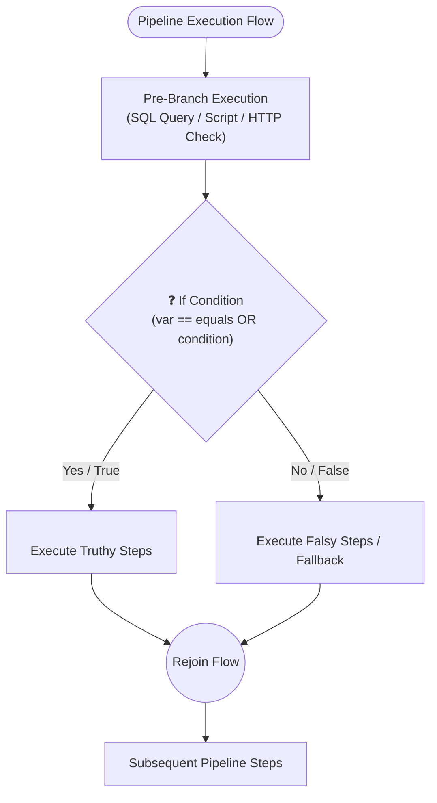

# Conditional Branching (`<if>`, `<then>`, `<else>`) in Flow 🔀

Flow pipelines support conditional routing through native `<if>` blocks. Conditional branching enables dynamic ETL decision-making, such as executing data ingestion only when source timestamps diverge, routing failed API responses to fallback webhooks, bypassing destructive migrations outside maintenance windows, or running alternative database queries based on environment variables.

---

## 🏗️ Architecture & Branching Model

Flow's conditional execution engine supports two primary patterns:
1. **Explicit Branch Containers (`<if>`, `<then>`, `<else>`)**: A parent `<if>` block encapsulates two distinct sub-branches. When the condition evaluates to true, child nodes inside `<then>` are executed. When false, child nodes inside `<else>` are executed.
2. **Inline Step Predicates (`if_var`, `if_equals`, `condition`)**: Many individual nodes (such as `<group>`, `<sql>`, `<script>`, `<foreach>`) support conditional attributes directly on the element, conditionally skipping the node if the predicate is not met without wrapping it in an `<if>` container.

### Execution Lifecycle & Flowchart



---

## 🛠️ XML Syntax & Attribute Reference

```xml
<if id="CheckStatus"
    var="JobStatus"
    equals="COMPLETED"
    condition="eq .JobStatus 'COMPLETED'"
    description="Evaluate pipeline state before downstream processing">
    <then>
        <!-- Child nodes executed when condition is truthy -->
    </then>
    <else>
        <!-- Optional child nodes executed when condition is falsy -->
    </else>
</if>
```

### Complete Attributes Reference

| Attribute | Type | Required | Description |
| :--- | :--- | :--- | :--- |
| **`id`** | `string` | Optional | Unique identifier for this conditional step. Recommended for tracing and observability logging. |
| **`var`** | `string` | Optional | Variable name to evaluate from the pipeline variable registry. Case-insensitive lookup. |
| **`if_var`** | `string` | Optional | Canonical alias for `var`. |
| **`equals`** | `string` | Optional | Expected value to compare `var` against. Case-insensitive string comparison. Supports template placeholders (e.g. `equals="{{TargetTimestamp}}"`). |
| **`val`** / **`value`** | `string` | Optional | Canonical aliases for `equals`. |
| **`if_val`** / **`if_equals`** | `string` | Optional | Canonical aliases for `equals`. |
| **`condition`** | `string` | Optional | Dynamic boolean expression or template condition evaluated against the variable context. |
| **`cond`** | `string` | Optional | Canonical alias for `condition`. |
| **`description`** | `string` | Optional | Human-readable explanation of why this branch condition is being tested. |

### Child Elements

*   **`<then>`** *(Optional, max 1)*: Container holding child nodes (`<sql>`, `<sql_bulk>`, `<script>`, `<group>`, `<http_client>`, etc.) executed strictly when the condition evaluates to **true**.
*   **`<else>`** *(Optional, max 1)*: Container holding child nodes executed strictly when the condition evaluates to **false**.
*   **Inline Child Nodes**: If `<then>` is omitted, direct child elements placed inside `<if>` default to the **truthy** branch.

---

## ⚙️ Evaluation Mechanisms

Flow provides three common ways to formulate conditional predicates:

### 1. Direct Variable Equality (`var` + `equals`)
The simplest and most resilient mode. Evaluates whether the variable in `var` matches `equals`:
```xml
<if id="CheckActive" var="IsActive" equals="true">
    <then>
        <sql db="prod_db">UPDATE Users SET Verified = 1 WHERE Active = 1;</sql>
    </then>
</if>
```

Dynamic placeholder comparisons are also supported:
```xml
<if id="CompareTimestamps" var="SOURCE_MAX_DATE" equals="{{TARGET_MAX_DATE}}">
    <then>
        <!-- Tables are already identical -->
    </then>
    <else>
        <!-- Tables differ: trigger synchronization -->
    </else>
</if>
```

### 2. Upstream Flag Computation (SQL `CASE WHEN` or Go Script)
For complex date arithmetic, regex matching, or multi-variable logic, compute a boolean flag in an upstream step and evaluate it:
```xml
<!-- Step 1: SQL computation -->
<sql id="CheckStaleData" db="primary_db" output_var="NEEDS_SYNC">
    <![CDATA[
    SELECT CASE WHEN DATEDIFF(hour, MAX(ExportTime), GETDATE()) > 24 THEN 'true' ELSE 'false' END AS NEEDS_SYNC
    FROM dbo.SyncLog;
    ]]>
</sql>

<!-- Step 2: Conditional execution -->
<if id="SyncIfStale" var="NEEDS_SYNC" equals="true">
    <then>
        <group id="RunETL" transaction="true" db="primary_db">
            <!-- Sync steps -->
        </group>
    </then>
</if>
```

### 3. Expression Conditions (`condition` / `cond`)
Expression strings evaluate comparison rules against the current variable map:
```xml
<if id="CheckThreshold" condition="{{PendingRecords}} > 1000">
    <then>
        <!-- High-priority batch worker -->
    </then>
</if>
```

---

## 💡 Production Pipeline Examples

### Example 1: Database Health & System DB Verification (`if_than_else.xml`)
Checks if system databases exist. If true, runs Group A steps; otherwise runs Group B fallback steps.

```xml
<pipeline description="Database verification and conditional execution"
    xmlns:xsi="http://www.w3.org/2001/XMLSchema-instance"
    xsi:noNamespaceSchemaLocation="https://raw.githubusercontent.com/etl-madness/flow/main/xsd/pipeline.xsd">
    <variables>
        <variable name="PrimaryConn" type="string"
            value="sqlserver://PROD_SERVER:1433?database=AppDB&amp;integrated+security=true&amp;trustServerCertificate=true" />
    </variables>

    <databases>
        <database name="primary_db" connection_string="{{PrimaryConn}}" />
    </databases>

    <flow>
        <!-- Step 1: Query database system catalog and set ScriptAResult to 'true' or 'false' -->
        <sql id="ScriptA" db="primary_db" output_var="ScriptAResult"
            description="Query system databases to check if count is greater than zero">
            <![CDATA[
            SELECT CASE WHEN COUNT(*) > 0 THEN 'true' ELSE 'false' END FROM sys.databases;
            ]]>
        </sql>

        <!-- Step 2: Explicit <if> / <then> / <else> branching -->
        <if id="RouteExecution" var="ScriptAResult" equals="true">
            <then>
                <group id="GroupA">
                    <sql id="GroupA_Step1" db="primary_db" description="Execute primary workflow">
                        <![CDATA[ SELECT 'Executing Primary Production Group' AS status; ]]>
                    </sql>
                    <script id="GroupA_Step2" language="go">
                        <![CDATA[
                        package main
                        import "fmt"
                        func main() { fmt.Println("Primary branch completed successfully") }
                        ]]>
                    </script>
                </group>
            </then>
            <else>
                <group id="GroupB">
                    <sql id="GroupB_Step1" db="primary_db" description="Fallback when no databases exist">
                        <![CDATA[ SELECT 'Executing Fallback Workflow' AS status; ]]>
                    </sql>
                </group>
            </else>
        </if>
    </flow>
</pipeline>
```

---

### Example 2: Concurrent Multi-Database Timestamp Check & Delta Sync
Executes queries across two databases in `<parallel>`, uses a lightweight comparison script to set `NEEDS_ACTION`, and conditionally performs bulk streaming replication.

```xml
<pipeline description="Parallel timestamp check with conditional delta replication"
    xmlns:xsi="http://www.w3.org/2001/XMLSchema-instance"
    xsi:noNamespaceSchemaLocation="https://raw.githubusercontent.com/etl-madness/flow/main/xsd/pipeline.xsd">
    <variables>
        <variable name="TABLE" type="string" value="dbo.BillingExport" />
        <variable name="SOURCE_MAX_DATE" type="string" value="" />
        <variable name="TARGET_MAX_DATE" type="string" value="" />
        <variable name="NEEDS_ACTION" type="string" value="false" />
    </variables>

    <databases>
        <database name="source_db" connection_string="sqlserver://SOURCE_SRV:1433?database=Analytics&amp;integrated+security=true&amp;trustServerCertificate=true" />
        <database name="target_db" connection_string="sqlserver://TARGET_SRV:1433?database=Warehouse&amp;integrated+security=true&amp;trustServerCertificate=true" />
    </databases>

    <flow>
        <!-- Concurrent timestamp queries across both servers -->
        <parallel id="fetch_max_timestamps" max_threads="2" description="Query source and target databases in parallel">
            <sql id="get_source_max" db="source_db" output_var="SOURCE_MAX_DATE">
                <![CDATA[ SELECT ISNULL(MAX(ExportTime), '1970-01-01') AS SOURCE_MAX_DATE FROM {{TABLE}}; ]]>
            </sql>
            <sql id="get_target_max" db="target_db" output_var="TARGET_MAX_DATE">
                <![CDATA[ SELECT ISNULL(MAX(ExportTime), '1970-01-01') AS TARGET_MAX_DATE FROM {{TABLE}}; ]]>
            </sql>
        </parallel>

        <!-- Fast Go comparison script evaluating delta condition -->
        <script id="compare_timestamps" language="go" output_variable="NEEDS_ACTION">
            <![CDATA[
            package main
            import (
                "fmt"
                "host/vars"
            )
            func main() {
                src := vars.GetString("SOURCE_MAX_DATE")
                tgt := vars.GetString("TARGET_MAX_DATE")
                if src != "" && tgt != "" && src != tgt {
                    fmt.Println("true")
                } else {
                    fmt.Println("false")
                }
            }
            ]]>
        </script>

        <!-- Branch: Replicate delta when dates diverge, or log up-to-date notice -->
        <if id="check_sync_action" var="NEEDS_ACTION" equals="true">
            <then>
                <sql_bulk id="stream_delta_to_target" db="source_db" target_db="target_db" target_table="{{TABLE}}"
                    batch_size="25000" tablock="true" description="Replicate delta rows into warehouse">
                    <![CDATA[
                    SELECT * FROM {{TABLE}} WHERE ExportTime > '{{TARGET_MAX_DATE}}';
                    ]]>
                </sql_bulk>
            </then>
            <else>
                <script id="log_in_sync" language="go">
                    <![CDATA[
                    package main
                    import "fmt"
                    func main() { fmt.Println("Target warehouse is fully up to date. No sync required.") }
                    ]]>
                </script>
            </else>
        </if>
    </flow>
</pipeline>
```

---

### Example 3: External API Response Status & Fallback Service Router
Calls a primary external microservice; if the HTTP response is 200, parses the payload and persists to SQL; otherwise routes to a backup service.

```xml
<pipeline description="HTTP API failover router"
    xmlns:xsi="http://www.w3.org/2001/XMLSchema-instance"
    xsi:noNamespaceSchemaLocation="https://raw.githubusercontent.com/etl-madness/flow/main/xsd/pipeline.xsd">
    <databases>
        <database name="app_db" driver="sqlite" connection_string="./app_data.db" />
    </databases>

    <flow>
        <!-- Ingest from Primary Service -->
        <http_client id="fetch_primary_rates"
            url="https://primary.api.example.com/v1/rates"
            method="GET"
            into="RatesPayload"
            status_into="PrimaryStatus"
            timeout="5s"
            on_error="continue" />

        <if id="route_api_response" var="PrimaryStatus" equals="200">
            <then>
                <json_path id="extract_primary" source="RatesPayload" query="$.rates.USD" into="USDRate" />
                <sql id="save_primary" db="app_db">
                    INSERT INTO ExchangeRates (Currency, Rate, Source) VALUES ('USD', {{USDRate}}, 'PrimaryAPI');
                </sql>
            </then>
            <else>
                <!-- Fallback to Secondary Microservice -->
                <http_client id="fetch_backup_rates"
                    url="https://backup.api.example.com/rates/latest"
                    method="GET"
                    into="BackupPayload"
                    status_into="BackupStatus"
                    timeout="10s" />
                <json_path id="extract_backup" source="BackupPayload" query="$.rate" into="USDRate" />
                <sql id="save_backup" db="app_db">
                    INSERT INTO ExchangeRates (Currency, Rate, Source) VALUES ('USD', {{USDRate}}, 'BackupAPI');
                </sql>
            </else>
        </if>
    </flow>
</pipeline>
```

---

### Example 4: Environment Deployment Gate & Maintenance Window
Checks whether the active deployment is running in `production` and whether `MAINTENANCE_WINDOW` is set to `open`.

```xml
<pipeline description="Gated production batch operation"
    xmlns:xsi="http://www.w3.org/2001/XMLSchema-instance"
    xsi:noNamespaceSchemaLocation="https://raw.githubusercontent.com/etl-madness/flow/main/xsd/pipeline.xsd">
    <variables>
        <variable name="DEPLOY_ENV" type="string" value="production" />
        <variable name="MAINTENANCE_WINDOW" type="string" value="open" />
    </variables>

    <databases>
        <database name="warehouse" driver="sqlite" connection_string="./warehouse.db" />
    </databases>

    <flow>
        <!-- Gated Execution -->
        <if id="gate_maintenance" var="MAINTENANCE_WINDOW" equals="open">
            <then>
                <group id="PerformHeavyMaintenance" transaction="true" db="warehouse">
                    <sql id="rebuild_indexes" db="warehouse">
                        VACUUM;
                    </sql>
                    <script id="notify_ops" language="powershell">
                        Write-Host "Production maintenance completed successfully."
                    </script>
                </group>
            </then>
            <else>
                <script id="skip_maintenance" language="powershell">
                    Write-Host "Maintenance window is CLOSED. Skipping heavy index rebuild."
                </script>
            </else>
        </if>
    </flow>
</pipeline>
```

---

### Example 5: Local File Cache Gate with Conditional Download
Checks if an output file exists and is populated. If not cached, downloads the dataset from a remote URL and caches it to disk.

```xml
<pipeline description="Local file cache with conditional remote download"
    xmlns:xsi="http://www.w3.org/2001/XMLSchema-instance"
    xsi:noNamespaceSchemaLocation="https://raw.githubusercontent.com/etl-madness/flow/main/xsd/pipeline.xsd">
    <variables>
        <variable name="CacheFile" type="string" value="cache/catalog.json" />
        <variable name="CacheValid" type="string" value="false" />
    </variables>

    <flow>
        <!-- Check cache file on disk -->
        <script id="check_cache_exists" language="go" output_variable="CacheValid">
            <![CDATA[
            package main
            import (
                "fmt"
                "host/vars"
                "os"
            )
            func main() {
                path := vars.GetString("CacheFile")
                if fi, err := os.Stat(path); err == nil && fi.Size() > 0 {
                    fmt.Println("true")
                } else {
                    fmt.Println("false")
                }
            }
            ]]>
        </script>

        <if id="evaluate_cache" var="CacheValid" equals="true">
            <then>
                <file_read id="read_cache" file="{{CacheFile}}" into="CatalogData" />
            </then>
            <else>
                <!-- Fetch and write cache -->
                <http_client id="download_catalog" url="https://api.example.com/catalog.json" into="CatalogData" />
                <file_save id="persist_cache" file="{{CacheFile}}" var="CatalogData" mode="overwrite" />
            </else>
        </if>
    </flow>
</pipeline>
```
