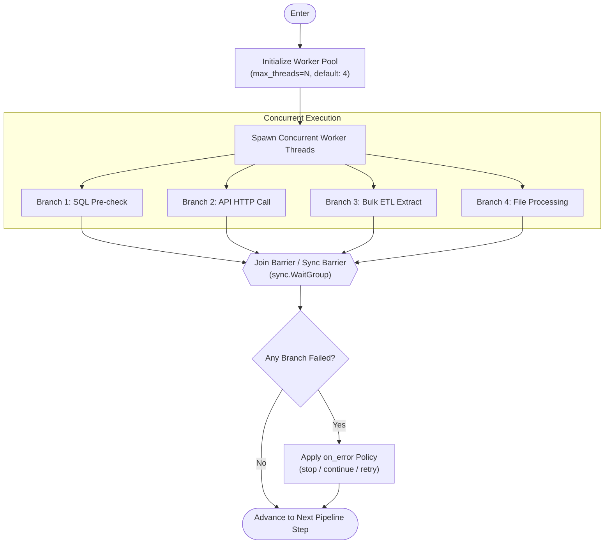
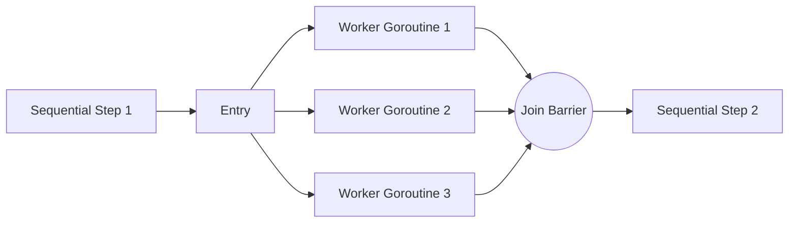

# Concurrent Step Execution: `<parallel>`

The `<parallel>` component executes multiple child tasks or branches concurrently across an asynchronous worker thread pool. Rather than executing child tasks sequentially from top to bottom, `<parallel>` dispatches each child step into a separate goroutine and establishes a synchronized join barrier, ensuring all concurrent operations finish before the pipeline advances to the subsequent step.

---

## Architecture & Lifecycle



---

## Attribute Reference

| Attribute | Type | Default | Mandatory | Description |
| :--- | :--- | :--- | :--- | :--- |
| `id` | `string` | *(generated)* | No | Unique identifier for the parallel step. Used for logging, metrics, and tracing. |
| `max_threads` | `positiveInteger` | `4` | No | Maximum number of concurrent worker threads/goroutines allowed to execute simultaneously. |
| `threads` | `positiveInteger` | `4` | No | Alias for `max_threads`. Defines concurrency limit. |
| `concurrency` | `positiveInteger` | `4` | No | Alias for `max_threads`. Defines concurrency limit. |
| `timeout` | `string` | *(none)* | No | Maximum duration for all parallel tasks to complete (e.g. `30s`, `5m`, `1h`). |
| `on_error` | `string` | `stop` | No | Action taken if any child branch returns an error: `stop` (fail pipeline), `continue` (log and proceed), or `retry`. |
| `description` | `string` | `""` | No | Human-readable explanation of the parallel operations. |

---

## Core Concurrency Guarantees

### 1. Synchronized Join Barrier
When `<parallel>` begins, child tasks are queued and assigned to the worker pool. The orchestrator halts forward progress on the main flow until **all** child branches have either completed successfully or terminated with an error.



### 2. Database Connection Pooling Considerations
When running multiple `<sql>` or `<sql_bulk>` nodes concurrently within `<parallel>`, ensure that the underlying `<database>` connection pool has enough capacity:
- Increase `max_open_conns` on your `<database>` definition to match or exceed `max_threads`.
- If `max_threads="8"` and `max_open_conns="2"`, worker tasks will wait in a database queue, bottlenecking concurrency.

```xml
<database name="analytics_db" 
          connection_string="{{AnalyticsConnStr}}" 
          max_open_conns="10" 
          max_idle_conns="5" />
```

### 3. Variable Thread-Safety & Scoping
- **Input Variables**: All child steps can safely read pipeline variables (`{{VarName}}` or `vars.Get*`).
- **Output Variables**: When concurrent steps write to variables (`output_var`), ensure each child step writes to an independent variable name (e.g. `BRANCH_A_STATUS`, `BRANCH_B_STATUS`) to avoid race conditions.

---

## Production Pipeline Examples

### Example 1: Parallel Health Check Across Multiple Systems
Query multiple databases concurrently to determine synchronization state before taking action.

```xml
<pipeline xmlns:xsi="http://www.w3.org/2001/XMLSchema-instance"
    xsi:noNamespaceSchemaLocation="https://raw.githubusercontent.com/etl-madness/flow/main/xsd/pipeline.xsd">
    <variables>
        <variable name="SourceConn" type="string" value="sqlserver://SRV01:1433?database=AppDB&amp;integrated+security=true" />
        <variable name="TargetConn" type="string" value="sqlserver://SRV02:1433?database=ReportingDB&amp;integrated+security=true" />
        <variable name="SOURCE_MAX_DATE" type="string" value="" />
        <variable name="TARGET_MAX_DATE" type="string" value="" />
    </variables>

    <databases>
        <database name="src_db" connection_string="{{SourceConn}}" max_open_conns="4" />
        <database name="tgt_db" connection_string="{{TargetConn}}" max_open_conns="4" />
    </databases>

    <flow>
        <!-- Execute both queries at the same time -->
        <parallel id="fetch_max_timestamps" max_threads="2" description="Query source and target databases in parallel">
            <sql id="get_source_max" db="src_db" output_var="SOURCE_MAX_DATE">
                SELECT ISNULL(MAX(UpdatedAt), '1970-01-01') AS SOURCE_MAX_DATE FROM dbo.Orders;
            </sql>
            <sql id="get_target_max" db="tgt_db" output_var="TARGET_MAX_DATE">
                SELECT ISNULL(MAX(UpdatedAt), '1970-01-01') AS TARGET_MAX_DATE FROM dbo.OrdersArchive;
            </sql>
        </parallel>

        <!-- Fast comparison script evaluating delta condition -->
        <script id="compare_timestamps" language="go" output_variable="NEEDS_ACTION"
            description="Evaluate whether source date exceeds target date">
            <![CDATA[
            package main
            import (
                "fmt"
                "host/vars"
            )
            func main() {
                src := vars.GetString("SOURCE_MAX_DATE")
                tgt := vars.GetString("TARGET_MAX_DATE")
                if src != "" && tgt != "" && src != tgt {
                    fmt.Println("true")
                } else {
                    fmt.Println("false")
                }
            }
            ]]>
        </script>

        <!-- Process findings: sync delta if dates diverge -->
        <if id="check_sync_action" var="NEEDS_ACTION" equals="true">
            <then>
                <sql_bulk id="sync_delta" db="src_db" target_db="tgt_db" target_table="dbo.OrdersArchive" batch_size="10000"
                    description="Bulk stream modified delta rows">
                    <![CDATA[
                    SELECT * FROM dbo.Orders WHERE UpdatedAt > '{{TARGET_MAX_DATE}}';
                    ]]>
                </sql_bulk>
            </then>
            <else>
                <script id="log_in_sync" language="go">
                    <![CDATA[
                    package main
                    import "fmt"
                    func main() { fmt.Println("Target archive is fully up to date. No sync needed.") }
                    ]]>
                </script>
            </else>
        </if>
    </flow>
</pipeline>
```

---

### Example 2: Concurrent API Ingestion and Staging
Fetch disparate datasets from external REST endpoints in parallel, save them to local storage, and extract JSON payloads.

```xml
<pipeline description="Fetch multiple external data feeds concurrently"
    xmlns:xsi="http://www.w3.org/2001/XMLSchema-instance"
    xsi:noNamespaceSchemaLocation="https://raw.githubusercontent.com/etl-madness/flow/main/xsd/pipeline.xsd">
    <variables>
        <variable name="ApiKey" type="string" value="secret_live_token" />
        <variable name="RatesJson" type="string" value="" />
        <variable name="UsersJson" type="string" value="" />
    </variables>

    <flow>
        <parallel id="parallel_ingestion" max_threads="4" description="Download currency and user data simultaneously">
            <!-- Branch 1: Exchange Rates -->
            <http_client id="fetch_rates" url="https://api.example.com/v1/rates" method="GET" into="RatesJson">
                <headers>
                    <header name="Authorization">Bearer {{ApiKey}}</header>
                </headers>
            </http_client>

            <!-- Branch 2: Active User Profiles -->
            <http_client id="fetch_users" url="https://api.example.com/v1/users/active" method="GET" into="UsersJson">
                <headers>
                    <header name="Authorization">Bearer {{ApiKey}}</header>
                </headers>
            </http_client>
        </parallel>

        <!-- Parse responses after both downloads finish -->
        <json_path id="extract_usd_rate" source="var" var="RatesJson" query="$.rates.USD" into="USD_RATE" />
        <json_path id="extract_user_count" source="var" var="UsersJson" query="$.total_count" into="TOTAL_USERS" />
    </flow>
</pipeline>
```

---

### Example 3: Multi-Table Archive & Cleanup Operations
Execute independent maintenance statements concurrently across large reporting tables.

```xml
<pipeline description="Parallel table maintenance"
    xmlns:xsi="http://www.w3.org/2001/XMLSchema-instance"
    xsi:noNamespaceSchemaLocation="https://raw.githubusercontent.com/etl-madness/flow/main/xsd/pipeline.xsd">
    <databases>
        <database name="warehouse_db" 
                  connection_string="sqlserver://WH01:1433?database=Warehouse&amp;integrated+security=true" 
                  max_open_conns="10" />
    </databases>

    <flow>
        <parallel id="nightly_maintenance" max_threads="3" timeout="15m" description="Run archive purges concurrently">
            <sql id="purge_audit_logs" db="warehouse_db">
                DELETE FROM dbo.AuditLog WHERE CreatedAt &lt; DATEADD(DAY, -90, GETUTCDATE());
            </sql>
            <sql id="purge_session_cache" db="warehouse_db">
                DELETE FROM dbo.SessionCache WHERE ExpiresAt &lt; GETUTCDATE();
            </sql>
            <sql id="rebuild_stage_indexes" db="warehouse_db">
                ALTER INDEX ALL ON dbo.StagingEvents REBUILD;
            </sql>
        </parallel>
    </flow>
</pipeline>
```

---

### Example 4: Concurrent File Transformations
Read multiple local data files simultaneously, run transformation scripts, and export formatted reports.

```xml
<pipeline description="Parallel report extraction"
    xmlns:xsi="http://www.w3.org/2001/XMLSchema-instance"
    xsi:noNamespaceSchemaLocation="https://raw.githubusercontent.com/etl-madness/flow/main/xsd/pipeline.xsd">
    <flow>
        <parallel id="generate_department_reports" max_threads="3">
            <excel_read id="read_finance" file="./data/finance_q3.xlsx" sheet="Summary" output_var="FINANCE_DATA" />
            <excel_read id="read_sales" file="./data/sales_q3.xlsx" sheet="Summary" output_var="SALES_DATA" />
            <file_read id="read_hr_csv" path="./data/hr_headcount.csv" into="HR_DATA" />
        </parallel>

        <assert id="validate_finance_loaded" var="FINANCE_DATA" condition="ne .FINANCE_DATA \"\"" message="Finance data missing" />
        <assert id="validate_sales_loaded" var="SALES_DATA" condition="ne .SALES_DATA \"\"" message="Sales data missing" />
    </flow>
</pipeline>
```

---

### Example 5: High-Throughput Bulk Replication Across Multiple Target Tables
Stream extracts concurrently from a core database into multiple target tables on an analytics server.

```xml
<pipeline description="Concurrent multi-table replication"
    xmlns:xsi="http://www.w3.org/2001/XMLSchema-instance"
    xsi:noNamespaceSchemaLocation="https://raw.githubusercontent.com/etl-madness/flow/main/xsd/pipeline.xsd">
    <databases>
        <database name="oltp_db" connection_string="sqlserver://OLTP:1433?database=Core&amp;integrated+security=true" max_open_conns="8" />
        <database name="olap_db" connection_string="sqlserver://OLAP:1433?database=Analytics&amp;integrated+security=true" max_open_conns="8" />
    </databases>

    <flow>
        <parallel id="bulk_replicate_all" max_threads="3" timeout="30m">
            <sql_bulk id="copy_customers" db="oltp_db" target_db="olap_db" target_table="dbo.DimCustomers" batch_size="25000" tablock="true">
                SELECT CustomerID, AccountNumber, Name, TerritoryID, ModifiedDate FROM Sales.Customer;
            </sql_bulk>
            <sql_bulk id="copy_products" db="oltp_db" target_db="olap_db" target_table="dbo.DimProducts" batch_size="25000" tablock="true">
                SELECT ProductID, Name, ProductNumber, StandardCost, ListPrice FROM Production.Product;
            </sql_bulk>
            <sql_bulk id="copy_territories" db="oltp_db" target_db="olap_db" target_table="dbo.DimTerritory" batch_size="5000" tablock="true">
                SELECT TerritoryID, Name, CountryRegionCode, [Group] FROM Sales.SalesTerritory;
            </sql_bulk>
        </parallel>
    </flow>
</pipeline>
```

---

## Best Practices & Troubleshooting

> [!TIP]
> **Right-size `max_threads`**: Default is 4. Avoid setting `max_threads` higher than the number of available CPU cores or database connection limits, as excess goroutines cause thread thrashing and connection pool exhaustion.

> [!IMPORTANT]
> **Independent Output Variables**: Never configure two parallel branches to output into the same variable name. Each concurrent branch should write to a uniquely named variable.

> [!WARNING]
> **Deadlock Prevention**: If multiple concurrent branches interact with the same database, ensure they modify disjoint sets of rows or tables to prevent database transaction deadlocks.
