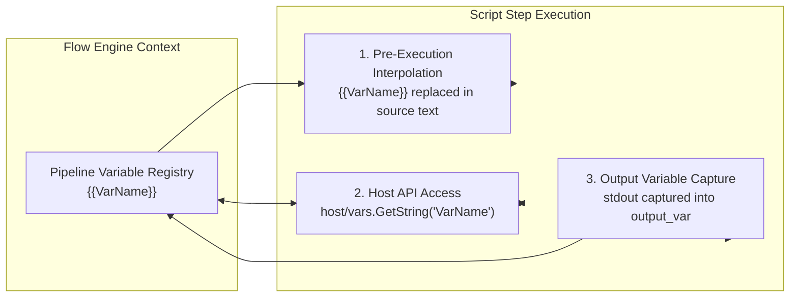

# `<script>` Node Reference & Cross-Platform Guide

The `<script>` node executes dynamic code within an ETL Madness Flow pipeline. It bridges declarative XML workflow orchestration with programmatic logic, enabling custom transformations, system checks, file manipulations, API integrations, and database operations.

Flow supports multiple scripting engines, ranging from its **built-in zero-dependency Go interpreter** (which runs identically on Windows, Linux, and macOS without requiring any compiler or runtime installation) to platform shells (PowerShell, Bash, POSIX sh, Zsh, Cmd) and .NET Script (CSX).

---

## 1. Complete Attribute Specification

The `<script>` node accepts the following attributes:

| Attribute | XML Schema Type | Default | Description |
| :--- | :--- | :--- | :--- |
| `id` | `xs:string` | Auto (`script_N`) | Unique step identifier used for logging, telemetry, and execution flow tracking. |
| `language` / `lang` | `xs:string` | `powershell` (in Builder) | The script engine or interpreter runtime (e.g., `go`, `powershell`, `pwsh`, `bash`, `sh`, `cmd`, `git-bash`, `zsh`, `csx`, `sql`). |
| `output_var` / `output_variable` / `out_var` | `xs:string` | *None* | Pipeline variable name that receives the captured standard output (`stdout`) of the script. |
| `var` / `variable` | `xs:string` | *None* | Name of an existing pipeline variable containing the script code to execute. When specified, overrides the XML body content. |
| `timeout` | `xs:string` | *None* | Maximum execution duration before terminating the script (e.g., `10s`, `45s`, `5m`, `1h`). |
| `description` | `xs:string` | *None* | Human-readable explanation displayed in logs, Mermaid flowcharts, and HTML execution summaries. |
| `on_error` | `xs:string` | `stop` | Failure policy when the script exits with a non-zero code (`stop`, `continue`, `retry`). |
| `retry_count` | `xs:int` | `0` | Number of retry attempts when `on_error="retry"`. |
| `retry_interval` | `xs:string` | `1s` | Delay duration between retry attempts (e.g., `2s`, `10s`). |
| `db` / `database` | `xs:string` | *None* | Database connection alias for `language="sql"` or database-bound operations. |
| `target_db` | `xs:string` | *None* | Destination database connection alias for cross-database streaming. |
| `target_table` | `xs:string` | *None* | Target table name for streaming operations. |
| `batch_size` | `xs:int` | `500` | Chunk batch size for bulk data operations. |

---

## 2. Supported Runtimes & Cross-Platform Compatibility Matrix

| Runtime / Engine | `language` Value(s) | Windows | Linux | macOS | Dependencies | Notes |
| :--- | :--- | :---: | :---: | :---: | :--- | :--- |
| **Interpreted Go** | `go` | ✅ | ✅ | ✅ | **None** (Built into Flow binary via Yaegi) | **Recommended for multi-platform pipelines.** Native access to Go standard library, `host/vars`, and `host/db`. |
| **PowerShell Core** | `pwsh` | ✅ | ✅ | ✅ | `pwsh` in `PATH` | Modern cross-platform PowerShell (v7+). Runs identically across OS platforms. |
| **Windows PowerShell** | `powershell` | ✅ | ❌ | ❌ | Pre-installed on Windows (`powershell.exe`) | Windows PowerShell 5.1. Executes with `-NoProfile -NonInteractive -ExecutionPolicy Bypass`. |
| **GNU Bash** | `bash` | ⚠️ | ✅ | ✅ | `/bin/bash` or `bash` in `PATH` | Native on Linux/macOS. Requires Git Bash, MSYS2, or WSL on Windows. |
| **POSIX Shell** | `shell`, `sh` | ⚠️ | ✅ | ✅ | `/bin/sh` or `sh` in `PATH` | Lightweight POSIX script. On Windows falls back to available `sh.exe` or `cmd.exe`. |
| **Windows Command** | `cmd` | ✅ | ❌ | ❌ | Windows native (`cmd.exe /c`) | Legacy batch scripts (`.bat` / `.cmd`). Windows only. |
| **Git Bash** | `git-bash`, `gitbash` | ✅ | ⚠️ | ⚠️ | Git for Windows installed | Specifically targets Git's Bash binary on Windows (`C:\Program Files\Git\bin\bash.exe`). |
| **Z Shell** | `zsh` | ❌ | ✅ | ✅ | `/bin/zsh` | Default login shell on modern macOS; standard on Linux. |
| **C# Script (.NET)** | `csx`, `dotnet-script` | ✅ | ✅ | ✅ | `dotnet-script` CLI tool | Executes C# code with Roslyn compiler. Requires .NET SDK and `dotnet-script`. |
| **SQL Script** | `sql` | ✅ | ✅ | ✅ | Configured `<database>` in pipeline | Executes native SQL against target database connection. |

> [!TIP]
> **Cross-Platform Recommendation**: For pipelines intended to run seamlessly across Windows, Linux containers, and macOS runners, prefer **`language="go"`**. Because the Go interpreter is embedded directly within the Flow executable, your pipeline requires **zero external software or interpreter installations** on target machines.

---

## 3. Variable Passing & Output Capture Mechanics

There are two primary mechanisms for sharing data between the Flow pipeline and scripts:



### 1. Template Interpolation (`{{VarName}}`)
Before any script runs, Flow scans the script content and replaces all `{{VarName}}` placeholders with their current runtime values.
- Works across **all** script languages (`go`, `bash`, `powershell`, `cmd`, `csx`).
- Evaluated prior to passing code to the interpreter.

### 2. Built-in Host APIs (Go Scripts Only)
Go scripts can import the built-in host package `"host/vars"` for dynamic, typed interaction with the pipeline variable registry:

```go
package main

import (
    "fmt"
    "host/vars"
)

func main() {
    // Read typed variables
    server := vars.GetString("ServerHost")
    port   := vars.GetInt("ServerPort")
    active := vars.GetBool("IsProduction")
    rate   := vars.GetFloat("ExchangeRate")

    // Write back directly to the pipeline registry
    vars.Set("ProcessedCount", 42)
    vars.SetString("StatusMessage", "All records validated")
}
```

### 3. Capturing Output via `output_var`
Any content written to standard output (`stdout` / `fmt.Print` / `Write-Host` / `echo` / `Console.Write`) is captured by the engine and stored in the variable named by `output_var`:
- Subsequent pipeline steps can reference this variable via `{{VariableName}}` or `vars.GetString("VariableName")`.
- Trailing newlines (`\r\n` or `\n`) are trimmed automatically to prevent formatting discrepancies.

---

## 4. Cross-Platform Scripting Best Practices

When writing scripts designed to run on multiple operating systems:

1. **Path Separators**: Avoid hardcoding `\` or `/`.
   - In Go: Use `filepath.Join("folder", "file.csv")` or `filepath.FromSlash(path)`.
   - In PowerShell: Use `Join-Path $folder $file`.
   - In Bash: Always use forward slashes `/`.
2. **Line Endings (CRLF vs. LF)**:
   - Windows outputs `\r\n`; Unix outputs `\n`.
   - When checking string equality in conditions (`<if>`), trim whitespace or normalize returns.
3. **Quoting and CDATA**:
   - Always wrap script source inside an XML `<![CDATA[ ... ]]>` block to avoid XML entity conflicts (`<`, `>`, `&`, `"`).
4. **Environment Variables**:
   - Windows environment variable names are case-insensitive; Linux and macOS are strictly case-sensitive.
   - Use pipeline variables (`{{MyVar}}` or `vars.GetString("MyVar")`) instead of system environment variables whenever possible.

---

## 5. Comprehensive Cross-Platform Examples

### Example 1: Universal Cross-Platform File Inspection (`language="go"`)

This script inspects a directory, calculates file sizes and MD5 hashes, and outputs a JSON summary. It runs identically on Windows, Linux, and macOS with **zero external dependencies**.

```xml
<pipeline xmlns:xsi="http://www.w3.org/2001/XMLSchema-instance"
          xsi:noNamespaceSchemaLocation="https://raw.githubusercontent.com/etl-madness/flow/main/xsd/pipeline.xsd">
    <variables>
        <variable name="TargetDir" type="string" value="./data_inbound" />
        <variable name="FileManifest" type="string" value="" />
    </variables>

    <flow>
        <script id="ScanDirectory" language="go" output_var="FileManifest">
            <![CDATA[
            package main

            import (
                "crypto/md5"
                "encoding/hex"
                "encoding/json"
                "fmt"
                "io"
                "os"
                "path/filepath"
                "time"
                "host/vars"
            )

            type FileInfo struct {
                Name      string    `json:"name"`
                Path      string    `json:"path"`
                SizeBytes int64     `json:"size_bytes"`
                MD5       string    `json:"md5"`
                Modified  time.Time `json:"modified"`
            }

            func getFileMD5(filePath string) (string, error) {
                f, err := os.Open(filePath)
                if err != nil {
                    return "", err
                }
                defer f.Close()

                h := md5.New()
                if _, err := io.Copy(h, f); err != nil {
                    return "", err
                }
                return hex.EncodeToString(h.Sum(nil)), nil
            }

            func main() {
                dir := vars.GetString("TargetDir")
                if dir == "" {
                    dir = "."
                }

                var files []FileInfo
                entries, err := os.ReadDir(dir)
                if err != nil {
                    fmt.Printf("[]")
                    return
                }

                for _, entry := range entries {
                    if entry.IsDir() {
                        continue
                    }
                    fullPath := filepath.Join(dir, entry.Name())
                    info, err := entry.Info()
                    if err != nil {
                        continue
                    }

                    hash, _ := getFileMD5(fullPath)
                    files = append(files, FileInfo{
                        Name:      entry.Name(),
                        Path:      filepath.ToSlash(fullPath),
                        SizeBytes: info.Size(),
                        MD5:       hash,
                        Modified:  info.ModTime().UTC(),
                    })
                }

                jsonBytes, _ := json.MarshalIndent(files, "", "  ")
                fmt.Print(string(jsonBytes))
            }
            ]]>
        </script>
    </flow>
</pipeline>
```

---

### Example 2: OS Detection and Dynamic Platform Routing

Determines the host operating system at runtime using Go's built-in `runtime.GOOS`, registers the OS name into a pipeline variable, and conditionally executes platform-specific actions.

```xml
<pipeline xmlns:xsi="http://www.w3.org/2001/XMLSchema-instance"
          xsi:noNamespaceSchemaLocation="https://raw.githubusercontent.com/etl-madness/flow/main/xsd/pipeline.xsd">
    <variables>
        <variable name="CurrentOS" type="string" value="" />
        <variable name="HostCores" type="int" value="1" />
    </variables>

    <flow>
        <!-- Step 1: Detect Operating System and Core Count -->
        <script id="DetectHostEnvironment" language="go">
            <![CDATA[
            package main

            import (
                "fmt"
                "runtime"
                "host/vars"
            )

            func main() {
                osName := runtime.GOOS       // "windows", "linux", "darwin"
                arch   := runtime.GOARCH     // "amd64", "arm64"
                cpus   := runtime.NumCPU()

                vars.SetString("CurrentOS", osName)
                vars.Set("HostCores", cpus)

                fmt.Printf("Detected Host OS: %s (%s) with %d CPUs\n", osName, arch, cpus)
            }
            ]]>
        </script>

        <!-- Step 2: Windows Branch -->
        <if id="CheckWindows" var="CurrentOS" equals="windows">
            <then>
                <script id="WindowsLog" language="powershell">
                    <![CDATA[
                    Write-Host "Running on Windows. System Drive: $env:SystemDrive"
                    ]]>
                </script>
            </then>
        </if>

        <!-- Step 3: Linux / macOS Branch -->
        <if id="CheckUnix" var="CurrentOS" equals="linux">
            <then>
                <script id="LinuxLog" language="bash">
                    <![CDATA[
                    echo "Running on Linux. Kernel: $(uname -r), Uptime: $(uptime -p 2>/dev/null || uptime)"
                    ]]>
                </script>
            </then>
        </if>
    </flow>
</pipeline>
```

---

### Example 3: Cross-Platform Zip Archive Generator (`language="go"`)

Compresses ETL export files into a `.zip` archive across all platforms without calling external tools like `zip`, `tar`, or 7-Zip.

```xml
<pipeline xmlns:xsi="http://www.w3.org/2001/XMLSchema-instance"
          xsi:noNamespaceSchemaLocation="https://raw.githubusercontent.com/etl-madness/flow/main/xsd/pipeline.xsd">
    <variables>
        <variable name="SourceFolder" type="string" value="./exports" />
        <variable name="ZipFile" type="string" value="./exports_archive.zip" />
        <variable name="ArchivedFilesCount" type="int" value="0" />
    </variables>

    <flow>
        <script id="CreateZipArchive" language="go">
            <![CDATA[
            package main

            import (
                "archive/zip"
                "fmt"
                "io"
                "os"
                "path/filepath"
                "host/vars"
            )

            func main() {
                srcDir  := vars.GetString("SourceFolder")
                zipPath := vars.GetString("ZipFile")

                zipFile, err := os.Create(zipPath)
                if err != nil {
                    fmt.Printf("Failed to create zip file: %v\n", err)
                    return
                }
                defer zipFile.Close()

                archive := zip.NewWriter(zipFile)
                defer archive.Close()

                count := 0
                err = filepath.Walk(srcDir, func(path string, info os.FileInfo, err error) error {
                    if err != nil || info.IsDir() {
                        return err
                    }

                    relPath, err := filepath.Rel(srcDir, path)
                    if err != nil {
                        return err
                    }

                    header, err := zip.FileInfoHeader(info)
                    if err != nil {
                        return err
                    }
                    header.Name = filepath.ToSlash(relPath)
                    header.Method = zip.Deflate

                    writer, err := archive.CreateHeader(header)
                    if err != nil {
                        return err
                    }

                    file, err := os.Open(path)
                    if err != nil {
                        return err
                    }
                    defer file.Close()

                    _, err = io.Copy(writer, file)
                    if err == nil {
                        count++
                    }
                    return err
                })

                vars.Set("ArchivedFilesCount", count)
                fmt.Printf("Successfully packaged %d files into %s\n", count, zipPath)
            }
            ]]>
        </script>
    </flow>
</pipeline>
```

---

### Example 4: REST API Integration with Bearer Token (`language="go"`)

Issues an HTTP POST request to an external token authority, parses the response JSON, and saves the bearer token into the pipeline registry for downstream `<http_client>` steps.

```xml
<pipeline xmlns:xsi="http://www.w3.org/2001/XMLSchema-instance"
          xsi:noNamespaceSchemaLocation="https://raw.githubusercontent.com/etl-madness/flow/main/xsd/pipeline.xsd">
    <variables>
        <variable name="AuthEndpoint" type="string" value="https://auth.internal.example.com/oauth/token" />
        <variable name="ClientId" type="string" value="flow-etl-worker" />
        <variable name="ClientSecret" type="string" value="{{SECURE_CLIENT_SECRET}}" />
        <variable name="AccessToken" type="string" value="" />
    </variables>

    <flow>
        <script id="FetchAuthToken" language="go" timeout="30s">
            <![CDATA[
            package main

            import (
                "bytes"
                "encoding/json"
                "fmt"
                "io"
                "net/http"
                "time"
                "host/vars"
            )

            type TokenResponse struct {
                AccessToken string `json:"access_token"`
                TokenType   string `json:"token_type"`
                ExpiresIn   int    `json:"expires_in"`
            }

            func main() {
                url    := vars.GetString("AuthEndpoint")
                id     := vars.GetString("ClientId")
                secret := vars.GetString("ClientSecret")

                payload := map[string]string{
                    "client_id":     id,
                    "client_secret": secret,
                    "grant_type":    "client_credentials",
                }
                bodyBytes, _ := json.Marshal(payload)

                client := &http.Client{Timeout: 15 * time.Second}
                resp, err := client.Post(url, "application/json", bytes.NewBuffer(bodyBytes))
                if err != nil {
                    fmt.Printf("HTTP Request failed: %v\n", err)
                    return
                }
                defer resp.Body.Close()

                respData, _ := io.ReadAll(resp.Body)
                if resp.StatusCode < 200 || resp.StatusCode >= 300 {
                    fmt.Printf("Auth server returned status %d: %s\n", resp.StatusCode, string(respData))
                    return
                }

                var tokenResp TokenResponse
                if err := json.Unmarshal(respData, &tokenResp); err != nil {
                    fmt.Printf("Failed to decode token JSON: %v\n", err)
                    return
                }

                vars.SetString("AccessToken", tokenResp.AccessToken)
                fmt.Printf("Successfully acquired token (expires in %d sec)\n", tokenResp.ExpiresIn)
            }
            ]]>
        </script>

        <!-- Downstream HTTP step consumes the generated token -->
        <http_client id="FetchProtectedData"
                     url="https://api.internal.example.com/v1/customers"
                     method="GET"
                     headers="Authorization:Bearer {{AccessToken}},Accept:application/json"
                     output_var="CustomersJSON" />
    </flow>
</pipeline>
```

---

### Example 5: Cross-Platform PowerShell Core (`language="pwsh"`)

Demonstrates modern PowerShell Core (`pwsh`) syntax that runs identically on Linux, Windows, and macOS to calculate disk storage metrics.

```xml
<pipeline xmlns:xsi="http://www.w3.org/2001/XMLSchema-instance"
          xsi:noNamespaceSchemaLocation="https://raw.githubusercontent.com/etl-madness/flow/main/xsd/pipeline.xsd">
    <variables>
        <variable name="DiskSpaceReport" type="string" value="" />
    </variables>

    <flow>
        <script id="CheckFreeDiskSpace" language="pwsh" output_var="DiskSpaceReport">
            <![CDATA[
            # Cross-platform .NET DriveInfo works on Windows, Linux, and macOS
            $drives = [System.IO.DriveInfo]::GetDrives() | Where-Object { $_.IsReady -and $_.DriveType -eq 'Fixed' }
            
            $report = @()
            foreach ($d in $drives) {
                $totalGB = [math]::Round($d.TotalSize / 1GB, 2)
                $freeGB  = [math]::Round($d.AvailableFreeSpace / 1GB, 2)
                $pctFree = [math]::Round(($freeGB / $totalGB) * 100, 1)

                $report += [PSCustomObject]@{
                    RootDirectory = $d.RootDirectory.FullName
                    TotalGB       = $totalGB
                    FreeGB        = $freeGB
                    PercentFree   = $pctFree
                }
            }

            $report | ConvertTo-Json -Compress
            ]]>
        </script>
    </flow>
</pipeline>
```

---

### Example 6: Cross-Platform POSIX Shell Script (`language="sh"`)

A strictly POSIX-compliant shell script that runs under any Bourne-compatible shell (`/bin/sh`, `bash`, `dash`, `zsh`) across Unix environments and Windows Git Bash.

```xml
<pipeline xmlns:xsi="http://www.w3.org/2001/XMLSchema-instance"
          xsi:noNamespaceSchemaLocation="https://raw.githubusercontent.com/etl-madness/flow/main/xsd/pipeline.xsd">
    <variables>
        <variable name="StagingDir" type="string" value="./staging_data" />
        <variable name="CleanResult" type="string" value="" />
    </variables>

    <flow>
        <script id="CleanupOldStagingFiles" language="sh" output_var="CleanResult">
            <![CDATA[
            # POSIX-compliant file purging: removes .tmp files older than 7 days
            TARGET_DIR="{{StagingDir}}"
            
            if [ -d "$TARGET_DIR" ]; then
                DELETED_COUNT=$(find "$TARGET_DIR" -type f -name "*.tmp" -mtime +7 -exec rm -f {} + -print | wc -l)
                echo "Cleaned up $DELETED_COUNT stale staging files in $TARGET_DIR"
            else
                mkdir -p "$TARGET_DIR"
                echo "Created missing staging directory: $TARGET_DIR"
            fi
            ]]>
        </script>
    </flow>
</pipeline>
```

---

### Example 7: C# Scripting via .NET Script (`language="csx"`)

Executes C# code using `dotnet-script`, utilizing LINQ and `System.Text.Json` to process a variable payload.

```xml
<pipeline xmlns:xsi="http://www.w3.org/2001/XMLSchema-instance"
          xsi:noNamespaceSchemaLocation="https://raw.githubusercontent.com/etl-madness/flow/main/xsd/pipeline.xsd">
    <variables>
        <variable name="RawScores" type="string" value="95,82,78,99,88,91,65,74" />
        <variable name="ScoreStats" type="string" value="" />
    </variables>

    <flow>
        <script id="ComputeScoreStats" language="csx" output_var="ScoreStats">
            <![CDATA[
            using System;
            using System.Linq;
            using System.Text.Json;

            string raw = "{{RawScores}}";
            var scores = raw.Split(',', StringSplitOptions.RemoveEmptyEntries)
                            .Select(s => int.Parse(s.Trim()))
                            .ToList();

            var stats = new
            {
                Count = scores.Count,
                Min = scores.Min(),
                Max = scores.Max(),
                Average = Math.Round(scores.Average(), 2),
                Median = scores.OrderBy(x => x).Skip(scores.Count / 2).First()
            };

            Console.Write(JsonSerializer.Serialize(stats));
            ]]>
        </script>
    </flow>
</pipeline>
```

---

### Example 8: Database Connection Health & Latency Probe (`language="go"` with `"host/db"`)

Uses the built-in `"host/db"` integration package to inspect an active database connection pool, measure network round-trip ping latency in milliseconds, and record health status.

```xml
<pipeline xmlns:xsi="http://www.w3.org/2001/XMLSchema-instance"
          xsi:noNamespaceSchemaLocation="https://raw.githubusercontent.com/etl-madness/flow/main/xsd/pipeline.xsd">
    <databases>
        <database name="production_db"
                  driver="postgres"
                  connection_string="host=db.example.internal port=5432 user=flow_user password=SecretPassword dbname=analytics sslmode=require" />
    </databases>

    <variables>
        <variable name="DbPingLatencyMs" type="int" value="0" />
        <variable name="DbStatus" type="string" value="UNKNOWN" />
    </variables>

    <flow>
        <script id="ProbeDatabaseHealth" language="go" timeout="10s">
            <![CDATA[
            package main

            import (
                "context"
                "fmt"
                "time"
                "host/db"
                "host/vars"
            )

            func main() {
                conn, err := db.Get("production_db")
                if err != nil {
                    vars.SetString("DbStatus", "CONNECTION_POOL_NOT_FOUND")
                    fmt.Printf("Database pool error: %v\n", err)
                    return
                }

                ctx, cancel := context.WithTimeout(context.Background(), 5*time.Second)
                defer cancel()

                start := time.Now()
                err = conn.PingContext(ctx)
                durationMs := int(time.Since(start).Milliseconds())

                vars.Set("DbPingLatencyMs", durationMs)

                if err != nil {
                    vars.SetString("DbStatus", "PING_FAILED")
                    fmt.Printf("Database ping failed after %d ms: %v\n", durationMs, err)
                } else {
                    vars.SetString("DbStatus", "HEALTHY")
                    fmt.Printf("Database connection healthy (ping latency: %d ms)\n", durationMs)
                }
            }
            ]]>
        </script>

        <assert id="EnsureDatabaseHealthy"
                var="DbStatus"
                equals="HEALTHY"
                message="Production database connection failed latency health probe!"
                on_failure="halt" />
    </flow>
</pipeline>
```

---

### Example 9: Dynamic Script Execution from a Variable (`var="..."`)

Executes code stored inside a pipeline variable rather than an inline XML body. This pattern enables dynamic scripts generated by earlier pipeline steps or loaded from an external repository or encrypted payload.

```xml
<pipeline xmlns:xsi="http://www.w3.org/2001/XMLSchema-instance"
          xsi:noNamespaceSchemaLocation="https://raw.githubusercontent.com/etl-madness/flow/main/xsd/pipeline.xsd">
    <variables>
        <variable name="DynamicGoCode" type="string">
            <value>
                package main
                import (
                    "fmt"
                    "time"
                )
                func main() {
                    fmt.Printf("Dynamic execution at UTC: %s\n", time.Now().UTC().Format(time.RFC3339))
                }
            </value>
        </variable>
        <variable name="DynamicOutput" type="string" value="" />
    </variables>

    <flow>
        <!-- The var attribute directs Flow to execute the Go code stored in DynamicGoCode -->
        <script id="RunDynamicCode"
                language="go"
                var="DynamicGoCode"
                output_var="DynamicOutput" />

        <script id="LogDynamicOutput" language="powershell">
            <![CDATA[
            Write-Host "Result of dynamic execution: {{DynamicOutput}}"
            ]]>
        </script>
    </flow>
</pipeline>
```

---

## 6. Error Handling & Retry Policies

When a script fails (e.g. non-zero exit code, unhandled Go panic, or timeout expiration), the `<script>` node responds according to `on_error`:

```xml
<!-- Stop on failure (Default) -->
<script id="CriticalStep" language="go" on_error="stop">
    ...
</script>

<!-- Continue execution on failure -->
<script id="OptionalStep" language="bash" on_error="continue">
    ...
</script>

<!-- Automatic retry with exponential or fixed backoff -->
<script id="FlakyNetworkCall"
        language="go"
        on_error="retry"
        retry_count="3"
        retry_interval="5s"
        timeout="15s">
    ...
</script>
```

---

## 7. Summary & Quick Reference

| Goal | Recommended Approach |
| :--- | :--- |
| **Max portability (Windows, Linux, macOS)** | Use `<script language="go">` with `"host/vars"`. Requires zero host dependencies. |
| **Pass data between steps** | Use `output_var="VarName"` to capture `stdout`, or `vars.SetString("VarName", val)` in Go. |
| **Access pipeline variables in script** | Use `{{VarName}}` anywhere in the body, or `vars.GetString("VarName")` in Go. |
| **Prevent XML parsing errors** | Always enclose script bodies inside `<![CDATA[ ... ]]>`. |
| **Prevent runaway executions** | Set `timeout="30s"` or `timeout="5m"`. |
| **Enforce database prerequisites** | Use `language="go"` with `"host/db"` to probe connections before running large bulk ETL jobs. |
