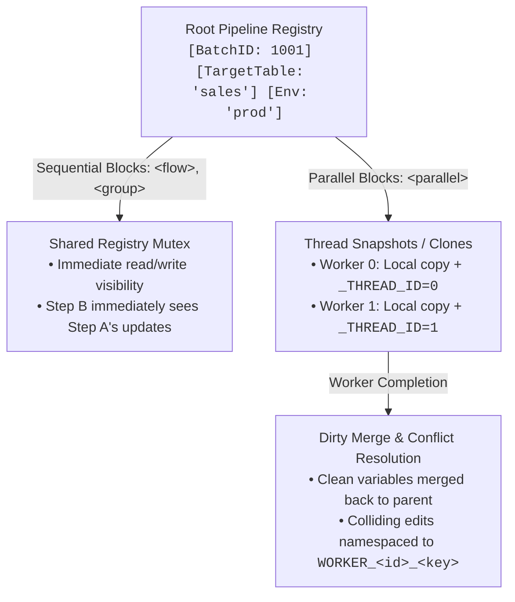
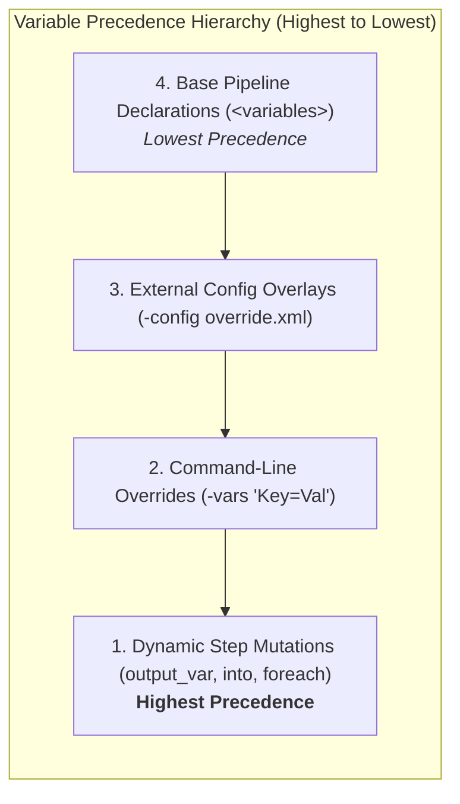

# Pipeline Variables (`<variable>`) & Registry Guide

The `<variable>` element initializes a named pipeline variable within the top-level `<variables>` container. Flow provides a high-performance, thread-safe variable registry (`*flow.Registry`) that enables dynamic parameterization of SQL queries, file paths, connection strings, HTTP endpoints, loop drivers, and cross-runtime script execution.

---

## 1. Syntax & Attribute Reference

Pipeline variables are declared inside the `<variables>` collection at the beginning of the pipeline:

```xml
<pipeline xmlns:xsi="http://www.w3.org/2001/XMLSchema-instance"
          xsi:noNamespaceSchemaLocation="https://raw.githubusercontent.com/etl-madness/flow/main/xsd/pipeline.xsd">
    <variables description="Global pipeline configuration and state variables">
        <variable id="var-batch-id" name="BatchID" type="int" value="1001" description="Current batch identifier" />
        <variable id="var-target-table" name="TargetTable" type="string" value="daily_sales" description="Destination table" />
        <variable id="var-is-prod" name="IsProduction" type="bool" value="true" description="Environment switch" />
    </variables>
    <!-- flow nodes -->
</pipeline>
```

### `<variables>` Container Attributes

| Attribute | Mandatory | Default | Description |
| :--- | :--- | :--- | :--- |
| `description` | No | `""` | Optional human-readable description of the variables collection. |

### `<variable>` Element Attributes

| Attribute | Mandatory | Default | Description |
| :--- | :--- | :--- | :--- |
| `name` | **Yes** | — | Unique variable name. Used for interpolation (e.g., `{{VariableName}}`), registry lookups, and OS environment variable exports. |
| `value` | **Yes** | — | Initial scalar string value assigned to the variable. Evaluated and converted according to `type`. |
| `type` | No | `string` | Data type for parsing and internal representation. Supported types: `string`, `int`, `integer`, `bool`, `boolean`, `float`, `double`, `float64`, `datetime`, `date`. |
| `id` | No | `""` | Optional unique identifier for the variable definition element. |
| `description` | No | `""` | Optional human-readable description of the variable's purpose, origin, or usage. |

---

## 2. Supported Data Types & Value Parsing

When initializing variables via XML, Flow parses string values into typed native representations:

| Type Name | Aliases | Description | Parsing Rules & Examples |
| :--- | :--- | :--- | :--- |
| `string` | — *(Default)* | Scalar text / string | Preserves literal text as entered: `value="production"`, `value="C:\Data\Reports"`. |
| `int` | `integer` | 64-bit signed integer (`int64`) | Parses base-10 integer numbers: `value="5000"`, `value="-42"`. |
| `bool` | `boolean` | Boolean flag | Case-insensitive boolean parsing: `true`, `false`, `1`, `0`, `t`, `f`, `TRUE`, `FALSE`. |
| `float` | `double`, `float64` | 64-bit floating point (`float64`) | Parses IEEE 754 floating point numbers: `value="99.95"`, `value="-0.0042"`. |
| `datetime` | — | ISO 8601 / RFC 3339 Timestamp | Parses standard timestamp formats (e.g. `2026-01-15T08:30:00Z`, `2026-01-15 08:30:00`). |
| `date` | — | Calendar Date | Parses calendar dates formatted as `YYYY-MM-DD` (e.g. `2026-01-15`). |

---

## 3. Variable Scopes & Concurrency Model

Variables are managed by a centralized, thread-safe registry (`*flow.Registry`). Their scoping behavior adapts automatically based on the execution context:



### Sequential Execution (Default)
In root `<flow>`, `<preflight>`, and `<group>` blocks:
- All steps share a single synchronized registry.
- Variable reads and mutations (`output_var`, `into`) are immediately visible to all subsequent steps.

### Parallel Execution (`<parallel>`)
When running concurrent branches inside `<parallel>` blocks:
- Flow **snapshots (deep-clones)** the variable registry for each concurrent worker thread.
- Automatically injects an integer `_THREAD_ID` variable (`0`, `1`, `2`, ...) into each worker's local scope.
- Workers mutate their private copy without blocking or corrupting other threads.
- Upon worker completion, only **mutated ("dirty") variables** are merged back into the parent registry.
- If two or more parallel workers mutate the same key with differing values, Flow applies automatic **conflict resolution**, namespacing colliding entries to `WORKER_<id>_<key>` to prevent race conditions and stale overwrites.

---

## 4. Variable Interpolation Syntax

Flow supports mustache-style double curly brace interpolation: `{{VariableName}}`. Placeholders are resolved case-insensitively at runtime across pipeline components:

### 1. SQL Statements & Queries (`<sql>`, `<sql_bulk>`)
```xml
<sql id="QueryWithLimit" db="reporting_db">
    SELECT order_id, customer_name, total_amount
    FROM {{TargetTable}}
    WHERE order_date >= '{{StartDate}}'
    LIMIT {{BatchLimit}};
</sql>
```

### 2. Database Connection Strings (`<database>`)
```xml
<database name="dynamic_db" driver="postgres"
          connection_string="host={{DB_HOST}} port={{DB_PORT}} user={{DB_USER}} password={{DB_PASS}} dbname={{DB_NAME}}" />
```

### 3. File & Directory Paths (`<file_read>`, `<file_save>`, `<excel_read>`, `<excel_write>`)
```xml
<file_read id="LoadBatchFile" path="{{StorageDir}}/incoming/{{BatchID}}_{{BatchDate}}.csv" into="RawCsvData" />
```

### 4. HTTP Client URLs & Headers (`<http_client>`)
```xml
<http_client id="SyncWebhook" method="POST"
             url="https://api.internal.net/v1/orders/{{OrderID}}"
             headers="Authorization: Bearer {{API_TOKEN}}; Content-Type: application/json"
             body="{{PayloadJson}}" />
```

### 5. Conditional Expressions (`<if>`, `<group>`, `<while>`, `<assert>`)
```xml
<assert id="VerifyTotal" var="RecordCount" equals="{{ExpectedCount}}" message="Row count mismatch!" />
```

---

## 5. Setting & Mutating Variables at Runtime

Variables can be dynamically updated by any pipeline node supporting output capture:

| Pipeline Node | Output Attribute | Capture Behavior |
| :--- | :--- | :--- |
| `<sql>` | `output_var` / `into` | Captures single scalar result (single row/col) or tab-delimited text. |
| `<script>` | `output_var` | Captures trimmed standard output (`stdout`) produced by script execution. |
| `<http_client>` | `into` / `output_var` | Captures HTTP response body. `status_into` captures status code. |
| `<template>` | `into` / `output_var` | Captures rendered Go `text/template` output. |
| `<template_html>` | `into` / `output_var` | Captures rendered Go `html/template` (context-aware escaped) output. |
| `<file_read>` | `into` / `output_var` | Reads entire file content into string variable. |
| `<excel_read>` | `output_var` / `into` | Captures parsed Excel table rows formatted as delimited or JSON data. |
| `<json_path>` | `into` / `output_var` | Extracts specific value, object, or array matching JSONPath expression. |
| `<yaml_path>` | `into` / `output_var` | Evaluates path query against YAML data and stores extracted value. |
| `<xml_xpath>` | `into` / `output_var` | Evaluates XPath expression on XML document and stores result. |
| `<kv>` | `into` / `output_var` | Retrieves stored value for given key from Key-Value store. |

---

## 6. Automatic Loop Injections

Looping constructs automatically bind contextual iteration variables:

### `<foreach>`
Iterates over rows returned by a SQL driver query:
- `LOOP_INDEX`: 0-indexed loop iteration counter (`0`, `1`, `2`, ...).
- **Column Bindings**: Every column returned by the driver query is automatically injected into the iteration registry under three casing formats:
  1. **Exact Case**: as defined in SQL `SELECT` (e.g. `CustomerId`).
  2. **Lowercase**: `customerid`.
  3. **Uppercase**: `CUSTOMERID`.

```xml
<foreach id="ProcessAccounts" db="app_db">
    SELECT account_id, org_name, status FROM accounts WHERE active = 1;

    <!-- Automatically available: {{account_id}}, {{org_name}}, {{status}}, {{LOOP_INDEX}} -->
    <sql id="LogAccount" db="audit_db">
        INSERT INTO audit_log (account_id, message, iteration)
        VALUES ({{account_id}}, 'Processed {{org_name}}', {{LOOP_INDEX}});
    </sql>
</foreach>
```

### `<while>`
Iterates while condition remains true:
- `WHILE_INDEX`: 0-indexed iteration counter (`0`, `1`, `2`, ...).

---

## 7. Consuming Variables in Script Nodes

Flow passes all registry variables into script runtimes:

### 1. Embedded Go Interpreter (`yaegi`)
Import `"host/vars"` to access strongly-typed getter functions:
```go
package main

import (
    "fmt"
    "host/vars"
)

func main() {
    batchId := vars.GetInt("BatchID")
    table   := vars.GetString("TargetTable")
    isProd  := vars.GetBool("IsProduction")
    fmt.Printf("Batch %d targeting %s (Prod=%t)\n", batchId, table, isProd)
}
```

Available `"host/vars"` Methods:
- `vars.Get(name string) interface{}`
- `vars.GetString(name string) string`
- `vars.GetInt(name string) int`
- `vars.GetBool(name string) bool`
- `vars.GetFloat(name string) float64`

### 2. C# (`dotnet-script` / `csx`)
Variables are exposed as OS environment variables:
```csharp
using System;

string targetTable = Environment.GetEnvironmentVariable("TargetTable");
string rawBatchId  = Environment.GetEnvironmentVariable("BatchID");
Console.WriteLine($"Running for {targetTable} (Batch {rawBatchId})");
```

### 3. PowerShell (`pwsh` / `powershell`)
Variables are accessible via the `$env:` drive:
```powershell
Write-Host "Processing table: $env:TargetTable"
Write-Host "Batch ID: $env:BatchID"
```

### 4. Linux Bash & POSIX Shell (`bash` / `shell`)
Variables are exported into the child process environment:
```bash
echo "Processing table: ${TargetTable}"
echo "Current environment: ${IsProduction}"
```

---

## 8. Variable Precedence & Overrides

When a variable name is defined in multiple places, Flow evaluates them in strict order of precedence (highest wins):



1. **Base Pipeline XML**: Initial values declared in `<variables>`.
2. **External Config File (`-config override.xml`)**: Overrides matching variable keys before execution starts.
3. **CLI Arguments (`-vars "Key=Value,Count=50"`)**: Overrides matching variable keys at launch.
4. **Runtime Node Mutations (`output_var`, `into`)**: Overwrites registry entries during pipeline execution.

---

## 9. Comprehensive Examples

### Example 1: Multi-Type Variable Initialization & Validation

```xml
<pipeline xmlns:xsi="http://www.w3.org/2001/XMLSchema-instance"
          xsi:noNamespaceSchemaLocation="https://raw.githubusercontent.com/etl-madness/flow/main/xsd/pipeline.xsd">
    <variables description="ETL batch parameters and thresholds">
        <variable id="v1" name="BatchID" type="int" value="42" description="Current execution batch ID" />
        <variable id="v2" name="BatchDate" type="date" value="2026-10-11" description="Processing calendar date" />
        <variable id="v3" name="ThresholdRate" type="float" value="0.95" description="Quality score threshold" />
        <variable id="v4" name="DryRun" type="bool" value="false" description="Toggle commit vs rollback" />
        <variable id="v5" name="ReportTitle" type="string" value="Monthly Aggregates" description="Report heading" />
    </variables>

    <flow>
        <assert id="CheckBatchID" var="BatchID" equals="42" message="BatchID was not initialized properly" />
        <assert id="CheckDryRun" var="DryRun" equals="false" message="DryRun flag must be false" />
    </flow>
</pipeline>
```

### Example 2: Dynamic SQL Scalar Capture & Conditional Branching

```xml
<pipeline xmlns:xsi="http://www.w3.org/2001/XMLSchema-instance"
          xsi:noNamespaceSchemaLocation="https://raw.githubusercontent.com/etl-madness/flow/main/xsd/pipeline.xsd">
    <variables>
        <variable name="PendingCount" type="int" value="0" description="Number of pending records" />
    </variables>

    <flow>
        <!-- Capture scalar count into PendingCount -->
        <sql id="CountPending" db="warehouse_db" output_var="PendingCount">
            SELECT COUNT(*) FROM staging_events WHERE status = 'PENDING';
        </sql>

        <!-- Execute group only when pending rows exist -->
        <group id="ProcessBatchGroup" if_var="PendingCount" if_val="0" equals="false">
            <sql id="ProcessPending" db="warehouse_db">
                UPDATE staging_events 
                SET status = 'PROCESSED', processed_at = CURRENT_TIMESTAMP
                WHERE status = 'PENDING';
            </sql>
        </group>
    </flow>
</pipeline>
```

### Example 3: Cross-Language Variable Passing (Go to PowerShell to SQL)

```xml
<pipeline xmlns:xsi="http://www.w3.org/2001/XMLSchema-instance"
          xsi:noNamespaceSchemaLocation="https://raw.githubusercontent.com/etl-madness/flow/main/xsd/pipeline.xsd">
    <variables>
        <variable name="SourceDir" type="string" value="./data/incoming" />
        <variable name="FileCount" type="int" value="0" />
    </variables>

    <flow>
        <!-- Step 1: PowerShell counts files and writes to stdout -->
        <script id="CountIncomingFiles" language="powershell" output_var="FileCount">
            $files = Get-ChildItem -Path $env:SourceDir -Filter *.csv
            Write-Host -NoNewline $files.Count
        </script>

        <!-- Step 2: Go script evaluates threshold -->
        <script id="EvaluateThreshold" language="go" output_var="EvaluationStatus">
            package main
            import (
                "fmt"
                "host/vars"
            )
            func main() {
                count := vars.GetInt("FileCount")
                if count > 0 {
                    fmt.Print("READY")
                } else {
                    fmt.Print("EMPTY")
                }
            }
        </script>

        <!-- Step 3: SQL records the audit log using interpolated variables -->
        <sql id="RecordAudit" db="audit_db">
            INSERT INTO etl_audit (source_directory, files_found, status)
            VALUES ('{{SourceDir}}', {{FileCount}}, '{{EvaluationStatus}}');
        </sql>
    </flow>
</pipeline>
```

### Example 4: Thread-Isolated Variables in `<parallel>` Workers

```xml
<pipeline xmlns:xsi="http://www.w3.org/2001/XMLSchema-instance"
          xsi:noNamespaceSchemaLocation="https://raw.githubusercontent.com/etl-madness/flow/main/xsd/pipeline.xsd">
    <variables>
        <variable name="BaseOutputDir" type="string" value="./output" />
    </variables>

    <flow>
        <parallel id="ConcurrentShardProcess">
            <!-- Worker 0: _THREAD_ID is 0 -->
            <script id="ProcessShard0" language="go">
                package main
                import (
                    "fmt"
                    "host/vars"
                )
                func main() {
                    thread := vars.GetInt("_THREAD_ID")
                    dir := vars.GetString("BaseOutputDir")
                    fmt.Printf("Worker %d writing to %s/shard_%d\n", thread, dir, thread)
                }
            </script>

            <!-- Worker 1: _THREAD_ID is 1 -->
            <script id="ProcessShard1" language="go">
                package main
                import (
                    "fmt"
                    "host/vars"
                )
                func main() {
                    thread := vars.GetInt("_THREAD_ID")
                    dir := vars.GetString("BaseOutputDir")
                    fmt.Printf("Worker %d writing to %s/shard_%d\n", thread, dir, thread)
                }
            </script>
        </parallel>
    </flow>
</pipeline>
```
