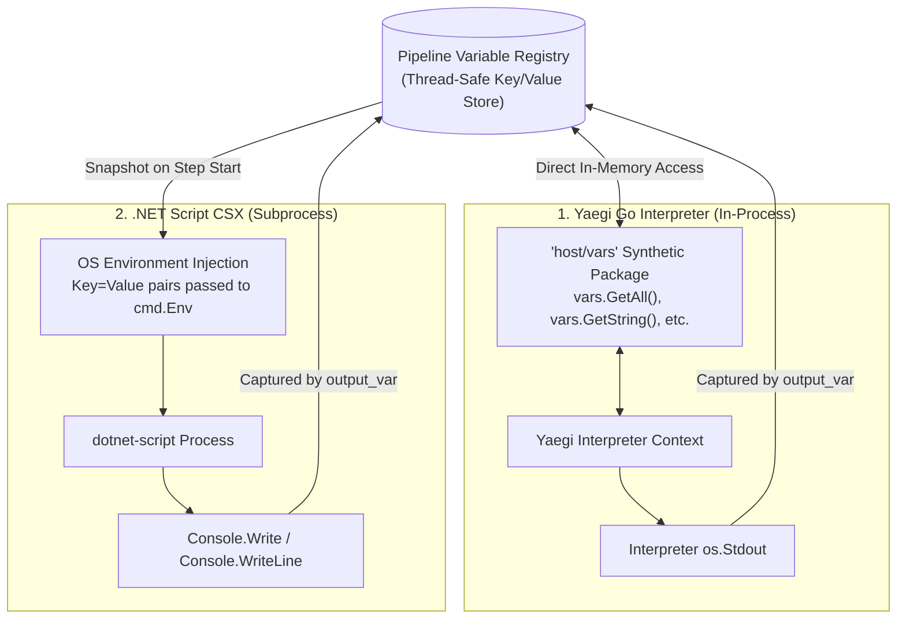
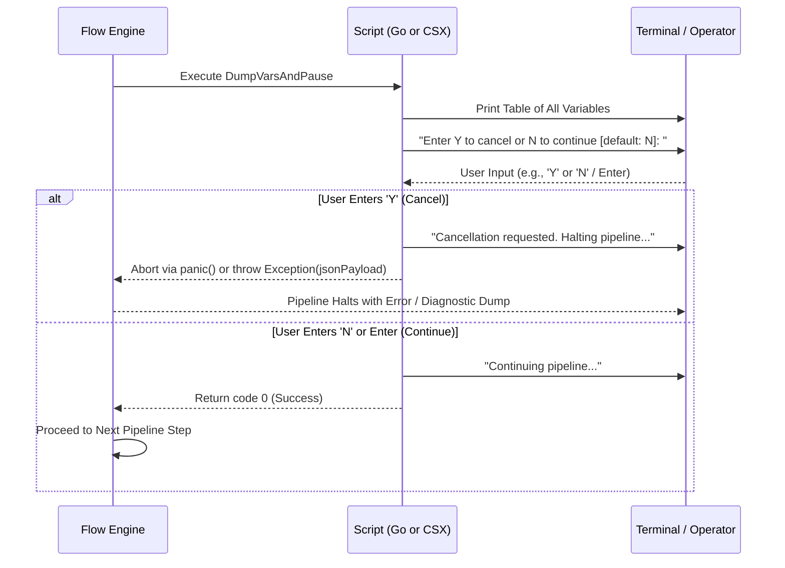
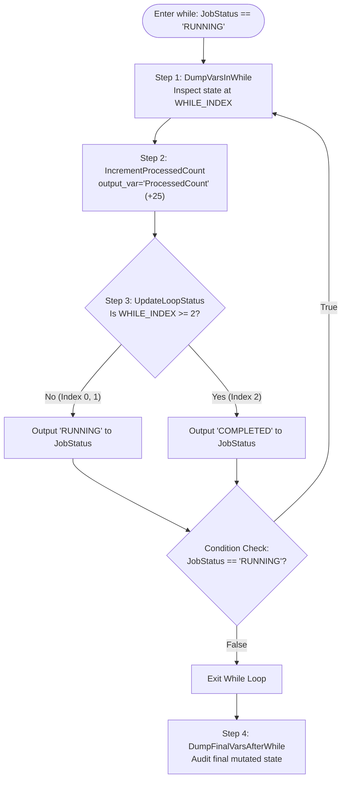
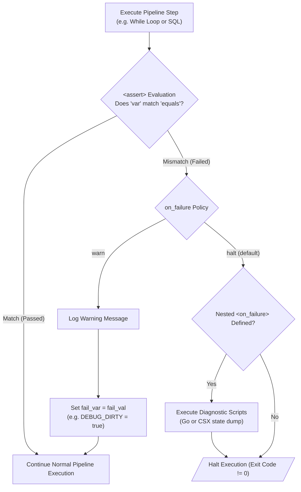

# Comprehensive Pipeline Debugging Guide: Assert, Go & CSX Script Patterns

This guide provides an end-to-end reference for inspecting, debugging, pausing, and validating dynamic ETL workflows in Flow. It details the two primary scripting engines—**Embedded Go (`language="go"`)** and **C# .NET Script (`language="csx"`)**—demonstrating how to observe pipeline state, trace loop mutations, prompt operators interactively, and diagnose execution issues across platforms.

---

## Table of Contents

1. [Architectural Overview & Scripting Engines](#1-architectural-overview--scripting-engines)
2. [Variable Discovery & State Observation](#2-variable-discovery--state-observation)
3. [Pattern 1: Inspect Specific Variables & Early Exit](#3-pattern-1-inspect-specific-variables--early-exit)
4. [Pattern 2: Interactive Breakpoints & Operator Prompts](#4-pattern-2-interactive-breakpoints--operator-prompts)
5. [Pattern 3: Per-Iteration Loop Inspection (`<foreach>`)](#5-pattern-3-per-iteration-loop-inspection-foreach)
6. [Pattern 4: State Mutation & Polling Verification (`<while>`)](#6-pattern-4-state-mutation--polling-verification-while)
7. [Pattern 5: Declarative Assertions & Diagnostic Dumps (`<assert>`)](#7-pattern-5-declarative-assertions--diagnostic-dumps-assert)
8. [Engine Comparison: Go (`host/vars`) vs. CSX (`Environment`)](#8-engine-comparison-go-hostvars-vs-csx-environment)
9. [CLI Diagnostic Flags & Best Practices](#9-cli-diagnostic-flags--best-practices)
10. [Debugging Quick Reference Table](#10-debugging-quick-reference-table)

---

## 1. Architectural Overview & Scripting Engines

Flow provides two distinct script execution models for pipeline logic, debugging, and data transformation:



### The Two Execution Environments

1. **Embedded Go (`language="go"`)**:
   - **Engine**: Traefik Yaegi Go interpreter running in-process.
   - **Performance**: Near-instantaneous ($O(\mu\text{s})$ initialization) with zero process fork overhead.
   - **Variable Interface**: Direct memory binding via the synthetic `"host/vars"` package.
   - **Portability**: Completely self-contained within `flow.exe`; requires no external Go compiler or runtime.

2. **C# .NET Script (`language="csx"`)**:
   - **Engine**: Cross-platform `dotnet-script` CLI executed via external process invocation.
   - **Performance**: High-power runtime with access to full .NET Base Class Libraries (BCL), LINQ, `System.Text.Json`, and NuGet packaging.
   - **Variable Interface**: Flow snapshots all registry variables and injects them as OS environment variables into the child process environment.
   - **Portability**: Runs on any system where the .NET SDK / `dotnet-script` tool is installed.

---

## 2. Variable Discovery & State Observation

When debugging complex pipelines, inspecting the live state of all pipeline variables is essential.

### Go: `vars.GetAll()`

In embedded Go scripts, the synthetic `"host/vars"` package provides `vars.GetAll()`, returning a copy of the current variable map:

```go
import (
    "fmt"
    "os"
    "sort"
    "host/vars"
)

allVars := vars.GetAll()
keys := make([]string, 0, len(allVars))
for k := range allVars {
    keys = append(keys, k)
}
sort.Strings(keys)

for _, name := range keys {
    fmt.Fprintf(os.Stdout, "  %-20s = %v\n", name, allVars[name])
}
```

### CSX: `Environment.GetEnvironmentVariable`

In C# scripts, all pipeline variables are injected into the child process environment. You can query specific variables by name or enumerate known pipeline variables in sorted order:

```csharp
using System;
using System.Collections.Generic;

var pipelineVarNames = new[] {
    "DBPath", "DEPARTMENT", "FormattedRow", "ID", "LAST_OUTPUT", "LOOP_INDEX",
    "MinSalary", "NAME", "SALARY", "department", "id", "log_db_cs", "name", "salary"
};

var keys = new List<string>();
foreach (var name in pipelineVarNames)
{
    if (Environment.GetEnvironmentVariable(name) != null)
    {
        keys.Add(name);
    }
}
keys.Sort(StringComparer.Ordinal);

foreach (var name in keys)
{
    var val = Environment.GetEnvironmentVariable(name);
    Console.WriteLine($"  {name,-20} = {val}");
}
```

---

## 3. Pattern 1: Inspect Specific Variables & Early Exit

### Purpose
When developing or troubleshooting a pipeline, you often need to verify that specific configuration variables (such as connection strings, file paths, or template outputs) were parsed correctly, and optionally halt before downstream destructive actions occur.

### Baseline Implementations
- **Go Reference**: [`../examples/debug_specific_vars_and_exit_pipeline.xml`](../examples/debug_specific_vars_and_exit_pipeline.xml)
- **CSX Reference**: [`../examples/debug_specific_vars_and_exit_csx_pipeline.xml`](../examples/debug_specific_vars_and_exit_csx_pipeline.xml)

### Side-by-Side Implementation

#### Embedded Go (`language="go"`)
```xml
<script id="DumpVarsAndExit" language="go">
    <![CDATA[
        package main

        import (
            "fmt"
            "os"
            "host/vars"
        )

        func main() {
            fmt.Println("========== Pipeline Variables ==========")
            fmt.Printf("  DBPath            = %v\n", vars.GetString("DBPath"))
            fmt.Printf("  MinSalary         = %v\n", vars.GetFloat("MinSalary"))
            fmt.Printf("  log_db_cs         = %v\n", vars.GetString("log_db_cs"))
            fmt.Printf("  FinalFormattedRow = \n%v\n", vars.GetString("FormattedRow"))
            fmt.Println("========================================")
            /* os.Exit(0) */ // Uncomment for unconditional early exit
        }
    ]]>
</script>
```

#### C# Script (`language="csx"`)
```xml
<script id="DumpVarsAndExit" language="csx">
    <![CDATA[
        using System;

        Console.WriteLine("========== Pipeline Variables ==========");
        Console.WriteLine($"  DBPath            = {Environment.GetEnvironmentVariable("DBPath")}");
        Console.WriteLine($"  MinSalary         = {Environment.GetEnvironmentVariable("MinSalary")}");
        Console.WriteLine($"  log_db_cs         = {Environment.GetEnvironmentVariable("log_db_cs")}");
        Console.WriteLine($"  FinalFormattedRow = \n{Environment.GetEnvironmentVariable("FormattedRow")}");
        Console.WriteLine("========================================");
        /* Environment.Exit(0); */ // Uncomment for unconditional early exit
    ]]>
</script>
```

### Sample Output
```text
========== Pipeline Variables ==========
  DBPath       = ./demo_employees.db
  MinSalary    = 100000
  log_db_cs    = sqlserver://db-server.example.com:1433?database=EXAMPLE_DB&integrated+security=true&trustServerCertificate=true&app+name=Flow_Logger
  FinalFormattedRow = 
==================================================
Employee ID: 103
Name:        Carol White
Department:  DevOps
Salary:      $132500.75
==================================================
========================================
```

---

## 4. Pattern 2: Interactive Breakpoints & Operator Prompts

### Purpose
In production troubleshooting or staging verifications, you may wish to inspect all live variables and prompt an operator whether to continue or abort. If aborted, the script halts execution and emits a structured JSON diagnostic payload.

### Baseline Implementations
- **Go Reference**: [`../examples/debug_and_ask_continue_pipeline.xml`](../examples/debug_and_ask_continue_pipeline.xml)
- **CSX Reference**: [`../examples/debug_and_ask_continue_csx_pipeline.xml`](../examples/debug_and_ask_continue_csx_pipeline.xml)

### Architecture



### Side-by-Side Implementation

#### Embedded Go (`language="go"`)
```xml
<script id="DumpVarsAndPause" language="go">
    <![CDATA[
        package main

        import (
            "bufio"
            "encoding/json"
            "fmt"
            "os"
            "sort"
            "strings"
            "host/vars"
        )

        func main() {
            fmt.Fprintln(os.Stdout, "\n========== Pipeline Variables ==========")
            allVars := vars.GetAll()
            keys := make([]string, 0, len(allVars))
            for k := range allVars {
                keys = append(keys, k)
            }
            sort.Strings(keys)
            for _, name := range keys {
                fmt.Fprintf(os.Stdout, "  %-20s = %v\n", name, allVars[name])
            }
            fmt.Fprintln(os.Stdout, "========================================")

            fmt.Fprint(os.Stdout, "\nEnter Y to cancel or N to continue [default: N]: ")
            os.Stdout.Sync()

            reader := bufio.NewReader(os.Stdin)
            rawInput, _ := reader.ReadString('\n')
            choice := strings.TrimSpace(strings.ToUpper(rawInput))

            if choice == "Y" {
                fmt.Fprintln(os.Stdout, "Cancellation requested. Halting pipeline...")
                jsonBytes, _ := json.Marshal(allVars)
                panic(string(jsonBytes))
            }

            fmt.Fprintln(os.Stdout, "Continuing pipeline...")
        }
    ]]>
</script>
```

#### C# Script (`language="csx"`)
```xml
<script id="DumpVarsAndPause" language="csx">
    <![CDATA[
        using System;
        using System.Collections.Generic;
        using System.Text.Json;

        Console.WriteLine("\n========== Pipeline Variables ==========");

        var pipelineVarNames = new[] {
            "DBPath", "DEPARTMENT", "FormattedRow", "ID", "LAST_OUTPUT", "LOOP_INDEX",
            "MinSalary", "NAME", "SALARY", "department", "id", "log_db_cs", "name", "salary"
        };

        var keys = new List<string>();
        foreach (var name in pipelineVarNames)
        {
            if (Environment.GetEnvironmentVariable(name) != null)
            {
                keys.Add(name);
            }
        }
        keys.Sort(StringComparer.Ordinal);

        var allVars = new Dictionary<string, string>();
        foreach (var name in keys)
        {
            string val = Environment.GetEnvironmentVariable(name) ?? "";
            allVars[name] = val;
            Console.WriteLine($"  {name,-20} = {val}");
        }
        Console.WriteLine("========================================");

        Console.Write("\nEnter Y to cancel or N to continue [default: N]: ");
        string rawInput = Console.ReadLine() ?? "";
        string choice = rawInput.Trim().ToUpper();

        if (choice == "Y")
        {
            Console.WriteLine("Cancellation requested. Halting pipeline...");
            string jsonString = JsonSerializer.Serialize(allVars);
            throw new Exception(jsonString);
        }

        Console.WriteLine("Continuing pipeline...");
    ]]>
</script>
```

---

## 5. Pattern 3: Per-Iteration Loop Inspection (`<foreach>`)

### Purpose
In cursor-driven database loops (`<foreach>`), data bugs often occur on specific rows (e.g., unexpected nulls, boundary values, or character encoding mismatches). Placing an inspection script inside the loop captures variable state on every single pass.

### Baseline Implementations
- **Go Reference**: [`../examples/debug_and_exit_pipeline.xml`](../examples/debug_and_exit_pipeline.xml)
- **CSX Reference**: [`../examples/debug_and_exit_csx_pipeline.xml`](../examples/debug_and_exit_csx_pipeline.xml)

### Side-by-Side Implementation

#### Embedded Go (`language="go"`)
```xml
<foreach id="SelectEmployees" db="sample_db">
    <![CDATA[
        SELECT id, name, department, salary
        FROM employees
        WHERE salary >= {{MinSalary}}
        ORDER BY id;
    ]]>
    <template id="FormatEmployeeRow" output_var="FormattedRow">
        Employee ID: {{.id}} | Name: {{.name}} | Salary: ${{.salary}}
    </template>
    
    <!-- In-loop debugging script -->
    <script id="DumpVarsPerLoop" language="go">
        <![CDATA[
            package main

            import (
                "fmt"
                "os"
                "sort"
                "host/vars"
            )

            func main() {
                loopIdx := vars.GetInt("LOOP_INDEX")
                header := fmt.Sprintf("\n========== Variables at LOOP_INDEX %d ==========", loopIdx)
                fmt.Fprintln(os.Stdout, header)

                allVars := vars.GetAll()
                keys := make([]string, 0, len(allVars))
                for k := range allVars {
                    keys = append(keys, k)
                }
                sort.Strings(keys)
                for _, name := range keys {
                    fmt.Fprintf(os.Stdout, "  %-20s = %v\n", name, allVars[name])
                }
                fmt.Fprintln(os.Stdout, "=================================================")
            }
        ]]>
    </script>
</foreach>
```

#### C# Script (`language="csx"`)
```xml
<foreach id="SelectEmployees" db="sample_db">
    <![CDATA[
        SELECT id, name, department, salary
        FROM employees
        WHERE salary >= {{MinSalary}}
        ORDER BY id;
    ]]>
    <template id="FormatEmployeeRow" output_var="FormattedRow">
        Employee ID: {{.id}} | Name: {{.name}} | Salary: ${{.salary}}
    </template>
    
    <!-- In-loop debugging script -->
    <script id="DumpVarsPerLoop" language="csx">
        <![CDATA[
            using System;
            using System.Collections.Generic;

            int loopIdx = int.TryParse(Environment.GetEnvironmentVariable("LOOP_INDEX"), out var li) ? li : 0;
            Console.WriteLine($"\n========== Variables at LOOP_INDEX {loopIdx} ==========");

            var pipelineVarNames = new[] {
                "DBPath", "DEPARTMENT", "FormattedRow", "ID", "LAST_OUTPUT", "LOOP_INDEX",
                "MinSalary", "NAME", "SALARY", "department", "id", "log_db_cs", "name", "salary"
            };

            var keys = new List<string>();
            foreach (var name in pipelineVarNames)
            {
                if (Environment.GetEnvironmentVariable(name) != null) keys.Add(name);
            }
            keys.Sort(StringComparer.Ordinal);

            foreach (var name in keys)
            {
                var val = Environment.GetEnvironmentVariable(name);
                Console.WriteLine($"  {name,-20} = {val}");
            }
            Console.WriteLine("=================================================");
        ]]>
    </script>
</foreach>
```

---

## 6. Pattern 4: State Mutation & Polling Verification (`<while>`)

### Purpose
`<while>` loops are commonly used for polling asynchronous jobs or processing paginated batches. Debugging while loops requires:
1. Observing variables at each `WHILE_INDEX` iteration pass.
2. Verifying accumulator logic (e.g. `ProcessedCount = ProcessedCount + 25`).
3. Ensuring termination conditions correctly evaluate and break the loop.

### Baseline Implementations
- **Go Reference**: [`../examples/debug_while_loop_pipeline.xml`](../examples/debug_while_loop_pipeline.xml)
- **CSX Reference**: [`../examples/debug_while_loop_csx_pipeline.xml`](../examples/debug_while_loop_csx_pipeline.xml)

### While Loop Workflow



### Side-by-Side Implementation

#### Step 1: Dump Variables at Current `WHILE_INDEX`

```xml
<!-- Go Version -->
<script id="DumpVarsInWhile" language="go">
    <![CDATA[
        package main
        import ("fmt"; "os"; "sort"; "host/vars")

        func main() {
            idx := vars.GetInt("WHILE_INDEX")
            fmt.Fprintf(os.Stdout, "\n========== Variables at WHILE_INDEX %d ==========\n", idx)
            allVars := vars.GetAll()
            // ... Sort & Print Keys ...
        }
    ]]>
</script>

<!-- CSX Version -->
<script id="DumpVarsInWhile" language="csx">
    <![CDATA[
        using System;
        using System.Collections.Generic;

        int idx = int.TryParse(Environment.GetEnvironmentVariable("WHILE_INDEX"), out var i) ? i : 0;
        Console.WriteLine($"\n========== Variables at WHILE_INDEX {idx} ==========");
        // ... Sort & Print Keys ...
    ]]>
</script>
```

#### Step 2: Simulate Processing & Mutate Accumulator via `output_var`

Flow captures anything written to standard output (`stdout`) and updates the variable specified by `output_var`:

```xml
<!-- Go Version -->
<script id="IncrementProcessedCount" language="go" output_var="ProcessedCount">
    <![CDATA[
        package main
        import ("fmt"; "host/vars")

        func main() {
            count := vars.GetInt("ProcessedCount") + 25
            fmt.Print(count) // Captured directly by ProcessedCount
        }
    ]]>
</script>

<!-- CSX Version -->
<script id="IncrementProcessedCount" language="csx" output_var="ProcessedCount">
    <![CDATA[
        using System;

        int count = int.TryParse(Environment.GetEnvironmentVariable("ProcessedCount"), out var c) ? c : 0;
        count += 25;
        Console.Write(count); // Captured directly by ProcessedCount
    ]]>
</script>
```

#### Step 3: Update Loop Termination Condition via `output_var`

```xml
<!-- Go Version -->
<script id="UpdateLoopStatus" language="go" output_var="JobStatus">
    <![CDATA[
        package main
        import ("fmt"; "host/vars")

        func main() {
            idx := vars.GetInt("WHILE_INDEX")
            if idx >= 2 {
                fmt.Print("COMPLETED")
            } else {
                fmt.Print("RUNNING")
            }
        }
    ]]>
</script>

<!-- CSX Version -->
<script id="UpdateLoopStatus" language="csx" output_var="JobStatus">
    <![CDATA[
        using System;

        int idx = int.TryParse(Environment.GetEnvironmentVariable("WHILE_INDEX"), out var i) ? i : 0;
        if (idx >= 2) {
            Console.Write("COMPLETED");
        } else {
            Console.Write("RUNNING");
        }
    ]]>
</script>
```

#### Step 4: Final State Audit After While Loop

```xml
<!-- Go Version -->
<script id="DumpFinalVarsAfterWhile" language="go">
    <![CDATA[
        package main
        import ("fmt"; "os"; "sort"; "host/vars")

        func main() {
            fmt.Fprintln(os.Stdout, "\n========== Final Pipeline Variables After While Loop ==========")
            // ... Print all final variables ...
        }
    ]]>
</script>

<!-- CSX Version -->
<script id="DumpFinalVarsAfterWhile" language="csx">
    <![CDATA[
        using System;
        using System.Collections.Generic;

        Console.WriteLine("\n========== Final Pipeline Variables After While Loop ==========");
        // ... Print all final variables ...
    ]]>
</script>
```

---

## 7. Pattern 5: Declarative Assertions & Diagnostic Dumps (`<assert>`)

### Purpose
While embedded scripts offer maximum flexibility, Flow's native `<assert>` tag provides a zero-code declarative mechanism for fail-fast debugging. By asserting expected state invariants between steps, you prevent silent data corruption, catch logic regressions immediately, and trigger automated diagnostic dumps when unexpected values arise.

### Architecture



### Key `<assert>` Attributes for Debugging

| Attribute | Options / Default | Description |
| :--- | :--- | :--- |
| `var` | *(required)* | Name of the pipeline registry variable to evaluate. |
| `equals` / `value` | *(required)* | Expected value (case-insensitive string comparison). |
| `message` | `""` | Informative error or diagnostic message logged upon failure. |
| `on_failure` | `halt` (default) \| `warn` | `halt` stops the pipeline immediately; `warn` logs the failure and continues. |
| `fail_var` | `""` | Optional variable name to set upon failure (e.g., `DEBUG_ALERT`). |
| `fail_val` | `"true"` | Value assigned to `fail_var` when assertion fails. |
| `<on_failure>` | *(child block)* | Container of child nodes (`<script>`, `<sql>`, etc.) executed exclusively if the assertion fails. |

---

### Example 1: Post-Loop Invariant Validation (Fail-Fast)

Verify that the while loop terminated because `JobStatus` reached `"COMPLETED"` and that the expected batch count (`ProcessedCount == "75"`) was reached:

```xml
<flow>
    <!-- While Loop Execution -->
    <while id="MonitorWhileLoop" var="JobStatus" equals="RUNNING" max_iterations="5">
        <!-- ... child steps mutating ProcessedCount and JobStatus ... -->
    </while>

    <!-- Fail-fast assertion: Ensure JobStatus is COMPLETED -->
    <assert id="VerifyJobCompleted" 
            var="JobStatus" 
            equals="COMPLETED" 
            message="State Error: Expected JobStatus to be COMPLETED after while loop!" 
            on_failure="halt" />

    <!-- Fail-fast assertion: Verify exact processed record volume -->
    <assert id="VerifyProcessedVolume" 
            var="ProcessedCount" 
            equals="75" 
            message="Volume Mismatch: Expected ProcessedCount to reach exactly 75!" 
            on_failure="halt" />
</flow>
```

---

### Example 2: Automated Diagnostic Dumps via `<on_failure>`

When an assertion fails, standard execution halts. By nesting an embedded Go or CSX `<script>` inside `<on_failure>`, you can automatically dump all live variables to `stderr` or generate a structured JSON post-mortem diagnostic report before the process exits.

#### Embedded Go (`language="go"`) inside `<on_failure>`
```xml
<assert id="ValidateBatchThreshold" 
        var="ProcessedCount" 
        equals="75" 
        on_failure="halt" 
        message="Critical Assertion Failed: ProcessedCount did not reach expected threshold!">
    <on_failure>
        <!-- Automated diagnostic post-mortem dump -->
        <script id="PostMortemDiagnosticGo" language="go">
            <![CDATA[
                package main

                import (
                    "encoding/json"
                    "fmt"
                    "os"
                    "sort"
                    "host/vars"
                )

                func main() {
                    fmt.Fprintln(os.Stderr, "\n========================================================")
                    fmt.Fprintln(os.Stderr, " [POST-MORTEM DIAGNOSTIC DUMP: ASSERTION FAILURE]")
                    fmt.Fprintln(os.Stderr, "========================================================")

                    allVars := vars.GetAll()
                    keys := make([]string, 0, len(allVars))
                    for k := range allVars {
                        keys = append(keys, k)
                    }
                    sort.Strings(keys)

                    for _, name := range keys {
                        fmt.Fprintf(os.Stderr, "  %-22s = %v\n", name, allVars[name])
                    }

                    // Serialize failure context to JSON for log ingestion
                    jsonPayload, _ := json.MarshalIndent(allVars, "", "  ")
                    fmt.Fprintf(os.Stderr, "\nSerialized State:\n%s\n", string(jsonPayload))
                    fmt.Fprintln(os.Stderr, "========================================================")
                }
            ]]>
        </script>
    </on_failure>
</assert>
```

#### C# Script (`language="csx"`) inside `<on_failure>`
```xml
<assert id="ValidateBatchThreshold" 
        var="ProcessedCount" 
        equals="75" 
        on_failure="halt" 
        message="Critical Assertion Failed: ProcessedCount did not reach expected threshold!">
    <on_failure>
        <!-- Automated diagnostic post-mortem dump -->
        <script id="PostMortemDiagnosticCSX" language="csx">
            <![CDATA[
                using System;
                using System.Collections.Generic;
                using System.Text.Json;

                Console.Error.WriteLine("\n========================================================");
                Console.Error.WriteLine(" [POST-MORTEM DIAGNOSTIC DUMP: ASSERTION FAILURE]");
                Console.Error.WriteLine("========================================================");

                var knownKeys = new[] {
                    "DBPath", "JobStatus", "LAST_OUTPUT", "MinSalary",
                    "ProcessedCount", "TargetBatch", "Threshold", "WHILE_INDEX"
                };

                var report = new Dictionary<string, object> {
                    ["TimestampUtc"] = DateTime.UtcNow.ToString("o"),
                    ["FailureReason"] = "ProcessedCount did not match expected threshold of 75"
                };

                var varSnapshot = new Dictionary<string, string>();
                foreach (var key in knownKeys)
                {
                    string val = Environment.GetEnvironmentVariable(key) ?? "(null)";
                    varSnapshot[key] = val;
                    Console.Error.WriteLine($"  {key,-22} = {val}");
                }
                report["Variables"] = varSnapshot;

                string json = JsonSerializer.Serialize(report, new JsonSerializerOptions { WriteIndented = true });
                Console.Error.WriteLine("\nStructured Diagnostic JSON:\n" + json);
                Console.Error.WriteLine("========================================================");
            ]]>
        </script>
    </on_failure>
</assert>
```

---

### Example 3: Non-Halting Soft Assertions with Warning Flags (`on_failure="warn"`)

In staging or non-critical diagnostic workflows, you can flag state anomalies without breaking execution. A downstream script checks the flag to decide whether to trigger deeper diagnostics:

```xml
<!-- Log warning and set DEBUG_ANOMALY=true if salary threshold was altered -->
<assert id="CheckExpectedSalaryFilter" 
        var="MinSalary" 
        equals="100000.00" 
        on_failure="warn" 
        message="Warning: MinSalary was overridden from default baseline!" 
        fail_var="DEBUG_ANOMALY" 
        fail_val="true" />

<!-- Downstream diagnostic step checks flag -->
<script id="ConditionalDiagnostics" language="csx">
    <![CDATA[
        using System;

        string isAnomaly = Environment.GetEnvironmentVariable("DEBUG_ANOMALY");
        if (isAnomaly == "true")
        {
            Console.WriteLine("[DEBUG NOTICE] Pipeline running under non-standard configuration!");
        }
    ]]>
</script>
```

---

## 8. Engine Comparison: Go (`host/vars`) vs. CSX (`Environment`)

| Feature / Behavior | Embedded Go (`language="go"`) | C# .NET Script (`language="csx"`) |
| :--- | :--- | :--- |
| **Execution Architecture** | In-process Yaegi interpreter | Subprocess (`dotnet-script`) |
| **Startup Overhead** | Negligible ($\sim 1\text{ ms}$) | Process startup ($\sim 800 - 1000\text{ ms}$) |
| **External Dependencies** | None (embedded in `flow.exe`) | .NET SDK + `dotnet-script` tool |
| **Read Pipeline Variable** | `vars.GetString("Key")`<br/>`vars.GetInt("Key")`<br/>`vars.GetFloat("Key")`<br/>`vars.GetBool("Key")` | `Environment.GetEnvironmentVariable("Key")` |
| **Enumerate All Variables** | `allVars := vars.GetAll()` | Query environment or iterate known pipeline variable list |
| **Mutate Variable** | Print to stdout + `output_var="VarName"` | `Console.Write(...)` + `output_var="VarName"` |
| **Interactive Console Read** | `bufio.NewReader(os.Stdin).ReadString('\n')` | `Console.ReadLine()` |
| **Halt with Error** | `panic("reason")` or `os.Exit(1)` | `throw new Exception("reason")` or `Environment.Exit(1)` |
| **Declarative Assertion** | `<assert var="K" equals="V" />` | `<assert var="K" equals="V" />` |
| **Assertion Failure Hook** | `<on_failure>` with `<script language="go">` | `<on_failure>` with `<script language="csx">` |
| **Clean Normal Exit** | Normal function return | Normal script completion |
| **Rich Library Access** | Standard Go packages (fmt, strings, time, etc.) | Full .NET BCL, LINQ, `System.Text.Json`, NuGet |

---

## 9. CLI Diagnostic Flags & Best Practices

Flow provides command-line flags to assist with pipeline debugging without altering pipeline XML:

### 1. Schema & Structure Validation (`-validate`)
Validates that the XML conforms to the Flow XSD schema and that all required attributes are present without executing any queries or scripts:
```bash
./flow -file examples/debug_while_loop_csx_pipeline.xml -validate
```

### 2. Preflight Only (`-preflight`)
Executes only `<preflight>` assertions (e.g. database connectivity, directory existence) and exits:
```bash
./flow -file my_pipeline.xml -preflight
```

### 3. Verbose Execution Logging (`-debug`)
Enables internal engine debug logging, showing SQL query preparation, timing, and variable substitutions:
```bash
./flow -file examples/debug_and_exit_csx_pipeline.xml -debug
```

### 4. Overriding Variables at Runtime (`-vars`)
Inject test parameters or override thresholds dynamically without editing the file:
```bash
./flow -file examples/debug_and_ask_continue_csx_pipeline.xml -vars "MinSalary=120000.00"
```

### 5. Structured Output Inspection (`-format`)
Format step results as JSON, Pretty JSON, or Markdown for log aggregators or documentation:
```bash
./flow -file examples/debug_specific_vars_and_exit_csx_pipeline.xml -format jsonpretty
```

---

## 10. Debugging Quick Reference Table

| Objective | Go (`language="go"`) Snippet | CSX (`language="csx"`) Snippet |
| :--- | :--- | :--- |
| **Print single variable** | `fmt.Println(vars.GetString("VarName"))` | `Console.WriteLine(Environment.GetEnvironmentVariable("VarName"));` |
| **Parse integer variable** | `val := vars.GetInt("LOOP_INDEX")` | `int val = int.Parse(Environment.GetEnvironmentVariable("LOOP_INDEX") ?? "0");` |
| **Format multiline output** | `fmt.Fprintf(os.Stdout, "Val: %s\n", val)` | `Console.WriteLine($"Val: {val}");` |
| **Store script result** | `fmt.Print(result)` with `output_var="Target"` | `Console.Write(result);` with `output_var="Target"` |
| **Prompt user** | `reader.ReadString('\n')` | `string input = Console.ReadLine();` |
| **Trigger failure halt** | `panic("Validation failed")` | `throw new Exception("Validation failed");` |
| **Dump JSON payload** | `bytes, _ := json.Marshal(allVars); panic(string(bytes))` | `string json = JsonSerializer.Serialize(vars); throw new Exception(json);` |
| **Assert and fail-fast** | `<assert var="Status" equals="COMPLETED" on_failure="halt" />` | *(Declarative XML tag; language-agnostic)* |
| **Assert with warning flag** | `<assert var="Env" equals="prod" on_failure="warn" fail_var="DIRTY" />` | *(Declarative XML tag; language-agnostic)* |
| **Post-mortem state dump** | `<on_failure>` wrapping Go diagnostic dump | `<on_failure>` wrapping CSX `System.Text.Json` dump |

