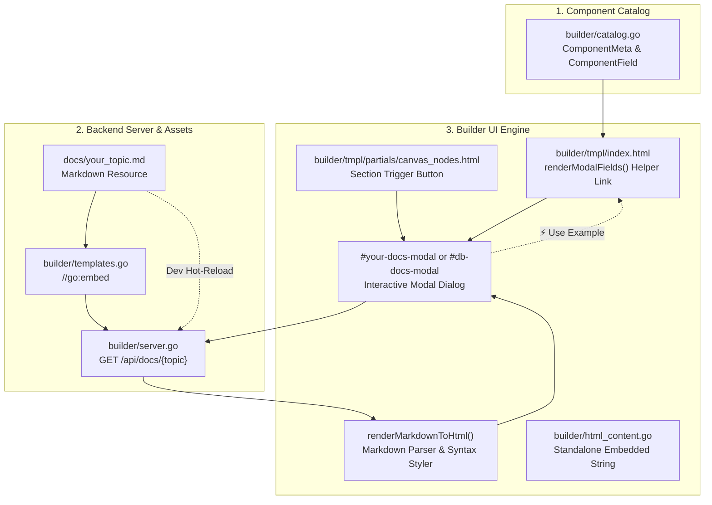

# Developer Guide: Adding Modal Tooltips & Documentation Popups to Builder Nodes

This guide explains how to add **modal tooltips**, **interactive documentation popups**, and **context-aware help links** to nodes and form fields in the Flow Pipeline Builder.

It covers both lightweight HTML tooltips and full interactive modal dialogs (similar to the [Database Connection Strings Guide](database_connection_strings.md)), detailing the complete end-to-end architecture across catalog metadata, backend API endpoints, embedded files, frontend templates, markdown rendering, and automated testing.

---

## 1. Architectural Overview

Flow Builder supports three tiers of node and attribute assistance:

| Tier | Component Type | Interaction | Purpose |
| :--- | :--- | :--- | :--- |
| **Tier 1: Inline Attribute Tooltips** | Native `title` & helper text | Mouse hover / subtitle | Brief attribute explanation (1–2 sentences), parameter defaults, variable substitution notes. |
| **Tier 2: Field-Level Modal Links** | Interactive link / button | Click | Contextual popup trigger next to a specific field label (e.g., `📖 Connection String Guide` or `Driver Reference ↗`). |
| **Tier 3: Section / Node-Level Popups** | Header action button | Click | Full documentation modal with real-time search, quick-jump pills, syntax examples, and one-click form insertion (`⚡ Use Example`). |

### Component Flow Diagram



---

## 2. Step-by-Step Implementation Guide

Follow these 7 steps to add a documentation modal or tooltip to any node (e.g., `<http>`, `<sql>`, `<template>`, `<assert>`, `<file>`, `<json_path>`, `<xml_path>`).

### Step 1: Define Field Tooltips in `builder/catalog.go`

In [`builder/catalog.go`](file:///c:/Users/U00001/source/repos/etl-madness/go-flow/builder/catalog.go), every node is represented by a `ComponentMeta` struct, and every attribute is a `ComponentField`.

1. Open [`builder/catalog.go`](file:///c:/Users/U00001/source/repos/etl-madness/go-flow/builder/catalog.go).
2. Locate your component (e.g. `http`, `sql`, `template`, `assert`).
3. Set the `Description` attribute on each field. This string is automatically rendered as helper text under the input field and used in hover tooltips:

```go
{
    Type:        "http_client",
    Tag:         "http_client",
    Name:        "HTTP / REST Client",
    Category:    "Integration & Web",
    Description: "Executes HTTP GET/POST/PUT/DELETE requests with headers and payload handling.",
    Section:     "flow",
    HasContent:  true,
    ContentHelp: "Request body content (for POST/PUT). Supports JSON and variable interpolation.",
    Fields: []ComponentField{
        {Name: "id", Label: "Step ID", Type: "text", Mandatory: true, Description: "Unique step ID for logging and orchestration"},
        {Name: "url", Label: "Endpoint URL", Type: "text", Mandatory: true, Description: "Target endpoint URL (supports {{Variables}} & query params)"},
        {Name: "method", Label: "HTTP Method", Type: "select", Mandatory: true, Default: "GET", Options: []string{"GET", "POST", "PUT", "DELETE", "PATCH", "HEAD", "OPTIONS"}, Description: "HTTP request verb"},
        {Name: "headers", Label: "Request Headers", Type: "text", Mandatory: false, Description: `Custom headers: {"Authorization":"Bearer {{Token}}"} or K1:V1,K2:V2`},
        {Name: "content_type", Label: "Content-Type", Type: "text", Mandatory: false, Description: "Shortcut for Content-Type header (e.g. application/json, text/xml)"},
        {Name: "into", Label: "Response Variable", Type: "text", Mandatory: false, Description: "Variable name receiving the response body (alias output_var)"},
        {Name: "status_into", Label: "Status Code Variable", Type: "text", Mandatory: false, Description: "Variable name receiving HTTP status code (e.g. 200, 404)"},
        {Name: "timeout", Label: "Timeout Duration", Type: "text", Mandatory: false, Description: "Total request timeout duration (e.g. 10s, 30s, 2m)"},
        {Name: "proxy", Label: "HTTP Proxy URL", Type: "text", Mandatory: false, Description: "Proxy URL (e.g. http://proxy.internal:8080)"},
        {Name: "tls_insecure_skip_verify", Label: "Skip TLS Verify", Type: "select", Mandatory: false, Default: "false", Options: []string{"false", "true"}, Description: "Disable SSL/TLS certificate validation checks"},
        {Name: "follow_redirects", Label: "Follow Redirects", Type: "select", Mandatory: false, Default: "true", Options: []string{"true", "false"}, Description: "Follow HTTP 3xx redirect responses automatically"},
        {Name: "description", Label: "Description", Type: "text", Mandatory: false, Description: "Step explanation displayed in logs and flowcharts"},
    },
    DefaultXML: `<http_client id="FetchRemoteData" url="https://api.example.com/data" method="GET" into="ApiResponse" />`,
}
```

---

### Step 2: Prepare the Markdown Documentation Resource

1. Place or edit your canonical markdown file under `docs/` (for example, [`docs/http_client.md`](file:///c:/Users/U00001/source/repos/etl-madness/go-flow/docs/http_client.md) or [`docs/templates.md`](file:///c:/Users/U00001/source/repos/etl-madness/go-flow/docs/templates.md)).
2. Make a copy under `builder/tmpl/` for standalone compilation:
   ```powershell
   Copy-Item docs/http_client.md builder/tmpl/docs_http_client.md
   ```
3. Update the `//go:embed` directive in [`builder/templates.go`](file:///c:/Users/U00001/source/repos/etl-madness/go-flow/builder/templates.go) to include the new file:

```go
// In builder/templates.go:
//go:embed tmpl/*.html tmpl/partials/*.html tmpl/docs_connection_strings.md tmpl/docs_http_client.md
var templateFS embed.FS
```

---

### Step 3: Add the Backend HTTP Endpoint in `builder/server.go`

In [`builder/server.go`](file:///c:/Users/U00001/source/repos/etl-madness/go-flow/builder/server.go), implement an API handler that returns the documentation JSON. Always use the **dual-source strategy** (check disk first for live development changes, fall back to embedded filesystem for standalone binaries):

```go
// handleHttpClientDoc serves the HTTP Client documentation markdown.
func (s *Server) handleHttpClientDoc(w http.ResponseWriter, r *http.Request) {
    if r.Method != http.MethodGet {
        http.Error(w, "Method Not Allowed", http.StatusMethodNotAllowed)
        return
    }

    docFilename := "http_client.md"
    diskCandidates := []string{
        filepath.Join("docs", docFilename),
        filepath.Join("..", "docs", docFilename),
        filepath.Join("builder", "tmpl", "docs_http_client.md"),
    }

    var content []byte
    var usedPath string

    for _, p := range diskCandidates {
        if b, err := os.ReadFile(p); err == nil && len(b) > 0 {
            content = b
            usedPath = p
            break
        }
    }

    // Fall back to embedded filesystem for standalone binary
    if len(content) == 0 {
        if b, err := templateFS.ReadFile("tmpl/docs_http_client.md"); err == nil && len(b) > 0 {
            content = b
            usedPath = "embedded:tmpl/docs_http_client.md"
        }
    }

    if len(content) == 0 {
        http.Error(w, "HTTP Client documentation not found", http.StatusNotFound)
        return
    }

    w.Header().Set("Content-Type", "application/json; charset=utf-8")
    json.NewEncoder(w).Encode(map[string]string{
        "filename": docFilename,
        "path":     usedPath,
        "content":  string(content),
    })
}
```

Register the endpoint in `registerRoutes` under the authentication middleware:

```go
// In builder/server.go under authenticated router:
s.mux.Handle("/api/docs/http-client", s.requireAuth(http.HandlerFunc(s.handleHttpClientDoc)))
```

---

### Step 4: Wire Trigger Links & Dynamic Header Guide in `builder/tmpl/index.html`

When a user adds or edits a node, [`renderModalFields`](file:///c:/Users/U00001/source/repos/etl-madness/go-flow/builder/tmpl/index.html) and modal openers dynamically construct the form inputs and configure header buttons.

#### 4.1 Modal Header Guide Button (`#node-modal-guide-btn`)

In `#node-modal` header, add a dynamic guide button that adapts based on the active node type:

```html
<button type="button" id="node-modal-guide-btn" class="hidden text-xs px-2.5 py-1 bg-slate-800 hover:bg-slate-700 text-cyan-400 hover:text-cyan-300 border border-slate-700/80 rounded transition cursor-pointer flex items-center space-x-1 font-medium">
    <span>📖 Guide</span>
</button>
```

Wire `updateNodeModalGuideButton(nodeType)` into `openAddNodeModal(type, ...)` and `openEditNode(id, type, ...)`:

```javascript
function updateNodeModalGuideButton(nodeType) {
    const guideBtn = document.getElementById('node-modal-guide-btn');
    if (!guideBtn) return;
    if (nodeType === 'http_client') {
        guideBtn.innerHTML = '<span>📖 HTTP Guide</span>';
        guideBtn.setAttribute('onclick', 'openHttpDocsModal()');
        guideBtn.setAttribute('title', 'Open HTTP Client Guide (docs/http_client.md)');
        guideBtn.classList.remove('hidden');
    } else if (nodeType === 'database') {
        guideBtn.innerHTML = '<span>📖 DB Guide</span>';
        guideBtn.setAttribute('onclick', 'openDbDocsModal()');
        guideBtn.setAttribute('title', 'Open Database Connection Strings Guide');
        guideBtn.classList.remove('hidden');
    } else {
        guideBtn.classList.add('hidden');
    }
}
```

#### 4.2 Inline Field-Level Triggers in `renderModalFields()`

To add contextual helper links directly to specific form fields (such as `url` and `headers` for `http_client`):

```javascript
// Field-specific helper link next to the label
let labelExtra = '';
if (f.name === 'connection_string') {
    labelExtra = '<button type="button" onclick="openDbDocsModal(getModalCurrentDriver())" class="text-[11px] text-cyan-400 hover:text-cyan-300 font-medium underline underline-offset-2 cursor-pointer flex items-center space-x-1" title="View documentation and examples"><span>📖 Connection String Guide</span></button>';
} else if (f.name === 'url' && (meta.type === 'http_client' || meta.tag === 'http_client')) {
    labelExtra = '<button type="button" onclick="openHttpDocsModal()" class="text-[11px] text-cyan-400 hover:text-cyan-300 font-medium underline underline-offset-2 cursor-pointer flex items-center space-x-1" title="View HTTP Client documentation, headers, and request examples from docs/http_client.md"><span>📖 HTTP Client Guide</span></button>';
} else if (f.name === 'headers' && (meta.type === 'http_client' || meta.tag === 'http_client')) {
    labelExtra = '<button type="button" onclick="openHttpDocsModal(\'headers\')" class="text-[11px] text-cyan-400 hover:text-cyan-300 font-medium underline underline-offset-2 cursor-pointer flex items-center space-x-1" title="Jump to Headers documentation"><span>📖 Headers Ref</span></button>';
}

// Assemble the label header
div.innerHTML = '<div class="flex justify-between items-center">' +
    '<label class="text-xs font-medium text-slate-300">' + f.label + (f.mandatory ? ' <span class="text-red-400">*</span>' : '') + '</label>' +
    '<div class="flex items-center space-x-2">' + labelExtra + '<span class="text-[10px] text-slate-500">' + (f.description || '') + '</span></div>' +
'</div>' + inputHtml;
```

And optionally add inline helper footers below inputs:

```javascript
} else if (f.name === 'url' && (meta.type === 'http_client' || meta.tag === 'http_client')) {
    inputHtml = '<div class="space-y-1">' +
        '<input type="text" id="attr_' + f.name + '" name="attr_' + f.name + '" value="' + (val || '').replace(/"/g, '&quot;') + '" placeholder="https://api.example.com/v1/resource" class="w-full bg-slate-950 border border-slate-700 rounded p-1.5 text-xs text-cyan-300 font-mono focus:outline-none focus:border-blue-500">' +
        '<div class="flex justify-between items-center text-[10px] text-slate-500">' +
            '<span>Supports &#123;&#123;Variables&#125;&#125; and query parameters</span>' +
            '<a href="javascript:void(0)" onclick="openHttpDocsModal()" class="text-cyan-400 hover:text-cyan-300 hover:underline cursor-pointer">HTTP Reference &amp; Headers ↗</a>' +
        '</div>' +
    '</div>';
}
```

---

### Step 5: Add Guide Buttons to Canvas & Node Cards

1. **Canvas Section Headers** ([`builder/tmpl/partials/canvas_nodes.html`](file:///c:/Users/U00001/source/repos/etl-madness/go-flow/builder/tmpl/partials/canvas_nodes.html)):
   ```html
   <div class="flex items-center space-x-1.5">
       <button type="button" onclick="openDbDocsModal()" class="px-2 py-0.5 text-[11px] font-medium bg-slate-800 hover:bg-slate-700 text-cyan-400 hover:text-cyan-300 border border-slate-700 rounded transition flex items-center space-x-1 cursor-pointer" title="View documentation and connection string examples for all supported databases">
           <span>📖 Connection Guide</span>
       </button>
       <button type="button" onclick="openAddNodeModal('database', 'Database Connection', 'databases')" class="px-2 py-0.5 text-[11px] font-medium bg-blue-600 hover:bg-blue-500 text-white rounded transition flex items-center space-x-1 cursor-pointer">
           <span>＋ Add Database</span>
       </button>
   </div>
   ```

2. **Canvas Node Cards** ([`builder/tmpl/partials/node_card.html`](file:///c:/Users/U00001/source/repos/etl-madness/go-flow/builder/tmpl/partials/node_card.html)):
   In leaf node headers, expose a direct documentation shortcut button:
   ```html
   {{if eq .NodeType "http_client"}}
   <button type="button" onclick="openHttpDocsModal()" class="p-1 hover:bg-slate-700 rounded text-cyan-400 hover:text-cyan-300 transition text-[11px]" title="Open HTTP Client Guide (docs/http_client.md)">📖</button>
   {{else if eq .NodeType "database"}}
   <button type="button" onclick="openDbDocsModal()" class="p-1 hover:bg-slate-700 rounded text-cyan-400 hover:text-cyan-300 transition text-[11px]" title="Open Connection String Guide">📖</button>
   {{end}}
   ```

---

### Step 6: Create the Popup Modal & Client-Side Logic

#### Modal HTML Container Pattern

Add the modal structure right before `<!-- EVENT DETAIL MODAL -->` in [`builder/tmpl/index.html`](file:///c:/Users/U00001/source/repos/etl-madness/go-flow/builder/tmpl/index.html):

```html
<!-- HTTP CLIENT DOCS MODAL -->
<div id="http-docs-modal" class="hidden fixed inset-0 bg-black/80 backdrop-blur-sm flex items-center justify-center p-4 z-[75]" onclick="if(event.target===this)closeHttpDocsModal()">
    <div class="bg-slate-900 border border-slate-800 rounded-xl max-w-5xl w-full p-6 shadow-2xl flex flex-col space-y-4 max-h-[92vh]">
        <!-- Header -->
        <div class="flex items-center justify-between border-b border-slate-800 pb-3">
            <div class="flex items-center space-x-3">
                <span class="text-2xl">🌐</span>
                <div>
                    <h3 class="text-base font-bold text-white flex items-center space-x-2">
                        <span>HTTP Client &amp; API Guide</span>
                        <span class="text-[10px] font-mono px-2 py-0.5 rounded bg-slate-800 text-slate-400 border border-slate-700">docs/http_client.md</span>
                    </h3>
                    <p class="text-xs text-slate-400">REST methods, authentication headers, query parameters, and payload examples</p>
                </div>
            </div>
            <div class="flex items-center space-x-2">
                <button type="button" onclick="copyHttpDocsRaw()" id="btn-copy-raw-http-docs" class="text-xs px-2.5 py-1 bg-slate-800 hover:bg-slate-700 text-slate-300 rounded border border-slate-700 transition cursor-pointer">📋 Copy Markdown</button>
                <button onclick="closeHttpDocsModal()" class="text-slate-400 hover:text-white text-xl leading-none px-2 py-1 cursor-pointer">&times;</button>
            </div>
        </div>

        <!-- Filter & Quick Jumps -->
        <div class="flex flex-wrap items-center justify-between gap-2 bg-slate-950/70 p-2.5 rounded-lg border border-slate-800">
            <div class="flex items-center space-x-2 flex-1 min-w-[200px]">
                <span class="text-xs text-slate-500">🔍</span>
                <input type="text" id="http-docs-filter" oninput="filterHttpDocs(this.value)" placeholder="Search endpoints, headers, auth..." class="w-full bg-transparent text-xs text-white placeholder-slate-500 focus:outline-none">
            </div>
            <div class="flex items-center space-x-1 text-[11px] overflow-x-auto">
                <button type="button" onclick="jumpToHttpSection('attributes')" class="px-2 py-0.5 rounded bg-slate-800 hover:bg-blue-600 text-slate-300 hover:text-white transition cursor-pointer">Attributes</button>
                <button type="button" onclick="jumpToHttpSection('client')" class="px-2 py-0.5 rounded bg-slate-800 hover:bg-emerald-600 text-slate-300 hover:text-white transition cursor-pointer">Client Settings</button>
                <button type="button" onclick="jumpToHttpSection('tls')" class="px-2 py-0.5 rounded bg-slate-800 hover:bg-amber-600 text-slate-300 hover:text-white transition cursor-pointer">TLS &amp; Proxy</button>
                <button type="button" onclick="jumpToHttpSection('payload')" class="px-2 py-0.5 rounded bg-slate-800 hover:bg-purple-600 text-slate-300 hover:text-white transition cursor-pointer">Payloads &amp; Vars</button>
                <button type="button" onclick="jumpToHttpSection('loops')" class="px-2 py-0.5 rounded bg-slate-800 hover:bg-cyan-600 text-slate-300 hover:text-white transition cursor-pointer">Loops &amp; Parallel</button>
                <button type="button" onclick="jumpToHttpSection('examples')" class="px-2 py-0.5 rounded bg-slate-800 hover:bg-rose-600 text-slate-300 hover:text-white transition cursor-pointer">Examples</button>
            </div>
        </div>

        <!-- Scrollable Body -->
        <div id="http-docs-content" class="flex-1 overflow-y-auto custom-scrollbar bg-slate-950 p-4 rounded-lg border border-slate-800 text-xs text-slate-300 leading-relaxed space-y-4">
            <div id="http-docs-loading" class="flex items-center justify-center p-12 text-slate-400 space-x-2">
                <span class="animate-spin text-base">⏳</span>
                <span>Loading documentation...</span>
            </div>
            <div id="http-docs-body" class="hidden space-y-4"></div>
        </div>

        <!-- Footer -->
        <div class="flex items-center justify-between pt-2 border-t border-slate-800">
            <span class="text-[11px] text-slate-500">Click any snippet or button to insert or copy</span>
            <button type="button" onclick="closeHttpDocsModal()" class="px-4 py-1.5 text-xs font-semibold bg-slate-800 hover:bg-slate-700 text-slate-300 rounded-md transition cursor-pointer">Close</button>
        </div>
    </div>
</div>
```

#### JavaScript Controller Logic

```javascript
let httpDocsLoaded = false;
let httpDocsRawContent = '';

function openHttpDocsModal(preferredSection) {
    const modal = document.getElementById('http-docs-modal');
    if (!modal) return;
    modal.classList.remove('hidden');

    if (!httpDocsLoaded) {
        document.getElementById('http-docs-loading').classList.remove('hidden');
        document.getElementById('http-docs-body').classList.add('hidden');
        fetch('/api/docs/http-client')
            .then(res => {
                if (!res.ok) throw new Error('HTTP ' + res.status);
                return res.json();
            })
            .then(data => {
                httpDocsRawContent = data.content || '';
                const html = renderMarkdownToHtml(httpDocsRawContent);
                const body = document.getElementById('http-docs-body');
                body.innerHTML = html;
                document.getElementById('http-docs-loading').classList.add('hidden');
                body.classList.remove('hidden');
                httpDocsLoaded = true;
                if (preferredSection) setTimeout(() => jumpToHttpSection(preferredSection), 150);
            })
            .catch(err => {
                document.getElementById('http-docs-loading').innerHTML =
                    '<div class="text-rose-400 p-4 border border-rose-900/50 rounded bg-rose-950/20">Failed to load documentation: ' + escapeHtml(err.message) + '</div>';
            });
    } else {
        if (preferredSection) setTimeout(() => jumpToHttpSection(preferredSection), 50);
    }
}

function closeHttpDocsModal() {
    const modal = document.getElementById('http-docs-modal');
    if (modal) modal.classList.add('hidden');
}

function jumpToHttpSection(sec) {
    if (!sec) return;
    sec = sec.toLowerCase();
    const map = {
        'attributes': 'sec-2-complete-attribute-specification',
        'core': 'sec-2-1-core-request-variable-attributes',
        'headers': 'sec-2-1-core-request-variable-attributes',
        'client': 'sec-2-2-go-http-client-settings',
        'timeout': 'sec-2-2-go-http-client-settings',
        'tls': 'sec-2-3-go-http-transport-tls-tuning',
        'proxy': 'sec-2-3-go-http-transport-tls-tuning',
        'payload': 'sec-3-payload-resolution-variable-interpolation',
        'payloads': 'sec-3-payload-resolution-variable-interpolation',
        'vars': 'sec-3-payload-resolution-variable-interpolation',
        'loops': 'sec-4-control-flow-loop-integration',
        'parallel': 'sec-4-3-concurrent-requests-parallel',
        'examples': 'sec-5-comprehensive-pipeline-examples'
    };
    const targetId = map[sec] || ('sec-' + sec);
    const targetEl = document.getElementById(targetId);
    if (targetEl) {
        targetEl.scrollIntoView({ behavior: 'smooth', block: 'start' });
        targetEl.classList.add('bg-blue-900/40', 'p-1', 'rounded', 'transition-colors');
        setTimeout(() => {
            targetEl.classList.remove('bg-blue-900/40', 'p-1', 'rounded', 'transition-colors');
        }, 2000);
    }
}
```

#### The Escape Key Priority Rule

In [`builder/tmpl/index.html`](file:///c:/Users/U00001/source/repos/etl-madness/go-flow/builder/tmpl/index.html), ensure that pressing `Escape` closes the documentation modal **without** closing the parent node modal underneath:

```javascript
document.addEventListener('keydown', (e) => {
    if (e.key === 'Escape') {
        const httpModal = document.getElementById('http-docs-modal');
        if (httpModal && !httpModal.classList.contains('hidden')) {
            closeHttpDocsModal();
            return;
        }
        const dbModal = document.getElementById('db-docs-modal');
        if (dbModal && !dbModal.classList.contains('hidden')) {
            closeDbDocsModal();
            return;
        }
        closeFileBrowser();
        closeNodeModal();
        closeComponentPicker();
        closeDatabaseModal();
    }
});
```

---

### Step 7: Synchronizing `builder/html_content.go`

> [!CAUTION]
> **Zero Inconsistency Rule**: [`builder/html_content.go`](file:///c:/Users/U00001/source/repos/etl-madness/go-flow/builder/html_content.go) contains `const IndexHTML = ` + "`<index.html>`". It must remain identical to [`builder/tmpl/index.html`](file:///c:/Users/U00001/source/repos/etl-madness/go-flow/builder/tmpl/index.html) so that the standalone binary works without disk files.

#### Two Critical Pitfalls to Avoid:

1. **No Raw Backticks Inside `tmpl/index.html`**:
   In Go, raw string literals (`` `...` ``) cannot contain a backtick, even when escaped.
   - ❌ **Do not write**: ``text.replace(/`([^`]+)`/g, ...)``
   - ❌ **Do not write**: ``if (line.startsWith('```'))``
   - ✅ **Write instead**:
     ```javascript
     const fence = String.fromCharCode(96, 96, 96);
     const inlineCodeRegex = new RegExp('\\x60([^\\x60]+)\\x60', 'g');
     ```

2. **No Unescaped Go Template Actions `{{...}}`**:
   Go's `html/template.Parse` parses any `{{...}}` sequence as a Go template variable or action.
   - ❌ **Do not write**: `'<span>Supports {{Variables}}</span>'` (Go will error with `function "Variables" not defined`)
   - ✅ **Write instead**: `'<span>Supports &#123;&#123;Variables&#125;&#125;</span>'`

#### Safe Synchronization Command:

Use this PowerShell one-liner to synchronize `builder/html_content.go`:

```powershell
powershell -Command "& { `$h = [System.IO.File]::ReadAllText('builder/tmpl/index.html'); `$bt = [char]96; `$content = 'package builder' + [Environment]::NewLine + [Environment]::NewLine + 'const IndexHTML = ' + `$bt + `$h + `$bt + [Environment]::NewLine; [System.IO.File]::WriteAllText('builder/html_content.go', `$content, [System.Text.Encoding]::UTF8); Write-Host 'html_content.go successfully synchronized.' }"
```

---

## 3. The Form Autofill Pattern (`⚡ Use Example`)

One of the most useful features of Flow Builder modal guides is the ability to directly populate form inputs from code examples.

When markdown code blocks are parsed by `renderMarkdownToHtml`, any snippet containing a URL, connection string, or `<http_client ...>` XML node includes a **`⚡ Use Example`** action button:

```javascript
function useSnippetInInput(codeId) {
    const el = document.getElementById(codeId);
    if (!el) return;
    const text = (el.innerText || el.textContent || '').trim();

    // 1. If Database Modal is open
    const dbModal = document.getElementById('database-modal');
    if (dbModal && !dbModal.classList.contains('hidden')) {
        const connInput = document.getElementById('db-conn-str');
        if (connInput) {
            connInput.value = text;
            closeDbDocsModal();
            return;
        }
    }

    // 2. If Node Modal is open in Script Editor
    const nodeModal = document.getElementById('node-modal');
    if (nodeModal && !nodeModal.classList.contains('hidden')) {
        // Direct URL insertion
        if (text.startsWith('http://') || text.startsWith('https://')) {
            const urlInput = document.querySelector('#modal-fields-container input[name="attr_url"]');
            if (urlInput) {
                urlInput.value = text;
                closeHttpDocsModal();
                return;
            }
        }
        // Full <http_client ...> XML snippet extraction
        if (text.startsWith('<http_client') || text.includes('<http_client')) {
            const urlMatch = text.match(/url="([^"]+)"/);
            const methodMatch = text.match(/method="([^"]+)"/);
            if (urlMatch) {
                const u = document.querySelector('#modal-fields-container input[name="attr_url"]');
                if (u) u.value = urlMatch[1];
            }
            if (methodMatch) {
                const m = document.querySelector('#modal-fields-container select[name="attr_method"]');
                if (m) m.value = methodMatch[1];
            }
            closeHttpDocsModal();
            return;
        }
    }

    // 3. Fallback: Copy to system clipboard
    navigator.clipboard.writeText(text);
}
```

---

## 4. Writing Automated Verification Tests

Add automated tests in [`builder/builder_test.go`](file:///c:/Users/U00001/source/repos/etl-madness/go-flow/builder/builder_test.go) to guarantee that:
1. Unauthorized requests to the API are rejected (`401 Unauthorized`).
2. Authorized requests return the JSON content with expected keywords.
3. Both `builder/tmpl/index.html` and `builder/html_content.go` contain the required modal DOM elements and triggers.

```go
func TestHttpClientDocAPI(t *testing.T) {
    tmpDir := t.TempDir()
    storage, err := NewStorage(filepath.Join(tmpDir, "test_http_docs.db"))
    if err != nil {
        t.Fatalf("failed to create storage: %v", err)
    }
    defer storage.Close()

    srv, err := NewServer(storage, 0)
    if err != nil {
        t.Fatalf("failed to create server: %v", err)
    }
    srv.authToken = "test-token"

    // 1. Unauthorized request returns 401
    unauthReq := httptest.NewRequest(http.MethodGet, "/api/docs/http-client", nil)
    unauthRec := httptest.NewRecorder()
    srv.Handler().ServeHTTP(unauthRec, unauthReq)
    if unauthRec.Code != http.StatusUnauthorized {
        t.Errorf("expected 401, got %d", unauthRec.Code)
    }

    // 2. Authorized request returns 200 with JSON payload
    authReq := httptest.NewRequest(http.MethodGet, "/api/docs/http-client?token=test-token", nil)
    authRec := httptest.NewRecorder()
    srv.Handler().ServeHTTP(authRec, authReq)
    if authRec.Code != http.StatusOK {
        t.Errorf("expected 200, got %d", authRec.Code)
    }

    var resp struct {
        Filename string `json:"filename"`
        Content  string `json:"content"`
    }
    json.Unmarshal(authRec.Body.Bytes(), &resp)
    if resp.Filename != "http_client.md" || len(resp.Content) == 0 {
        t.Errorf("invalid response payload: %+v", resp)
    }
}

func TestHttpClientDocUI(t *testing.T) {
    indexBytes, err := os.ReadFile("tmpl/index.html")
    if err != nil {
        t.Fatalf("failed to read index.html: %v", err)
    }
    tmplStr := string(indexBytes)

    required := []string{
        `id="http-docs-modal"`,
        `openHttpDocsModal`,
        `closeHttpDocsModal`,
        `updateNodeModalGuideButton`,
        `node-modal-guide-btn`,
        `📖 HTTP Client Guide`,
        `/api/docs/http-client`,
    }
    for _, snippet := range required {
        if !strings.Contains(tmplStr, snippet) {
            t.Errorf("expected tmpl/index.html to contain %q", snippet)
        }
        if !strings.Contains(IndexHTML, snippet) {
            t.Errorf("expected IndexHTML in html_content.go to contain %q", snippet)
        }
    }
}
```

---

## 5. Summary Checklist for Adding New Node Modals

When adding a tooltip or documentation modal to any other node, check off each step:

- [ ] **Catalog Metadata** updated in [`builder/catalog.go`](file:///c:/Users/U00001/source/repos/etl-madness/go-flow/builder/catalog.go) (`Description` on fields for hover tooltips).
- [ ] **Markdown File** created under `docs/` and copied to `builder/tmpl/docs_<name>.md`.
- [ ] **Embed Directive** updated in [`builder/templates.go`](file:///c:/Users/U00001/source/repos/etl-madness/go-flow/builder/templates.go).
- [ ] **HTTP Handler** implemented and registered in [`builder/server.go`](file:///c:/Users/U00001/source/repos/etl-madness/go-flow/builder/server.go) under `/api/docs/<topic>`.
- [ ] **Trigger Buttons** wired in [`renderModalFields`](file:///c:/Users/U00001/source/repos/etl-madness/go-flow/builder/tmpl/index.html) and/or [`canvas_nodes.html`](file:///c:/Users/U00001/source/repos/etl-madness/go-flow/builder/tmpl/partials/canvas_nodes.html).
- [ ] **Modal HTML & JS** defined in [`builder/tmpl/index.html`](file:///c:/Users/U00001/source/repos/etl-madness/go-flow/builder/tmpl/index.html).
- [ ] **Escape Key Listener** updated so `Escape` dismisses the documentation modal first.
- [ ] **No Raw Backticks** (`\x60`) and **No Unescaped `{{...}}`** (`&#123;&#123;...&#125;&#125;`) in `tmpl/index.html`.
- [ ] **Synchronized** [`builder/html_content.go`](file:///c:/Users/U00001/source/repos/etl-madness/go-flow/builder/html_content.go) with `builder/tmpl/index.html`.
- [ ] **Unit Tests** added in [`builder/builder_test.go`](file:///c:/Users/U00001/source/repos/etl-madness/go-flow/builder/builder_test.go) and passing:
  ```powershell
  go test -v -run "TestHttpClientDoc" ./builder/...
  go test ./builder/...
  go build -o flow.exe .
  ```
