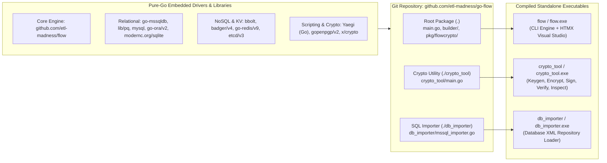

# Compilation, Git Workflow & Build Options Guide

> **Complete Reference for Cloning, Building, Cross-Compiling, and Packaging the `go-flow` Ecosystem**  
> **Binaries Covered:** `flow` (`flow.exe`), `crypto_tool` (`crypto_tool.exe`), `db_importer` (`db_importer.exe`)  
> **Go Toolchain:** Go `1.26.5+` | **Pure-Go Static Compilation:** Supported (`CGO_ENABLED=0`)

This guide provides step-by-step instructions for cloning the **Flow (`go-flow`)** repository with Git, managing dependencies (including co-development with the core `github.com/etl-madness/flow` library), and compiling all three ecosystem binaries across Windows, Linux, and macOS using every supported Go compiler option.

---

## Table of Contents

1. [Architecture of the Build Ecosystem](#1-architecture-of-the-build-ecosystem)
2. [Prerequisites & Toolchain Verification](#2-prerequisites--toolchain-verification)
3. [Git Instructions (Clone, Tags, Branches & Co-Development)](#3-git-instructions-clone-tags-branches--co-development)
4. [Quick Build: All Three Ecosystem Binaries](#4-quick-build-all-three-ecosystem-binaries)
5. [Complete Reference of Supported `go build` Options](#5-complete-reference-of-supported-go-build-options)
6. [Cross-Compilation Guide (Windows, Linux, macOS, ARM64)](#6-cross-compilation-guide-windows-linux-macos-arm64)
7. [Air-Gapped & Offline Vendor Builds](#7-air-gapped--offline-vendor-builds)
8. [Automated Multi-Platform Release Scripts](#8-automated-multi-platform-release-scripts)
9. [Running the Test Suite & Post-Build Verification](#9-running-the-test-suite--post-build-verification)
10. [Optional External Script Runtimes (`dotnet-script` & PowerShell `pwsh`)](#10-optional-external-script-runtimes-dotnet-script--powershell-pwsh)

---

## 1. Architecture of the Build Ecosystem

The `go-flow` repository contains **three executable `main` packages** and relies on **100% pure-Go database and cryptographic drivers**, allowing you to compile zero-dependency static binaries without a C compiler (`gcc`/`clang`):



| Target Binary | Source Package Path | Purpose |
| :--- | :--- | :--- |
| **`flow`** / **`flow.exe`** | `.` (Repository Root) | Main ETL & workflow orchestration engine, schema validator, XSLT/Mermaid doc generator, and embedded HTMX Visual Pipeline Studio (`-builder`). |
| **`crypto_tool`** / **`crypto_tool.exe`** | `./crypto_tool` | Standalone CLI for RSA/Ed25519 key generation, AES-256-GCM encryption (`FLOWENC:v1:`), digital signing (`FLOWSIGNED:v1:`, `.sig`, `.p7s`), and verification. |
| **`db_importer`** / **`db_importer.exe`** | `./db_importer` | Bulk imports `PipelineXML`, `OptionsXML`, and `ConfigXML` files (UTF-8 or UTF-16) into SQL Server tables (`dbo.flow_*_content`). |

---

## 2. Prerequisites & Toolchain Verification

1. **Go SDK**: Version `1.26.5` or newer (as specified in `go.mod`).
2. **Git**: Version `2.30+` for cloning, tag checkout, and module resolution.
3. **C Compiler *(Optional)***: **Not required** for standard or production builds (`CGO_ENABLED=0` works natively). Only required if compiling with the `-race` data race detector enabled.

Verify your environment before building:

```bash
# Verify Go and Git versions
go version
git --version

# Inspect active Go environment variables (GOOS, GOARCH, CGO_ENABLED, GOMODCACHE)
go env GOOS GOARCH CGO_ENABLED GOPROXY
```

---

## 3. Git Instructions (Clone, Tags, Branches & Co-Development)

### 3.1 Clone the Repository (HTTPS or SSH)

```bash
# Option A: Clone via HTTPS
git clone https://github.com/etl-madness/go-flow.git
cd go-flow

# Option B: Clone via SSH
git clone git@github.com:etl-madness/go-flow.git
cd go-flow
```

### 3.2 Checkout a Specific Release Tag (Recommended for Production)

To build a deterministic release version (such as `v1.1.24`, `v1.1.25`, or `v1.1.26`):

```bash
# Fetch all remote tags
git fetch --all --tags

# List the 10 most recent semantic version tags
git tag --sort=-v:refname | head -n 10

# Checkout a specific release tag into a detached HEAD or release branch
git checkout tags/v1.1.26 -b release-v1.1.26

# Confirm exact commit hash and tag
git status
git rev-parse --short HEAD
```

### 3.3 Shallow Clone for Fast CI/CD Pipelines

In automated CI/CD runners (GitHub Actions, GitLab CI, Azure DevOps) where full commit history is unnecessary:

```bash
# Clone only the single commit for tag v1.1.26
git clone --depth 1 --branch v1.1.26 https://github.com/etl-madness/go-flow.git
cd go-flow
```

### 3.4 Updating an Existing Local Clone

```bash
# Pull latest changes on main and prune deleted remote branches
git checkout main
git pull --ff-only origin main
git fetch --prune --prune-tags

# Synchronize and verify Go module dependencies against go.sum
go mod download
go mod verify
```

### 3.5 Co-Developing `go-flow` and `flow` Locally (Go Workspaces)

If you are modifying both `github.com/etl-madness/go-flow` (CLI & Visual Builder) and `github.com/etl-madness/flow` (Core Execution Engine) side-by-side:

```bash
# 1. Clone both repositories into the same parent directory (e.g., repos/etl-madness/)
cd ..
git clone https://github.com/etl-madness/flow.git
cd go-flow

# Option A: Use Go Workspace mode (Recommended — does not dirty go.mod)
go work init . ../flow
go work sync

# Option B: Temporary go.mod replace directive
go mod edit -replace github.com/etl-madness/flow=../flow
go mod tidy

# Revert the replace directive before committing to git:
go mod edit -dropreplace github.com/etl-madness/flow
go mod tidy
```

---

## 4. Quick Build: All Three Ecosystem Binaries

### Windows (PowerShell)

```powershell
# 1. Build the core Flow engine & HTMX Visual Builder
go build -o flow.exe .

# 2. Build the companion cryptographic utility
go build -o crypto_tool.exe ./crypto_tool

# 3. Build the SQL Server XML repository importer
go build -o db_importer.exe ./db_importer
```

### Linux & macOS (Bash / Zsh)

```bash
# 1. Build the core Flow engine & HTMX Visual Builder
go build -o flow .

# 2. Build the companion cryptographic utility
go build -o crypto_tool ./crypto_tool

# 3. Build the SQL Server XML repository importer
go build -o db_importer ./db_importer
```

---

## 5. Complete Reference of Supported `go build` Options

Below is the comprehensive matrix of Go compiler, linker, and environment options supported when building `flow`, `crypto_tool`, and `db_importer`, along with copy-paste examples for each option.

### Summary Matrix of Build Options

| Option / Env Var | Category | Effect on `go-flow` Binaries | Recommended For |
| :--- | :--- | :--- | :--- |
| **`-o <path>`** | Output | Sets output executable path and filename (`flow.exe`, `bin/flow`). | All builds |
| **`CGO_ENABLED=0`** | Linker / Portability | Disables `cgo`, producing a **100% static binary** with zero libc/C dependencies. | Production, Docker `scratch` / `distroless` / Alpine |
| **`-trimpath`** | Security / Reproducibility | Strips all local filesystem paths (e.g., `C:\Users\...`) from the compiled binary and stack traces. | Production & Security-Hardened Releases |
| **`-ldflags="-s -w"`** | Size Optimization | Omits the symbol table (`-s`) and DWARF debug tables (`-w`), shrinking binary size by ~25–30%. | Production & Edge Deployments |
| **`-buildvcs=true\|false`** | Provenance | Embeds (or omits) Git commit SHA, timestamp, and dirty-tree status in Go build info (`go version -m`). | CI/CD Auditing (`true`) or Reproducible (`false`) |
| **`-mod=readonly`** | Dependency Lock | Fails the build if `go.mod` or `go.sum` needs updating, preventing accidental dependency drift. | CI/CD Pipelines |
| **`-mod=vendor`** | Air-Gapped / Offline | Compiles strictly using the local `./vendor` directory without any network access. | Air-Gapped / Restricted Enterprise Networks |
| **`-race`** | Concurrency Analysis | Instruments memory access to detect data races in `<parallel>` workflows (requires `CGO_ENABLED=1`). | QA, Integration Testing & Parallel Debugging |
| **`-gcflags="all=-N -l"`** | Interactive Debugging | Disables compiler optimizations (`-N`) and function inlining (`-l`) for accurate breakpoints in Delve (`dlv`). | Local Developer Debugging |
| **`-pgo=auto`** | Performance | Applies Profile-Guided Optimization from `default.pgo` CPU profiles (~5–10% throughput boost). | High-Volume Bulk ETL (`<sql_bulk>`, `<kv_bulk>`) |
| **`-a`** | Cache Control | Forces recompilation of all packages, ignoring cached build artifacts in `GOCACHE`. | Clean Release Builds |
| **`-v` / `-x` / `-work`** | Build Diagnostics | Prints compiled package names (`-v`), exact compiler commands (`-x`), and preserves temp workdir (`-work`). | Troubleshooting Toolchain Issues |
| **`GOAMD64=v1..v4`** | CPU Microarchitecture | Targets specific x86-64 instruction sets (`v1` baseline SSE2, `v3` AVX2/BMI2, `v4` AVX-512). | Hardware-Tuned Data Warehouse Servers |

---

### Detailed Examples for Every Supported Option

#### 5.1 Production Hardened & Size-Optimized Build (`CGO_ENABLED=0`, `-trimpath`, `-ldflags="-s -w"`)
Produces a compact, reproducible, statically linked binary with no local filesystem paths leaked in panic traces:

```powershell
# Windows (PowerShell)
$env:CGO_ENABLED = "0"
go build -trimpath -ldflags="-s -w" -o dist/flow.exe .
go build -trimpath -ldflags="-s -w" -o dist/crypto_tool.exe ./crypto_tool
go build -trimpath -ldflags="-s -w" -o dist/db_importer.exe ./db_importer
```

```bash
# Linux / macOS (Bash)
CGO_ENABLED=0 go build -trimpath -ldflags="-s -w" -o dist/flow .
CGO_ENABLED=0 go build -trimpath -ldflags="-s -w" -o dist/crypto_tool ./crypto_tool
CGO_ENABLED=0 go build -trimpath -ldflags="-s -w" -o dist/db_importer ./db_importer
```

#### 5.2 Embedding & Inspecting Git VCS Provenance (`-buildvcs=true`)
By default, Go embeds the exact Git commit hash, commit timestamp, and whether uncommitted modifications existed at build time. You can enforce this with `-buildvcs=true` and inspect any compiled `flow` binary using `go version -m`:

```bash
# Build with explicit VCS metadata stamping
go build -buildvcs=true -trimpath -o flow.exe .

# Inspect embedded Git commit, Go version, compiler flags, and module hashes
go version -m flow.exe
```

*Sample `go version -m` output:*
```text
flow.exe: go1.26.5
        path    github.com/etl-madness/go-flow
        mod     github.com/etl-madness/go-flow  (devel)
        dep     github.com/etl-madness/flow     v1.3.4
        build   -buildmode=exe
        build   -compiler=gc
        build   -trimpath=true
        build   vcs=git
        build   vcs.revision=a1b2c3d4e5f6...
        build   vcs.time=2026-10-31T12:00:00Z
        build   vcs.modified=false
```

#### 5.3 Interactive Debugger Build (`-gcflags="all=-N -l"`)
When stepping through `flow` or `builder/` in **VS Code**, **GoLand**, or **Delve (`dlv`)**, disable inlining and register optimizations so all local variables remain inspectable:

```bash
# Build with full DWARF symbols and optimizations disabled
go build -gcflags="all=-N -l" -o flow_debug.exe .

# Launch under Delve debugger
dlv exec ./flow_debug.exe -- -file pipeline.xml -debug
```

#### 5.4 Data Race Detector Build (`-race`)
When testing complex `<parallel>` pipelines or custom Go extensions, compile with `-race` (requires `CGO_ENABLED=1` and a C compiler such as MinGW-w64 `gcc` on Windows or `build-essential` on Linux):

```powershell
# Windows (PowerShell with MinGW-w64 gcc in PATH)
$env:CGO_ENABLED = "1"
go build -race -o flow_race.exe .
./flow_race.exe -file parallel_pipeline.xml
```

```bash
# Linux / macOS
CGO_ENABLED=1 go build -race -o flow_race .
./flow_race -file parallel_pipeline.xml
```

#### 5.5 CPU Microarchitecture Tuning (`GOAMD64` & `GOARM64`)
For high-throughput `<sql_bulk>`, `<kv_bulk>`, and AES-256-GCM encryption on modern server hardware, target modern SIMD instruction sets:

```bash
# Target x86-64-v3 (AVX2, BMI2, FMA — Intel Haswell+ / AMD Excavator+ / modern cloud VMs)
GOAMD64=v3 CGO_ENABLED=0 go build -trimpath -ldflags="-s -w" -o flow_avx2.exe .

# Target x86-64-v4 (AVX-512 — Intel Skylake-X / Ice Lake+ / AMD Zen 4+)
GOAMD64=v4 CGO_ENABLED=0 go build -trimpath -ldflags="-s -w" -o flow_avx512.exe .

# Target ARM64 v9.0 with LSE atomics and crypto extensions (AWS Graviton3/4, Apple M-series)
GOOS=linux GOARCH=arm64 GOARM64=v9.0,lse,crypto CGO_ENABLED=0 go build -trimpath -ldflags="-s -w" -o flow_graviton .
```

#### 5.6 Diagnostic & Force-Rebuild Options (`-a`, `-v`, `-x`, `-work`)
When diagnosing build cache issues or auditing compiler invocations:

```bash
# Force full rebuild (-a) and print each package as it compiles (-v)
go build -a -v -o flow.exe .

# Print every underlying compiler/linker command (-x) and preserve temporary work directory (-work)
go build -x -work -o flow.exe .
```

---

## 6. Cross-Compilation Guide (Windows, Linux, macOS, ARM64)

Because `go-flow` uses pure-Go drivers (`modernc.org/sqlite`, `go-mssqldb`, `lib/pq`, `go-sql-driver/mysql`, `go-ora/v2`, `bbolt`, `badger`), you can cross-compile for **any operating system and CPU architecture from a single workstation** by setting `GOOS`, `GOARCH`, and `CGO_ENABLED=0`.

### 6.1 Cross-Compiling from Windows (PowerShell)

```powershell
# Ensure pure-Go static linking is enabled for all targets
$env:CGO_ENABLED = "0"

# 1. Windows x64 (amd64)
$env:GOOS = "windows"; $env:GOARCH = "amd64"
go build -trimpath -ldflags="-s -w" -o dist/windows-amd64/flow.exe .
go build -trimpath -ldflags="-s -w" -o dist/windows-amd64/crypto_tool.exe ./crypto_tool
go build -trimpath -ldflags="-s -w" -o dist/windows-amd64/db_importer.exe ./db_importer

# 2. Windows ARM64 (Surface / Windows on ARM)
$env:GOOS = "windows"; $env:GOARCH = "arm64"
go build -trimpath -ldflags="-s -w" -o dist/windows-arm64/flow.exe .
go build -trimpath -ldflags="-s -w" -o dist/windows-arm64/crypto_tool.exe ./crypto_tool
go build -trimpath -ldflags="-s -w" -o dist/windows-arm64/db_importer.exe ./db_importer

# 3. Linux x64 (amd64 — Ubuntu, RHEL, Debian, Alpine, Docker scratch)
$env:GOOS = "linux"; $env:GOARCH = "amd64"
go build -trimpath -ldflags="-s -w" -o dist/linux-amd64/flow .
go build -trimpath -ldflags="-s -w" -o dist/linux-amd64/crypto_tool ./crypto_tool
go build -trimpath -ldflags="-s -w" -o dist/linux-amd64/db_importer ./db_importer

# 4. Linux ARM64 (AWS Graviton, Raspberry Pi 4/5, Kubernetes ARM nodes)
$env:GOOS = "linux"; $env:GOARCH = "arm64"
go build -trimpath -ldflags="-s -w" -o dist/linux-arm64/flow .
go build -trimpath -ldflags="-s -w" -o dist/linux-arm64/crypto_tool ./crypto_tool
go build -trimpath -ldflags="-s -w" -o dist/linux-arm64/db_importer ./db_importer

# 5. macOS Apple Silicon (darwin/arm64 — M1/M2/M3/M4)
$env:GOOS = "darwin"; $env:GOARCH = "arm64"
go build -trimpath -ldflags="-s -w" -o dist/darwin-arm64/flow .
go build -trimpath -ldflags="-s -w" -o dist/darwin-arm64/crypto_tool ./crypto_tool
go build -trimpath -ldflags="-s -w" -o dist/darwin-arm64/db_importer ./db_importer

# 6. macOS Intel (darwin/amd64)
$env:GOOS = "darwin"; $env:GOARCH = "amd64"
go build -trimpath -ldflags="-s -w" -o dist/darwin-amd64/flow .
go build -trimpath -ldflags="-s -w" -o dist/darwin-amd64/crypto_tool ./crypto_tool
go build -trimpath -ldflags="-s -w" -o dist/darwin-amd64/db_importer ./db_importer

# 7. FreeBSD x64 & ARM64 (freebsd/amd64 & freebsd/arm64)
$env:GOOS = "freebsd"; $env:GOARCH = "amd64"
go build -trimpath -ldflags="-s -w" -o dist/freebsd-amd64/flow .
go build -trimpath -ldflags="-s -w" -o dist/freebsd-amd64/crypto_tool ./crypto_tool
go build -trimpath -ldflags="-s -w" -o dist/freebsd-amd64/db_importer ./db_importer

$env:GOOS = "freebsd"; $env:GOARCH = "arm64"
go build -trimpath -ldflags="-s -w" -o dist/freebsd-arm64/flow .
go build -trimpath -ldflags="-s -w" -o dist/freebsd-arm64/crypto_tool ./crypto_tool
go build -trimpath -ldflags="-s -w" -o dist/freebsd-arm64/db_importer ./db_importer

# Reset environment variables to host defaults
Remove-Item Env:GOOS, Env:GOARCH, Env:CGO_ENABLED -ErrorAction SilentlyContinue
```

### 6.2 Cross-Compiling from Linux / macOS / FreeBSD (Bash / Sh)

```bash
# 1. Linux amd64 & arm64
CGO_ENABLED=0 GOOS=linux GOARCH=amd64 go build -trimpath -ldflags="-s -w" -o dist/linux-amd64/flow .
CGO_ENABLED=0 GOOS=linux GOARCH=arm64 go build -trimpath -ldflags="-s -w" -o dist/linux-arm64/flow .

# 2. Windows amd64 & arm64
CGO_ENABLED=0 GOOS=windows GOARCH=amd64 go build -trimpath -ldflags="-s -w" -o dist/windows-amd64/flow.exe .
CGO_ENABLED=0 GOOS=windows GOARCH=arm64 go build -trimpath -ldflags="-s -w" -o dist/windows-arm64/flow.exe .

# 3. macOS Apple Silicon (arm64) & Intel (amd64)
CGO_ENABLED=0 GOOS=darwin GOARCH=arm64 go build -trimpath -ldflags="-s -w" -o dist/darwin-arm64/flow .
CGO_ENABLED=0 GOOS=darwin GOARCH=amd64 go build -trimpath -ldflags="-s -w" -o dist/darwin-amd64/flow .

# 4. FreeBSD amd64 & arm64
CGO_ENABLED=0 GOOS=freebsd GOARCH=amd64 go build -trimpath -ldflags="-s -w" -o dist/freebsd-amd64/flow .
CGO_ENABLED=0 GOOS=freebsd GOARCH=arm64 go build -trimpath -ldflags="-s -w" -o dist/freebsd-arm64/flow .
```

> **Note on Platform-Specific PKCS#7 Signing (`crypto_tool -format p7s`)**:
> - **Verification** of `.p7s` (PKCS#7/CMS), `.sig` (OpenSSL), and `.asc` (OpenPGP) signatures is implemented in **100% pure Go** (`pkg/flowcrypto/pkcs7.go`) and works identically across Windows, Linux, and macOS.
> - **Signing** in `.p7s` format using the Windows Certificate Store (`-cert-thumbprint` / `-cert-store`) invokes PowerShell's `System.Security.Cryptography.Pkcs.SignedCms` when run on Windows, whereas `-format sig` (OpenSSL RSA/ECDSA/Ed25519) is pure Go on all platforms.

---

## 7. Air-Gapped & Offline Vendor Builds

For enterprise environments where build servers have no outbound internet access:

```bash
# Step 1 (On a connected machine): Vendor all module dependencies into ./vendor
git clone https://github.com/etl-madness/go-flow.git
cd go-flow
go mod tidy
go mod verify
go mod vendor

# Optional: Commit or archive the repository including ./vendor
tar -czf go-flow-vendored.tar.gz .

# Step 2 (On the air-gapped build server): Compile strictly from ./vendor
CGO_ENABLED=0 GOPROXY=off go build -mod=vendor -trimpath -ldflags="-s -w" -o flow.exe .
CGO_ENABLED=0 GOPROXY=off go build -mod=vendor -trimpath -ldflags="-s -w" -o crypto_tool.exe ./crypto_tool
CGO_ENABLED=0 GOPROXY=off go build -mod=vendor -trimpath -ldflags="-s -w" -o db_importer.exe ./db_importer
```

---

## 8. Automated Multi-Platform Release Scripts

### PowerShell Release Builder (`build-all.ps1`)
Builds all 3 binaries across all 6 target platforms and generates a `SHA256SUMS.txt` manifest:

```powershell
$ErrorActionPreference = "Stop"
$targets = @(
    @{ GOOS = "windows"; GOARCH = "amd64"; Ext = ".exe" },
    @{ GOOS = "windows"; GOARCH = "arm64"; Ext = ".exe" },
    @{ GOOS = "linux";   GOARCH = "amd64"; Ext = ""     },
    @{ GOOS = "linux";   GOARCH = "arm64"; Ext = ""     },
    @{ GOOS = "darwin";  GOARCH = "amd64"; Ext = ""     },
    @{ GOOS = "darwin";  GOARCH = "arm64"; Ext = ""     },
    @{ GOOS = "freebsd"; GOARCH = "amd64"; Ext = ""     },
    @{ GOOS = "freebsd"; GOARCH = "arm64"; Ext = ""     }
)

$env:CGO_ENABLED = "0"
New-Item -ItemType Directory -Force -Path "dist" | Out-Null
$hashes = @()

foreach ($t in $targets) {
    $env:GOOS = $t.GOOS
    $env:GOARCH = $t.GOARCH
    $outDir = "dist/$($t.GOOS)-$($t.GOARCH)"
    New-Item -ItemType Directory -Force -Path $outDir | Out-Null

    Write-Host "Building $($t.GOOS)/$($t.GOARCH)..." -ForegroundColor Cyan
    go build -mod=readonly -trimpath -ldflags="-s -w" -o "$outDir/flow$($t.Ext)" .
    go build -mod=readonly -trimpath -ldflags="-s -w" -o "$outDir/crypto_tool$($t.Ext)" ./crypto_tool
    go build -mod=readonly -trimpath -ldflags="-s -w" -o "$outDir/db_importer$($t.Ext)" ./db_importer

    Get-ChildItem -Path $outDir -File | ForEach-Object {
        $h = (Get-FileHash $_.FullName -Algorithm SHA256).Hash.ToLower()
        $rel = "$($t.GOOS)-$($t.GOARCH)/$($_.Name)"
        $hashes += "$h  $rel"
    }
}

$hashes | Set-Content -Path "dist/SHA256SUMS.txt" -Encoding UTF8
Remove-Item Env:GOOS, Env:GOARCH, Env:CGO_ENABLED -ErrorAction SilentlyContinue
Write-Host "Release build complete! Checksums written to dist/SHA256SUMS.txt" -ForegroundColor Green
```

---

## 9. Running the Test Suite & Post-Build Verification

After cloning or modifying the repository, run the automated test suite and smoke-test the compiled binaries:

```bash
# 1. Run all unit & integration tests across the entire repository
go test ./...

# 2. Run specific package tests with verbose output
go test -v .
go test -v ./builder
go test -v ./pkg/flowcrypto
go test -v ./crypto_tool
go test -v ./db_importer

# 3. Verify the compiled binaries respond to CLI flags
./flow -h
./crypto_tool -h
./db_importer -h

# 4. Validate a sample pipeline against the XSD schema without executing
./flow -file scripts.xml -xsd ./xsd/pipeline.xsd -validate
```

---

## 10. Optional External Script Runtimes (`dotnet-script` & PowerShell `pwsh`)

By default, `<script language="go">` runs **in-process** via the embedded pure-Go **Yaegi** interpreter and requires zero external tools. However, if your pipelines use C# scripts (`<script language="csx">`) or cross-platform PowerShell 7+ (`<script language="pwsh">`), you can install those optional runtimes from the command line as shown below.

| `<script>` Language Attribute | Runtime Binary Invoked | Bundled in `flow`? | When Installation Is Needed |
| :--- | :--- | :--- | :--- |
| `language="go"` | Embedded **Yaegi** engine | **Yes (Built-in)** | Never — compiled directly into `flow`. |
| `language="sh"` / `"bash"` / `"zsh"` / `"cmd"` | Host OS shell | **OS Built-in** | Included on standard POSIX / Windows hosts. |
| `language="csx"` | `dotnet-script` | Optional external | Required only if pipelines execute C# `.csx` `<script>` nodes. |
| `language="pwsh"` | `pwsh` (PowerShell 7+) | Optional external | Required on Linux, macOS, FreeBSD (or Windows for PS7+) when using `language="pwsh"`. |

---

### 10.1 Installing `dotnet-script` via Command Line (for `<script language="csx">`)

`dotnet-script` is distributed as a cross-platform **.NET Global Tool** and works on Windows, Linux, macOS, and FreeBSD wherever the .NET SDK (`dotnet` 10.0+) is installed.

#### Step 1: Install the .NET SDK (if not already installed)

```powershell
# Windows (via winget)
winget install Microsoft.DotNet.SDK.10
```

```bash
# Ubuntu / Debian Linux
sudo apt-get update && sudo apt-get install -y dotnet-sdk-10.0

# RHEL / Rocky / AlmaLinux / Fedora
sudo dnf install -y dotnet-sdk-10.0

# macOS (via Homebrew)
brew install --cask dotnet-sdk

# FreeBSD (via pkg)
sudo pkg install -y dotnet
```

#### Step 2: Install `dotnet-script` Globally via `dotnet tool`

```bash
# Install the latest stable dotnet-script global tool
dotnet tool install -g dotnet-script

# (Optional) Update an existing installation to the latest version
dotnet tool update -g dotnet-script

# (Optional) Install a specific pinned version for reproducible CI environments
dotnet tool install -g dotnet-script --version 1.6.0
```

#### Step 3: Ensure `~/.dotnet/tools` Is in `PATH` and Verify

```powershell
# Windows (PowerShell) — automatically added by the SDK installer, or add for current session:
$env:PATH += ";$HOME\.dotnet\tools"
dotnet-script --version
dotnet-script eval "Console.WriteLine(21 * 2);"
```

```bash
# Linux / macOS / FreeBSD (Bash / Zsh / Sh)
export PATH="$PATH:$HOME/.dotnet/tools"
# Persist in ~/.bashrc, ~/.zshrc, or ~/.profile:
echo 'export PATH="$PATH:$HOME/.dotnet/tools"' >> ~/.profile

# Verify dotnet-script execution
dotnet-script --version
dotnet-script eval 'Console.WriteLine("dotnet-script ready on " + Environment.OSVersion);'
```

---

### 10.2 Installing PowerShell (`pwsh`) on Linux, macOS & FreeBSD (for `<script language="pwsh">`)

When a pipeline step uses `<script language="pwsh">`, Flow invokes the cross-platform `pwsh` executable.

#### A. Linux (Ubuntu, Debian, RHEL, Alpine)

```bash
# Ubuntu / Debian (via Microsoft Package Repository)
sudo apt-get update && sudo apt-get install -y wget apt-transport-https software-properties-common
source /etc/os-release
wget -q "https://packages.microsoft.com/config/${ID}/${VERSION_ID}/packages-microsoft-prod.deb"
sudo dpkg -i packages-microsoft-prod.deb && rm packages-microsoft-prod.deb
sudo apt-get update && sudo apt-get install -y powershell

# RHEL 8/9, Rocky Linux, AlmaLinux, Fedora (via dnf)
sudo dnf install -y https://packages.microsoft.com/config/rhel/9/packages-microsoft-prod.rpm
sudo dnf install -y powershell

# Universal Linux Alternative (via Snap)
sudo snap install powershell --classic
```

#### B. macOS (Intel & Apple Silicon)

```bash
# Install PowerShell 7+ via Homebrew Cask
brew install --cask powershell

# Verify installation
pwsh -Version
```

#### C. FreeBSD (and Any OS with the .NET SDK Installed)

On FreeBSD (as well as minimal Linux containers or non-root environments), PowerShell can be installed directly as a **.NET Global Tool** using the `dotnet` CLI:

```bash
# 1. Install the .NET SDK on FreeBSD (if not already present)
sudo pkg install -y dotnet

# 2. Install PowerShell (pwsh) as a .NET Global Tool
dotnet tool install --global PowerShell

# 3. Ensure ~/.dotnet/tools is on PATH
export PATH="$PATH:$HOME/.dotnet/tools"

# 4. Verify pwsh in non-interactive mode
pwsh -NoProfile -NonInteractive -Command '$PSVersionTable.PSVersion'
```

---

## Related Documentation
- [**Polyglot Scripting (`<script>`)**](../script.md)
- [**Complete CLI Reference (`flow`, `crypto_tool`, `db_importer`)**](COMPLETE_CLI_OPTIONS_AND_ARGUMENTS.md)
- [**Configuration & Execution Hierarchy**](CONFIG_HIERARCHY.md)
- [**Security Order of Operations & Options**](SECURITY_ORDER_AND_OPTIONS.md)
- [**Database-Backed XML Storage (`db_importer`)**](README_DATABASE_XML.md)
