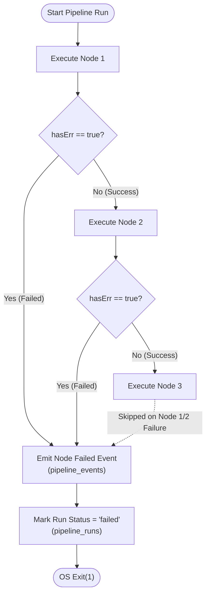
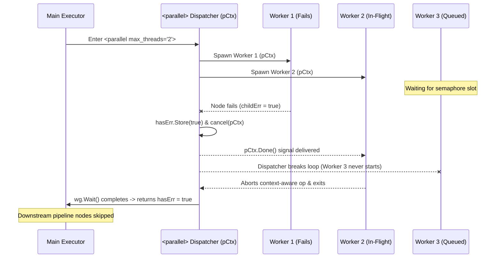
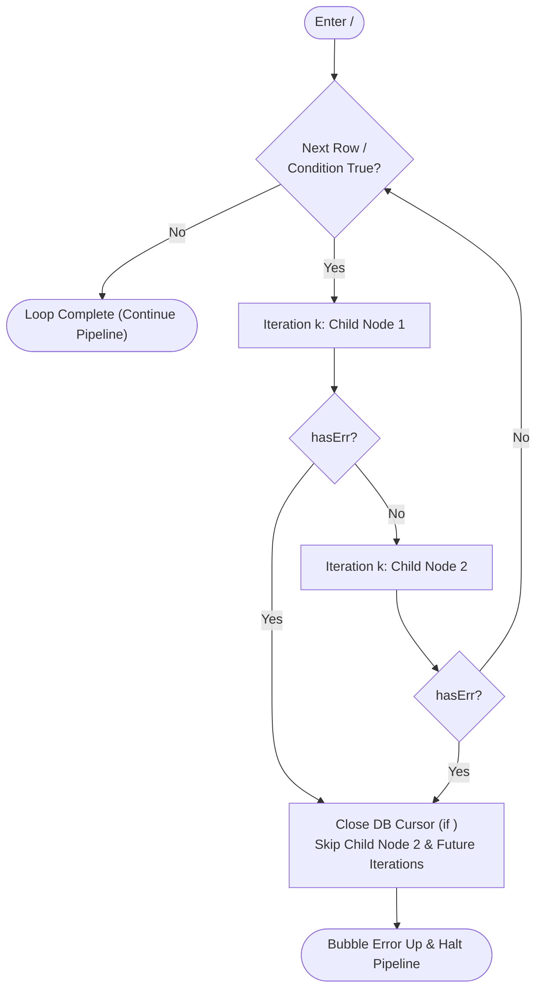
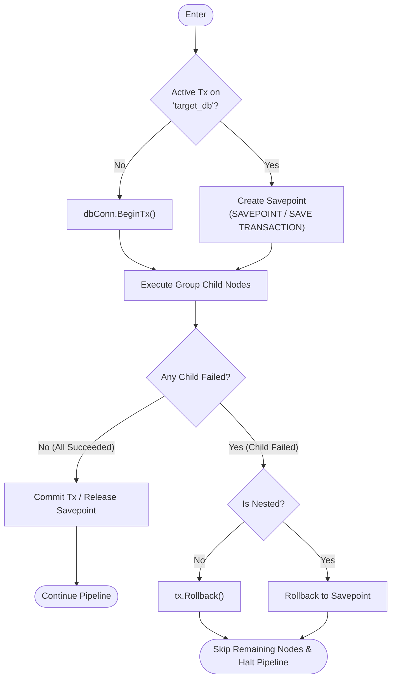
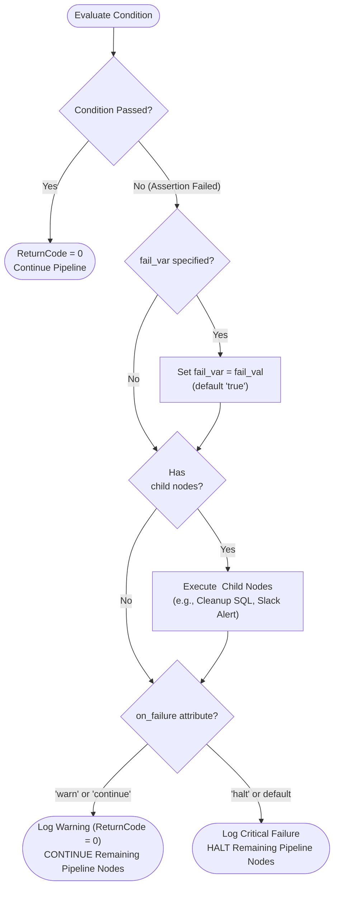

# Pipeline Failure Response & Error Propagation

**By default, `go-flow` uses fail-fast execution.** When a node fails, the remaining nodes in the pipeline will **not** continue.

This document details how failure propagation, cooperative cancellation, transactional rollbacks, and explicit recovery blocks work across every orchestration primitive in the `flow` runtime engine.

---

## Summary Matrix

| Orchestration Context | Default Behavior on Node Failure | Remaining Sibling Nodes | Downstream Pipeline Nodes | Special Recovery / Cleanup |
| :--- | :--- | :--- | :--- | :--- |
| **Sequential (`<flow>`, `<preflight>`, `<group>`, `<if>`)** | **Fail-Fast** | Skipped immediately | Skipped | None (unless inside `<assert>`) |
| **Parallel (`<parallel>`)** | **Cooperative Cancel** | Queued tasks skipped; in-flight workers receive `ctx.Done()` | Skipped after `wg.Wait()` | Worker variables only merged after barrier |
| **Loops (`<foreach>`, `<while>`)** | **Abort Loop** | Remaining children in current iteration & future iterations skipped | Skipped | Active DB cursor closed immediately |
| **Transactional Group (`<group transaction="true">`)** | **Rollback & Halt** | Skipped immediately | Skipped | Automatic `ROLLBACK` (or `ROLLBACK TO SAVEPOINT` if nested) |
| **Assertion (`<assert on_failure="halt">`)** | **Run Fallback, Then Halt** | Skipped | Skipped | Executes nested `<on_failure>` child nodes before halting |
| **Assertion (`<assert on_failure="warn">` / `"continue"`)** | **Warn & Continue** | **Executed normally** | **Executed normally** | Sets `fail_var`/`fail_val` and runs `<on_failure>` children |

---

## 1. Sequential Nodes (`<flow>`, `<preflight>`, `<group>`, `<if>`)

In `Executor.executeNodes`, pipeline nodes are evaluated sequentially inside a `for` loop. Each node handler returns a boolean `hasErr`:

* As soon as any node returns `hasErr == true`, `executeNodes` emits the node failure event to registered sinks (`pipeline_events`), appends the `ScriptResult`, and immediately returns `true` to its caller.
* All subsequent sibling nodes and parent containers are bypassed.
* `Executor.executeRun` records the overall run status as `failed` in `pipeline_runs`, and `go-flow` exits with return code `1`.



---

## 2. Parallel Blocks (`<parallel>`)

In `Executor.executeParallelNode`, child nodes run concurrently across a bounded worker pool (`max_threads`, defaulting to `4`) sharing a derived cancellable context (`pCtx, cancel := context.WithCancel(ctx)`).

When any child worker fails (`childErr == true`):
1. **Immediate Context Cancellation**: The failing worker sets an atomic flag (`hasErr.Store(true)`) and invokes `cancel()` on `pCtx`.
2. **Queued Siblings Skipped**: The dispatcher loop checks `hasErr.Load() || pCtx.Err() != nil` before acquiring the semaphore and immediately stops scheduling any remaining unstarted child nodes in the `<parallel>` block.
3. **In-Flight Siblings Notified**: Currently executing sibling goroutines receive the cancellation signal via `pCtx.Done()`, which aborts context-aware operations (such as SQL queries via `QueryContext`/`ExecContext`, shell/CSX scripts via `exec.CommandContext`, HTTP requests, and loops).
4. **Join Barrier & Halt**: `wg.Wait()` waits for all active workers to finish cleaning up. Because `executeParallelNode` returns `true`, **no downstream nodes after `<parallel>` will execute**.



---

## 3. Iterative Loops (`<foreach>`, `<while>`)

Both `<foreach>` (`Executor.executeForEachNode`, in both streaming and buffered modes) and `<while>` (`Executor.executeWhileNode`) evaluate their child nodes sequentially on each iteration via `e.executeNodes(ctx, node.Children, results)`.

* If any child node fails during iteration $k$:
  * Remaining child nodes in iteration $k$ are skipped.
  * For `<foreach>`, the active database `sql.Rows` cursor is immediately closed (`rows.Close()`).
  * Subsequent iterations ($k+1, \dots, N$) are aborted.
  * The error bubbles up and halts the rest of the pipeline.



---

## 4. Transactional Groups (`<group transaction="true">`)

When a `<group>` has `transaction="true"` and a target `db` configured:

* **Top-Level Transaction**: Begins a database transaction (`dbConn.BeginTx`) and pushes it onto the executor's active transaction stack for that database.
* **Nested Transaction on Same DB**: Creates a dialect-aware savepoint (`SAVE TRANSACTION sp_<timestamp>` on SQL Server or `SAVEPOINT sp_<timestamp>` on PostgreSQL, MySQL, SQLite, Oracle).
* **On Child Failure**:
  1. Remaining child nodes inside the `<group>` are skipped.
  2. The `defer` handler detects `!committed` and automatically executes `tx.Rollback()` (or `ROLLBACK TRANSACTION` / `ROLLBACK TO SAVEPOINT` for nested transactions).
  3. The transaction is popped from the stack and the pipeline halts.



---

## 5. Exceptions: When Nodes *Do* Continue (`<assert>`)

The `<assert>` component (`Executor.executeAssertNode`) is the only built-in node that provides explicit control over whether the pipeline halts or continues when a check fails, as well as a dedicated `<on_failure>` fallback block.



### Option A: Continue Execution on Failure (`on_failure="warn"` or `"continue"`)
Setting `on_failure="warn"` or `on_failure="continue"` logs a warning message, optionally sets a flag variable (`fail_var` / `fail_val`), executes any nested `<on_failure>` child nodes, and **allows all subsequent pipeline nodes to continue**.

```xml
<assert id="check_optional_feed"
        var="FEED_STATUS"
        equals="200"
        on_failure="warn"
        fail_var="USING_CACHED_FEED"
        fail_val="true"
        message="External feed unavailable; falling back to cache." />

<!-- Remaining nodes WILL continue executing -->
<if var="USING_CACHED_FEED" equals="true">
    <then>
        <sql id="load_from_cache" db="staging_db">
            INSERT INTO active_rates SELECT * FROM cached_rates;
        </sql>
    </then>
</if>
```

### Option B: Execute Cleanup Nodes Before Halting (`<on_failure>` with `on_failure="halt"`)
Even when `on_failure="halt"` (the default), any child nodes nested inside `<on_failure>...</on_failure>` **will** execute when the assertion fails, allowing you to run cleanup SQL or send alerts before the main pipeline halts.

```xml
<assert id="verify_row_threshold"
        var="ROW_COUNT"
        equals="1000"
        on_failure="halt"
        message="Row count mismatch!">
    <on_failure>
        <!-- These fallback nodes WILL execute before the pipeline halts -->
        <sql id="cleanup_staging" db="staging_db">
            TRUNCATE TABLE stg_import;
        </sql>
    </on_failure>
</assert>

<!-- This node will NOT execute because on_failure="halt" -->
<sql id="promote_to_prod" db="prod_db">
    INSERT INTO fact_orders SELECT * FROM stg_import;
</sql>
```
