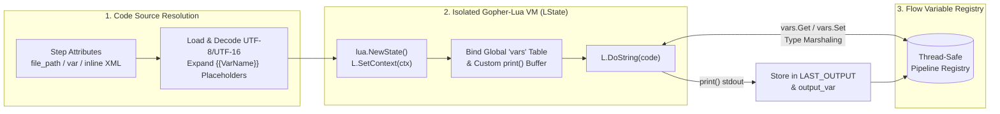

# Embedded Lua Scripting (`<script language="lua">`)

## 1. Overview

Flow includes a built-in, zero-dependency **Lua 5.1 Virtual Machine** powered by [Gopher-Lua (`github.com/yuin/gopher-lua`)](https://github.com/yuin/gopher-lua). Because the Lua interpreter is compiled directly into the `flow` binary, `<script language="lua">` steps execute in-memory across **Windows, Linux, macOS, and FreeBSD** without spawning external OS processes or requiring any external runtime installation.

Key capabilities of Flow's embedded Lua runtime include:
- **Zero External Dependencies**: Runs identically in minimal container images (`scratch` / `alpine`), air-gapped servers, and developer workstations.
- **Direct Pipeline Registry Bridge (`vars`)**: Read and write strongly-typed values, sequential arrays (`[]any`), and key-value maps (`map[string]any`) directly to and from the Flow variable registry via the global `vars` table.
- **Flexible Code Sourcing**: Execute inline `<![CDATA[ ... ]]>` code blocks, external `.lua` files (`file_path`, `file`, or `path` with automatic UTF-8 / UTF-16 BOM decoding), or dynamic code stored in a pipeline variable (`var` / `variable`).
- **Pre-Execution Template Interpolation**: `{{VariableName}}` placeholders in the script source or `file_path` are expanded before the VM compiles the Lua chunk.
- **Context-Aware Timeouts & Cancellation**: The Lua VM (`*lua.LState`) is bound directly to the step's `context.Context` (`L.SetContext(ctx)`), ensuring immediate termination when `timeout="5s"` expires or the pipeline is cancelled.
- **Thread-Safe Parallel Isolation**: Each `<script language="lua">` invocation creates a fresh, isolated `*lua.LState` VM instance while synchronizing variable reads and writes through Flow's thread-safe `Registry`.

---

## 2. Execution Architecture & Lifecycle



1. **Source Resolution**: Flow resolves the Lua script code in the following order:
   - If `file_path`, `file`, or `path` is set, Flow interpolates any `{{VarName}}` expressions in the path and loads the external `.lua` file from disk (automatically handling UTF-8, UTF-16LE, and UTF-16BE encodings).
   - Otherwise, if the `<script>` element contains an inline XML body (or `<![CDATA[ ... ]]>`), Flow uses the inline content.
   - Otherwise, if `var` or `variable` is set, Flow retrieves the Lua source code from that pipeline variable.
2. **Template Interpolation**: Flow replaces any `{{VarName}}` placeholders in the resolved Lua source text with their current values from the registry.
3. **VM Initialization**: A dedicated `*lua.LState` is created and bound to the step's `context.Context` (respecting `timeout` and pipeline cancellation).
4. **Host Bridge Injection**: Flow registers the global `vars` table and overrides global `print(...)` to write to an in-memory output buffer.
5. **Execution & Output Capture**: `L.DoString(code)` executes the script. Any `print(...)` output (trimmed of trailing `\r\n`) is written to `LAST_OUTPUT` and the variable specified by `output_var` (or `output`).

---

## 3. XML Attribute Reference

| Attribute | Required | Default | Description |
| :--- | :---: | :---: | :--- |
| `language` / `type` | **Yes** | — | Must be set to `"lua"` (case-insensitive). |
| `id` | No | — | Unique identifier for logging, auditing, and telemetry. |
| `file_path` | No | — | Path to an external `.lua` script file. Supports `{{VarName}}` interpolation. Aliases: `file`, `path`. |
| `var` | No | — | Name of a pipeline variable containing the Lua source code to execute when no inline body or `file_path` is provided. Alias: `variable`. |
| `output_var` | No | — | Pipeline variable name to store the captured `print(...)` output. Alias: `output`. Always also populates `LAST_OUTPUT`. |
| `timeout` | No | No limit | Maximum execution time (e.g., `"5s"`, `"1m"`, `"500ms"`). Cancels the Lua VM immediately on expiration. |
| `retry_count` | No | `0` | Number of automatic retries if the Lua script raises an `error(...)` or times out. |
| `retry_delay` | No | `1s` | Delay between retry attempts (e.g., `"2s"`). |
| `ignore_error` | No | `false` | When `true`, logs script failures as warnings and continues pipeline execution. |

---

## 4. The Global `vars` Host Bridge API

Every `<script language="lua">` step has built-in access to the global `vars` table without requiring any `require(...)` call.

> [!TIP]
> **Flexible Call Syntax**: Every function on `vars` accepts **both** standard dot syntax (`vars.Get("Key")`) and Lua colon method syntax (`vars:Get("Key")`).

### `vars` Function Reference

| Function Signature | Return Type (Lua) | Description |
| :--- | :--- | :--- |
| `vars.Get(key)`<br/>`vars:Get(key)` | `nil`, `boolean`, `number`, `string`, or `table` | Retrieves the native value of variable `key` from the pipeline registry and converts it into the corresponding Lua type (including nested tables for slices and maps). Returns `nil` if the variable does not exist. |
| `vars.GetString(key)`<br/>`vars:GetString(key)` | `string` | Retrieves variable `key` formatted as a Lua `string`. Returns `""` if the variable is unset. |
| `vars.GetInt(key)`<br/>`vars:GetInt(key)` | `number` | Retrieves variable `key` coerced to an integer `lua.LNumber`. Returns `0` if unset or unparseable. |
| `vars.GetNumber(key)`<br/>`vars.GetFloat(key)` | `number` | Retrieves variable `key` coerced to a floating-point `lua.LNumber` (`float64`). `GetFloat` is an alias for `GetNumber`. |
| `vars.GetBool(key)`<br/>`vars:GetBool(key)` | `boolean` | Retrieves variable `key` coerced to a Lua `boolean` (`true` / `false`). |
| `vars.GetAll()`<br/>`vars:GetAll()` | `table` | Returns a Lua key-value `table` containing a snapshot of all current variables in the pipeline registry. |
| `vars.Set(key, value)`<br/>`vars:Set(key, value)` | *(none)* | Converts `value` from a Lua value (`nil`, `boolean`, `number`, `string`, or `table`) into its native Go representation and stores it in the pipeline variable `key`. |
| `print(...)` | *(none)* | Writes all arguments (separated by tabs `\t` and terminated by `\n`) to Flow's internal script output buffer. Stored in `LAST_OUTPUT` and `output_var`. |

---

## 5. Bidirectional Go ↔ Lua Type Conversion

When reading variables with `vars.Get(key)` or writing variables with `vars.Set(key, value)`, Flow automatically marshals data structures between Go and Lua:

### Go Registry → Lua (`vars.Get` / `vars.GetAll`)

| Go Type in Flow Registry | Lua Type Returned | Notes |
| :--- | :--- | :--- |
| `nil` | `nil` (`lua.LNil`) | Returned when a variable is unset or explicitly `nil`. |
| `bool` | `boolean` (`lua.LBool`) | `true` or `false`. |
| `int`, `int64`, `float64` | `number` (`lua.LNumber`) | All numeric Go types map to Lua's double-precision `number`. |
| `string` | `string` (`lua.LString`) | UTF-8 string. |
| `[]any` (Slice / Array) | `table` (`*lua.LTable`) | Converted to a 1-indexed sequential Lua array table (`t[1]`, `t[2]`, ..., `#t`). |
| `map[string]any` (Map / Object) | `table` (`*lua.LTable`) | Converted to a key-value Lua dictionary table (`t["field"]` or `t.field`). |
| Any other Go struct/type | `string` (`lua.LString`) | Formatted via `fmt.Sprintf("%v", val)`. |

### Lua → Go Registry (`vars.Set`)

| Lua Value Passed to `vars.Set` | Go Type Stored in Registry | Notes |
| :--- | :--- | :--- |
| `nil` | `nil` | Clears the value to `nil`. |
| `boolean` | `bool` | Native Go boolean. |
| `number` (whole integer, e.g. `42`) | `int` | Automatically stored as a Go `int` when `float64(int(n)) == n`. |
| `number` (decimal, e.g. `19.95`) | `float64` | Stored as a Go `float64` when the number has a fractional component. |
| `string` | `string` | Native Go `string`. |
| `table` (sequential 1..N integer keys) | `[]any` | When a non-empty Lua table has only consecutive integer keys `1..N`, it is stored as a Go slice (`[]any`), directly usable by `<foreach>`. |
| `table` (string or mixed keys) | `map[string]any` | Stored as a nested Go map (`map[string]any`), accessible in templates or subsequent scripts. |

---

## 6. Practical Examples

### Example 1: Inline Lua Data Enrichment & Business Rules

Uses `vars.GetNumber`, `vars.GetString`, and `vars.Set` to calculate order totals, set boolean flags for downstream `<if>` steps, and capture output via `print(...)`.

```xml
<pipeline xmlns:xsi="http://www.w3.org/2001/XMLSchema-instance"
          xsi:noNamespaceSchemaLocation="https://raw.githubusercontent.com/etl-madness/flow/main/xsd/pipeline.xsd">
    <variables>
        <variable name="Subtotal" type="number" value="2400.00" />
        <variable name="Region" type="string" value="EU-WEST" />
        <variable name="OrderQuoteLog" type="string" value="" />
    </variables>

    <flow>
        <script id="CalculateOrderQuote"
                language="lua"
                timeout="5s"
                output_var="OrderQuoteLog">
            <![CDATA[
            local subtotal = vars.GetNumber("Subtotal")
            local region   = vars.GetString("Region")

            local tax_rate = 0.0
            if string.sub(region, 1, 2) == "EU" then
                tax_rate = 0.20
            elseif region == "US-CA" then
                tax_rate = 0.0825
            end

            local tax_amount  = math.floor((subtotal * tax_rate) * 100 + 0.5) / 100
            local grand_total = subtotal + tax_amount

            -- Write results back to the Flow variable registry
            vars.Set("TaxRate", tax_rate)
            vars.Set("GrandTotal", grand_total)
            vars.Set("RequiresManagerApproval", grand_total >= 2500)

            print(string.format("Region=%s | Subtotal=%.2f | Tax=%.2f | GrandTotal=%.2f",
                region, subtotal, tax_amount, grand_total))
            ]]>
        </script>

        <if id="CheckApprovalGate" var="RequiresManagerApproval" equals="true">
            <then>
                <echo message="High-value order ({{GrandTotal}}): routing to approval queue. Log: {{OrderQuoteLog}}" />
            </then>
            <else>
                <echo message="Order auto-approved ({{GrandTotal}})." />
            </else>
        </if>
    </flow>
</pipeline>
```

---

### Example 2: Generating & Filtering Collections for `<foreach>`

Because sequential Lua tables (`{ "a", "b", "c" }`) are automatically converted to Go `[]any` slices by `vars.Set`, Lua scripts are ideal for building, filtering, or transforming lists before a `<foreach>` loop.

```xml
<pipeline xmlns:xsi="http://www.w3.org/2001/XMLSchema-instance"
          xsi:noNamespaceSchemaLocation="https://raw.githubusercontent.com/etl-madness/flow/main/xsd/pipeline.xsd">
    <flow>
        <!-- Build a filtered list of active partitions in Lua -->
        <script id="PreparePartitions" language="lua">
            <![CDATA[
            local raw_partitions = {
                { id = "2026-01", rows = 15400, active = true },
                { id = "2026-02", rows = 0,     active = false },
                { id = "2026-03", rows = 28910, active = true }
            }

            local active_ids = {}
            local total_rows = 0

            for _, part in ipairs(raw_partitions) do
                if part.active and part.rows > 0 then
                    table.insert(active_ids, part.id)
                    total_rows = total_rows + part.rows
                end
            end

            -- Sequential table -> stored as []any in Flow registry
            vars.Set("ActivePartitions", active_ids)
            vars.Set("TotalExpectedRows", total_rows)
            ]]>
        </script>

        <foreach id="ProcessActivePartitions" collection="{{ActivePartitions}}" item="PartitionId">
            <echo message="Processing partition {{PartitionId}} (Total expected across batch: {{TotalExpectedRows}})" />
        </foreach>
    </flow>
</pipeline>
```

---

### Example 3: Executing External `.lua` Script Files (`file_path`)

For larger transformations or shared business rule libraries, store your Lua logic in external `.lua` files and reference them with `file_path` (or its aliases `file` / `path`).

```xml
<pipeline xmlns:xsi="http://www.w3.org/2001/XMLSchema-instance"
          xsi:noNamespaceSchemaLocation="https://raw.githubusercontent.com/etl-madness/flow/main/xsd/pipeline.xsd">
    <variables>
        <variable name="SCRIPTS_DIR" type="string" value="./scripts/lua" />
        <variable name="BatchId" type="string" value="BATCH-2026-1101" />
        <variable name="ValidationSummary" type="string" value="" />
    </variables>

    <flow>
        <!-- Loads ./scripts/lua/validate_batch.lua, interpolates {{Var}} placeholders, and runs in Gopher-Lua -->
        <script id="ValidateBatchRules"
                language="lua"
                file_path="{{SCRIPTS_DIR}}/validate_batch.lua"
                timeout="10s"
                output_var="ValidationSummary" />

        <assert id="EnsureBatchValid"
                var="BatchValid"
                equals="true"
                message="Lua batch validation failed: {{ValidationSummary}}" />
    </flow>
</pipeline>
```

Example `./scripts/lua/validate_batch.lua`:
```lua
local batch_id = vars.GetString("BatchId")
if batch_id == "" then
    error("BatchId cannot be empty")
end

-- Perform validation logic and update registry
vars.Set("BatchValid", true)
print("Validated batch: " .. batch_id)
```

---

## 7. Choosing Between Embedded Lua (`language="lua"`) and Embedded Go (`language="go"`)

Both **Lua (`Gopher-Lua`)** and **Go (`Yaegi`)** are embedded directly inside the `flow` binary and require zero external dependencies. Choose the engine that best matches your step's workload:

| Criterion | Embedded Lua (`language="lua"`) | Embedded Go (`language="go"`) |
| :--- | :--- | :--- |
| **Underlying Engine** | Gopher-Lua (`github.com/yuin/gopher-lua`, Lua 5.1) | Yaegi (`github.com/traefik/yaegi`, Go 1.24+) |
| **VM Startup Overhead** | Ultra-fast, lightweight state initialization | Fast, loads Go standard library symbols |
| **Syntax & Boilerplate** | Minimal — no `package main` or `func main()` required; write statements directly | Standard Go — requires `package main`, `import`, and `func main()` |
| **Data Structure Ergonomics** | Dynamic Lua tables natively map to `[]any` and `map[string]any` via `vars.Get` / `vars.Set` | Static Go types; uses `host/vars` typed getters/setters |
| **Standard Library Access** | Lua 5.1 standard libraries (`string`, `table`, `math`, `os`, `io`, `coroutine`) | Full Go standard library (`net/http`, `crypto/*`, `encoding/json`, `database/sql`, `regexp`, `filepath`, etc.) |
| **Best Use Cases** | Fast business rule evaluation, conditional branching calculations, array/table filtering, string formatting, lightweight row transformations | Complex cryptography (`hmac`/`sha256`), custom HTTP/network probes, heavy regex/file I/O, advanced concurrency or Go stdlib integrations |

---

## 8. Related Documentation

- **[Multi-Language Script Guide (`script.md`)](script.md)**: Complete reference for all `<script>` runtimes (`go`, `lua`, `powershell`, `bash`, `cmd`, `csx`, `sql`).
- **[Compilation & Build Guide (`COMPILATION_AND_BUILD_GUIDE.md`)](guides/COMPILATION_AND_BUILD_GUIDE.md)**: Details on how both Yaegi and Gopher-Lua are compiled into the standalone `flow` binary.
- **[Variables & Template Engine (`variables.md`)](variables.md)**: Deep dive into the pipeline variable registry and `{{VarName}}` expressions.
